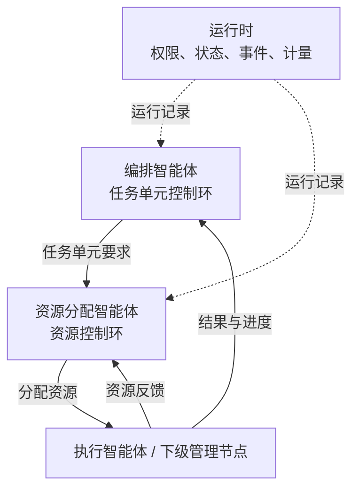
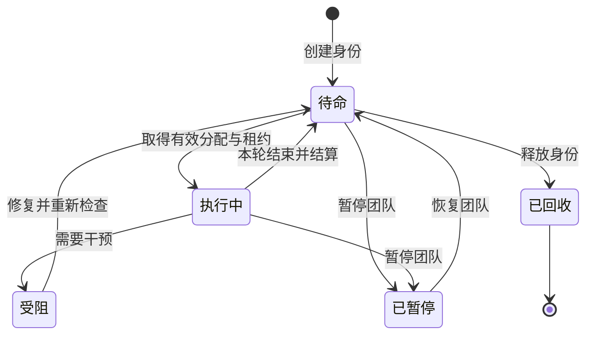
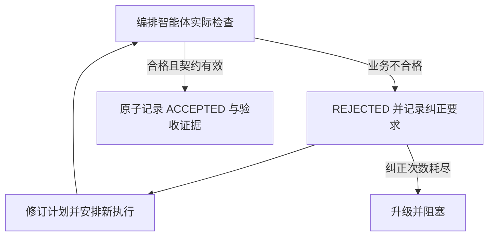

# 智能体分类

智能体集群由三类角色协作完成任务：**编排智能体负责规划与验收，资源分配智能体负责执行资源，执行智能体负责具体执行**。前两类角色共同组成管理节点，执行智能体位于管理树的叶子节点。节点与智能体身份的区别见[层次化智能体结构](/hierarchy)。

本页介绍各类角色的职责、决策权限和生命周期。身份状态、执行结果与界面状态分别说明，避免把一轮执行结束等同于任务验收。初次使用可先阅读[快速上手](/quick-start)，模型、能力和执行参数见[智能体配置参数](/configuration/agents)。

## 三类角色

每个角色分别维护身份、会话和决策记录。智能体与进程不必一一对应，不同角色也可以使用相同模型。

| 中文名称 | 英文名称 |
| --- | --- |
| 编排智能体 | Orchestrator |
| 资源分配智能体 | Allocator |
| 执行智能体 | Worker |

### 编排智能体：任务单元规划与验收

编排智能体对“做什么、如何拆解、结果是否满足目标”负责。它根据上级目标、执行反馈、验收证据和问题记录，定义任务单元及其依赖和执行要求，记录验收结论，并汇总结果。

它可使用已授权的原生文件、Shell、网页和浏览器工具读取输入、执行检查并核对真实产物。其主要工作是理解目标，拆解和调整任务单元，跟踪关键反馈，逐项验收结果并向上交付。它可以调整本管理域任务单元，但不得擅自降低上级委派的交付要求或突破预算边界；执行者选择、模型配置和负载调整由资源分配智能体负责。

### 资源分配智能体：执行资源配置

资源分配智能体对“谁来做、投入什么资源、如何调整执行配置”负责。它根据任务要求、可用智能体、预算、模型和运行状态建立执行分配，调整资源，并报告瓶颈。

它负责选择或创建执行智能体，建立下级管理节点，配置模型和预算，设置并发数。需要替换或回收执行者时，必须先等待当前执行达到安全点，并结束旧轮次与租约。目标、验收标准和授权额度不变时，它可以自主调度；不能用更换产物或降低标准解决资源不足。

### 执行智能体：具体执行

执行智能体取得任务单元的执行分配、必要上下文、工具授权和预算后，在授权范围内选择执行步骤，提交产物和证据，并报告进度、失败或阻塞原因。需要进一步规划时，它向所属管理节点反馈。

执行智能体无权自行验收、增加预算或创建管理层级。`submit_result` 提交的是候选结果，执行智能体声称完成不代表任务单元已被接受。

## 任务与资源控制环

资源分配智能体负责处理频繁的资源变化，减少这类变化对任务规划的干扰。编排智能体处理任务结构、关键反馈、实际检查和验收。两者依据同一套持久化状态和执行记录开展工作，分别保留自己的身份、会话和决策记录。角色在会话中的描述不能直接覆盖运行时记录的正式状态。

运行时按确定的规则校验权限、变更状态、投递事件、管理租约并计量资源用量。它执行控制规则，业务判断由各类智能体作出。

## 决策归属

| 场景 | 决策与执行责任 |
| --- | --- |
| 任务单元太复杂，需要独立规划域 | 编排智能体明确分解或委派要求；资源分配智能体决定可行资源配置并创建下级管理节点 |
| 执行智能体速度慢或模型不可用 | 资源分配智能体评估模型切换、替换或扩容；若会突破时限、成本或质量约束，向编排智能体报告，由其决定如何调整任务单元 |
| 验收标准遗漏关键条件 | 编排智能体基于具体证据修订标准，并明确旧分配和既有验收结论在新版本中的有效性 |
| 执行智能体声称已完成 | 只表示执行产物已提交；编排智能体实际检查并提交正向验收后，运行时才将结果记为正式接受 |
| 其他子树的智能体请求协助 | 可以交换信息；涉及新任务、预算或所有权变化时，由具备相应权限的管理节点作出正式决策 |
| 本管理域无法满足上级要求 | 编排智能体将目标或范围问题提交上级处理；资源分配智能体说明资源缺口 |
| 根节点无法解决冲突 | 请求用户或宿主介入，并记录阻塞原因；根节点没有可继续上报的父节点 |

## 执行身份与显示状态

图中展示常规执行与控制路径。角色身份创建后为 `READY`，每轮执行由有效租约驱动；正常结束并结算后回到 `READY`，回收后为 `TERMINATED`。阻塞、暂停和回收还会协调正在退出的轮次，不能只修改一个显示标记。

团队界面的 `waiting_user`、`waiting_agent`、`completed` 等状态来自任务结果、待处理消息与运行记录的投影。它们与数据库中的身份状态分别建模：等待用户意味着需要用户答复，等待其他智能体意味着依赖执行或验收；已回收意味着不再接受新的输入。工作完成的记录在回收后仍保留。

任务单元 `ACCEPTED` 表示结果通过编排智能体的实际验收；管理节点 `COMPLETED` 表示本管理域已完成交付与收尾。执行轮次正常结束并不自动建立这两种结论。未回收成员的文本续聊仍受团队终态、执行分配、预算和调度规则约束，详见[主会话与团队界面](/development/interface)。

## 业务纠正与运行问题

纠正项记录任务或管理域、目标版本、严重程度、证据和所需修改。编排智能体通过负向 `validate` 或 `reject_result` 记录业务缺陷并安排返工，成功验收只关闭本次新证据已解决的业务问题。首次拒绝产生问题；新交付再次失败才消耗纠正轮次，同一交付重试保持幂等。

权限拒绝、资源不足和未知副作用按责任交给资源分配智能体或有权处理的编排智能体；证据未解决的问题不能仅凭一次业务验收自动关闭。误报撤回也需要反证。无法解决的问题继续走上级或人工路径。

## 运行统计与完成条件

运行时从账本计算任务状态、等待时间、用量和未决问题等客观信号。管理域完成由交付、摘要、子域结清、轮次与租约退出、副作用明确处置及资源归还共同决定；根编排智能体还须提交 `finish_cluster`。业务判断由编排智能体负责，统计数字不代替实际核验。

## 开发入口

角色动作和责任范围见[动作索引](/development/action-catalog)，实际工具参数见 [API 手册](/development/api)，代码定位见[代码结构](/development/code-structure)。
