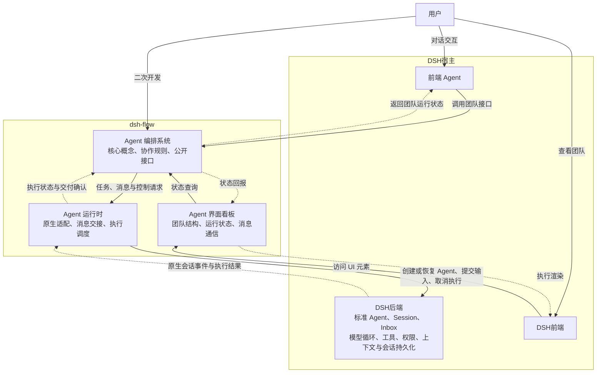

# dsh-flow 设计文档

本文档记录了对 dsh-flow 的整体架构设计，作为本仓库最高可信设计决策来源。除用户明确要求外，agent 不得修改本文档。在与其他文档、代码等冲突时，以本文档定义为准。

- [dsh-flow 设计文档](#dsh-flow-设计文档)
  - [总体定位](#总体定位)
  - [架构设计](#架构设计)
    - [Agent 编排系统](#agent-编排系统)
      - [Agent 智能体](#agent-智能体)
      - [`AgentProfile`: Agent 身份信息](#agentprofile-agent-身份信息)
      - [`AgentStatus`: Agent 运行状态](#agentstatus-agent-运行状态)
      - [`Group`: 群聊](#group-群聊)
      - [`Message`: 信息](#message-信息)
      - [`Signal`: 信号量](#signal-信号量)
    - [Agent 运行时](#agent-运行时)
      - [Mailbox](#mailbox)
    - [Agent 界面看板](#agent-界面看板)

> [!NOTE]
> Agent 使用该文档的方式
> - 将该文档作为最高可信来源，查阅概念定义和架构设计
> - 提示用户本文档需要增订或明确的部分
> - 在用户显式要求时参与该文件的修订

## 总体定位

dsh-flow 旨在扩展 dsh 中标准智能体团队的能力，提供预置的 agent 组织模板、agent 团队可视化面板以及共性 agent 团队运行时基础设施，方便用户在处理复杂任务时直接复用成熟的 agent 团队组织形式，降低 agent 团队组织架构决策难度，复用已有研究的经验成果。在此基础上，dsh-flow 提供了高度抽象的公开接口，用户可通过公开接口设计自己的团队编排，并与其他系统部分合作，以此扩展插件的现有模式。

## 架构设计

dsh-flow 包括三个方面：面向用户的界面看板，后端 agent 运行时，以及 agent 编排系统。其中，看板系统负责与 dsh 前端界面交互，在前端上显示当前智能体团队运行状态，并响应用户交互请求；agent 编排系统负责决策团队架构方案，与用户主 agent 交互完成任务分解和团队构建；最后是后端 agent 运行时，该层次将 agent 团队编排转译为 dsh 原生 agent 的业务请求，并维护团队特有的运行状态。

### Agent 编排系统

Agent 编排系统是 dsh-flow 的核心组件，其定义了智能体等核心概念及其交互逻辑，概念清单如下：

#### Agent 智能体

- **定义**：Agent 是团队的基本组成单位，其在上层对应于一个用户可见的智能体对象，在底层对应于一个 DSH 原生 Agent。
- **接口**：Agent 支持以下公开接口：
  - 基础信息查询类：
    - `getProfile() -> AgentProfile`: 获取 Agent 身份信息
    - `getParent() -> Agent`: 获取 Agent 的父级
    - `getChildren() -> Agent[]`: 获取 Agent 的子级，可以为空
  - 状态信息查询类：
    - `getStatus() -> AgentStatus`: 获取 Agent 运行状态
  - 通信类：
    - `recvSignal(s: Signal)`: 接收一个信号
    - `recvMessage(m: Message)`: 接收一个消息
    - `joinGroup(g: Group)`: 加入一个群聊，由 Group 对象在创建时调用
    - `quitGroup(g: Group)`: 退出一个群聊，由 Group 对象在销毁时调用
  - 生命周期类：
    - 构造函数`construct(p: Profile, parent: Agent, initmsg: Message, ctx?: Context)`: 通过身份信息、父亲、初始 Prompt 构造 Agent，可选传递已有上下文
    - 析构函数
    - `fork() -> Agent`：以自身为母版创建一个子 Agent，共享当前 Agent 的所有上下文、配置（但不包含通信关系）
    - `herb(agent: Agent)`: 以自身为母版创建一个子 Agent，其上下文由自己的上下文与另一个 Agent 的上下文共同组成
    - `kill(agent: Agent)`: 销毁一个子 Agent
    - `transfer(child: Agent, adopt: Agent)`: 将一个子 Agent 转移给另一个 Agent 

#### `AgentProfile`: Agent 身份信息

- **定义**：AgentProfile 是 Agent 身份信息的描述，其在 Agent 创建阶段确定，伴随 Agent 整个生命周期
- **成员**：AgentProfile 包含以下成员：
  - `role`: Agent 身份描述，一段提示词
  - `sessionID`: Agent 会话对应的 session ID
  - `permission`: Agent 权限，目前包括 只读、工作区内读写、完全访问 3 类基础权限
  - `name`: Agent 名字，一个用于呈现在前端界面上的用户友好的名字

#### `AgentStatus`: Agent 运行状态

目前包含 运行中、等待中、空闲、已终止 4 种基本状态，其中：

- 运行中代表 Agent 正在工作
- 等待中代表 Agent 被其他事件阻塞
- 空闲代表 Agent 实例存活，但没有进一步的工作请求
- 已终止代表 Agent 实例已销毁，与其相关的运行时基础设施均已停止；重启时需要重新加载这些基础设施

Agent 的状态转移是原子的、瞬时的，无论状态转移操作本身是否是原子的、瞬时的。对于状态转移操作，首先需要原子地将 Agent 状态置为目标状态，之后再执行实际的状态转移操作；对于单个 Agent 而言，状态转移操作是串行的，即在上个状态转移操作完成之前，下一个操作处于阻塞状态。

#### `Group`: 群聊

群聊是区别于点对点通信的另一种区域通信形式，加入群聊的各个 Agent 均可见其他 Agent 在群聊中发送的所有消息，每个 Agent 只能看见自己加入后的新增消息。此外，群聊还有一块共享式的信息区域**黑板（blackboard）**，Agent 可抢占式在现有内容上追加。Group 提供以下接口：

- 构造函数：传入一组`Agent`，调用各自的`joinGroup`完成构造
- 析构函数：解散当前 Group，调用所有成员 Agent 的 `quitGroup` 函数
- `postMessage(m: Message)`: 向群聊中发送一条消息
- `postToBlackboard(m: Message)`: 向黑板上追加一条消息。
- `readBlackboard(t?: Timestamp) -> Message[]`: 获取黑板上的信息。`t`为可选参数，提供时返回该时间戳之后的信息，否则返回所有信息。
- `hasNewMsgOnboard(t: Timestamp) -> bool`: 查询时间戳之后黑板内容是否有更新

注意，黑板信息读写接口采用 Message 对象是为了简化实现，其中保存的对象的读取状态相关信息无意义，信息的使用者需要注意这一点。

#### `Message`: 信息

`Message`建模了当前系统内的单条信息，是信息传递的基本单位，具体包括以下字段：

- `source: Agent | AgentInGroup | System | User`: 信息的来源，可以是用户、单个 Agent、一个群聊中的 Agent 或者系统运行时。其中 `AgentInGroup = { agent : Agent, g: Group }`, `System, User`为描述符
- `timestamp`: 消息发出的时间戳
- `read`: 是否被接收方已读，该状态由接收方修改
- `read_timestamp`: 消息被首次读取的时间戳
- `summary`: 消息摘要，不超过 50 个字符
- `payload`: 具体的消息内容

#### `Signal`: 信号量

信号量是一种特殊的信息，其表征了一些预定义的、Agent 需要立刻无条件相应的信息，例如立刻停止当前轮次、立即销毁自身等。这类信息具有最高优先级，且可在 Agent 运行过程中被插入，Agent 需要立刻中断并跳转到对应的信号处理程序中。当前预定义的信号量有：

- `SIGKILL`: 立刻终止 Agent 及其所有子 Agent。该信号立刻递归传递给所有子 Agent
- `SIGTERM`: Agent 需要在完成当前轮次后终止自身及所有子 Agent。该信号立刻递归传递给所有子 Agent

### Agent 运行时

Agent 运行时负责将上层的编排语义转译为 dsh 原生 agent 模型上，并维护整体运行状态、记录各上层对象的运行信息、维持交互语义约束，具体包括如下概念：

#### Mailbox

Mailbox 是 Agent 用于接受并存储消息的容器，其按时间顺序依次排列所有接受到的消息，并支持按来源、按时间范围、按已读状态等多种方式检索消息；批量检索时默认采用 peak 语义，即可以读到元信息，不返回完整信息，且不改变已读状态，在采用 get 语义时，返回完整信息并将状态改为已读。此外，Agent 可为自己的 Mailbox 设置过滤规则，默认 drop 掉匹配规则的信息。其包括的接口如下：

（在此补充接口）

### Agent 界面看板

Agent 界面看板提供了一个智能体标签页，用户可以在此标签页中直观查看当前已派发的智能体团队架构、智能体运行状态及消息通信情况，具体包含以下设计要素：
