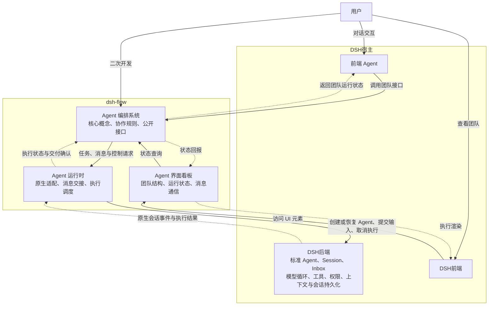

# dsh-flow 设计文档

本文档记录了对 dsh-flow 的整体架构设计，作为本仓库设计的唯一依据。除用户明确要求外，agent 不得修改本文档。在与其他文档、代码等冲突时，以本文档定义为准。

- [dsh-flow 设计文档](#dsh-flow-设计文档)
  - [总体定位](#总体定位)
  - [架构设计](#架构设计)
    - [Agent 编排系统](#agent-编排系统)
      - [Agent 智能体](#agent-智能体)
      - [`AgentProfile`: Agent 身份信息](#agentprofile-agent-身份信息)
      - [`AgentStatus`: Agent 运行状态](#agentstatus-agent-运行状态)
      - [`Group`: 群聊](#group-群聊)
      - [`Message`: 信息](#message-信息)
      - [`Signal`: 信号量](#signal-信号量)
    - [Agent 运行时](#agent-运行时)
      - [Mailbox](#mailbox)
      - [Context 上下文](#context-上下文)
      - [HostAdaptor 宿主适配器](#hostadaptor-宿主适配器)
    - [团队模式与作业](#团队模式与作业)
    - [Agent 界面看板](#agent-界面看板)

> [!NOTE]
> Agent 使用该文档的方式
> - 将该文档作为最高可信来源，查阅概念定义和架构设计
> - 提示用户本文档需要增订或明确的部分
> - 在用户显式要求时参与该文件的修订


## 总体定位

dsh-flow 旨在扩展 dsh 中标准智能体团队的能力，提供预置的 agent 组织模板、agent 团队可视化面板以及共性 agent 团队运行时基础设施，方便用户在处理复杂任务时直接复用成熟的 agent 团队组织形式，降低 agent 团队组织架构决策难度，复用已有研究的经验成果。在此基础上，dsh-flow 提供了高度抽象的公开接口，用户可通过公开接口设计自己的团队编排，并与其他系统部分合作，以此扩展插件的现有模式。

## 架构设计

dsh-flow 包括三个方面：面向用户的界面看板，后端 agent 运行时，以及 agent 编排系统。其中，看板系统负责与 dsh 前端界面交互，在前端上显示当前智能体团队运行状态，并响应用户交互请求；agent 编排系统负责决策团队架构方案，与用户主 agent 交互完成任务分解和团队构建；最后是后端 agent 运行时，该层次将 agent 团队编排转译为 dsh 原生 agent 的业务请求，并维护团队特有的运行状态。

本文讨论的概念模型、接口闭合与一致性，以 Flow 层明确声明的数据及行为为范围。Agent 的模型与推理参数在 `AgentProfile` 中以宿主无关的形式声明，由适配器落实；其中 `params`、`hostExtras` 不纳入一致性判定。provider 路由、运行预设等其他宿主内部配置仍由各适配器管理，不要求派生实例与母版在这些配置上逐项相同；宿主仍须落实本文明确约定的执行行为、初始权限的安装及资源生命周期。

本文中的接口统一遵循以下对象传递约定：

- 同一运行环境内的接口调用直接传递对象引用，不因传参或返回而复制对象，也不因此转移对象的生命周期管理权。
- ID 用于持久化、序列化、外部寻址及跨实例恢复时的稳定身份。仅为有这些需求的实体定义业务 ID，不为所有运行时对象分配通用 ID。
- 除接口另有说明，返回对象列表时只创建数组容器的副本，列表元素仍引用原对象；接收并长期保存调用方的数组时，也应隔离数组容器。需要隔离的消息内容、已读状态等数据由对应模块显式创建记录或快照。
- 对象释放通过生命周期接口显式完成，不依赖垃圾回收。释放不会使调用方已有的引用自动变成空值，对象应自行拒绝关闭后的执行及变更操作。



宿主主 Agent 通过入口工具启动团队运行。入口工具立即返回本次运行的句柄（run ID），不阻塞主会话等待团队完成；主 Agent 通过查询工具按句柄获取运行状态和结果。运行完成时，仅在主会话空闲时向其提交一条不主动唤醒的完成提示，提示内容自足，包含 run ID 及获取结果的方式；主会话正在运行时，等其当前轮次结束后再提交。完成提示不保证送达，查询工具是获取结果的可靠途径。进程重启后，重启前的运行句柄失效，查询时明确返回“该运行已随重启失效”，不返回空结果或沿用旧状态。

### Agent 编排系统

Agent 编排系统是 dsh-flow 的核心组件，其定义了智能体等核心概念及其交互逻辑，概念清单如下：

#### Agent 智能体

- **定义**：Agent 是团队的基本组成单位，其在上层对应于一个用户可见的智能体对象，在底层对应于一个由 Flow 创建或恢复的 DSH 原生 Agent。宿主主 Agent 作为编排接口的外部调用方，其创建的顶层 Flow Agent 的父级为 `null`。
- **接口**：Agent 支持以下接口，其中 `joinGroup/quitGroup` 仅用于内部生命周期协作，`hasPendingWait` 供适配器内部查询，不暴露为模型工具；其余为公开接口：
  - 基础信息查询类：
    - `getProfile() -> Readonly<AgentProfile>`: 获取 Agent 的只读身份信息引用，身份信息在该实例生命周期内保持不变
    - `getParent() -> Agent | null`: 获取逻辑父 Agent 的对象引用，根 Agent 返回 `null`
    - `getChildren() -> Agent[]`: 获取逻辑子 Agent 的对象列表，可以为空；返回数组容器副本，元素为当前子 Agent 的引用
  - 状态信息查询类：
    - `getStatus() -> AgentStatus`: 获取 Agent 运行状态
    - `hasPendingWait() -> bool`: 查询是否存在尚未匹配消息或超时的主动等待；直接读取 Flow 的等待记录。临时处理优先消息时，即使 `getStatus()` 为运行中，该值仍为 `true`；等待完成或 Agent 终止后返回 `false`
  - 通信类：
    - `getMailbox() -> Mailbox`: 获取自身 Mailbox 的同一对象引用，供宿主适配器绑定消息读取、过滤和来源评级工具；不复制 Mailbox，也不转移其生命周期管理权
    - `recvSignal(s: Signal)`: 接收并处理一个控制信号；终止信号的接收与收尾方式合并不等待已有异步收尾完成，也不因 Agent 已逻辑终止而直接拒绝
    - `recvMessage(m: Message)`: 将消息交给自身 Mailbox，成功入箱后按消息优先级安排通知；被过滤的消息不通知模型。通知只提供消息提示，正文由模型通过读取工具按需获取
    - `wait(condition: MailboxQuery, timeout: number) -> WaitResult`: 主动等待其他 Agent 发来的、符合 `condition` 的消息；`timeout` 必填，由发起等待的 Agent 自行指定，为以毫秒计的有限正数。检查时已有匹配消息的，直接完成本次等待并返回 `{ kind: 'matched', message }`，`message` 为该消息的 `MessageMeta`，适配器不结束当前轮次；否则返回 `{ kind: 'registered' }`，表示已完成等待登记，不表示目标消息已返回，适配器随后结束当前轮次，不在工具调用内持续等待。具体匹配、超时和临时唤醒规则见 AgentStatus
    - `joinGroup(g: Group)`: 由 Group 对象在创建时调用，建立初始成员关联；不作为运行期间主动入群的入口
    - `quitGroup(g: Group)`: 由 Agent 逻辑终止、释放或 Group 解散的生命周期流程调用，解除双方成员关联；重复解除不产生额外操作，不作为主动退群的入口
  - 生命周期类：
    - 静态异步工厂 `Agent.create(ctx: Context, p: AgentProfile, parent: Agent | null, initmsg: Message, history?: string) -> Promise<Agent>`: 通过身份信息、逻辑父 Agent 对象和初始消息创建 Agent，可选传递序列化的历史上下文。父级在创建前根据任务明确指定 `p.permission`，创建时只安装该初始权限，不保证实例存续期间不被改变；无法安装所要求的初始权限时创建失败。该初始权限不得高于父级 Profile 记录的初始权限（`read-only` < `workspace-write` < `full-access`）；父级此后在宿主侧的权限变化不跟踪，也不参与这次比较。根 Agent 由外部调用方指定权限，其父级为 `null`。父级参数仅用于 Flow 编排关系
    - 静态异步工厂 `Agent.resume(ctx: Context, parent: Agent | null, session: SessionID) -> Promise<Agent>`: 通过持久化会话 ID 冷恢复对话与配置，创建新的 Agent 实例，重新初始化空 Mailbox 及通信关系。逻辑父级仅由本次传入的 `parent` 建立，不从历史恢复；恢复的资源归属于新实例，不依赖父 Agent 的资源；旧实例的引用不会自动指向恢复后的新实例
    - 析构函数：结束 Agent 在 Flow 中的生命周期，清理其编排关系及运行时绑定。原生 Agent 的停止、持久化或保留由宿主适配器按后端能力实现，不作为逻辑终止的前提
    - `fork() -> Promise<Agent>`：以自身为母版创建一个逻辑子 Agent，复制母版 `AgentProfile` 的字段并将 `sessionID` 替换为新分配的会话身份，建立独立的只读 Profile 记录。对话通过显式快照导入新会话，不继承通信关系；子 Agent 的运行状态、Mailbox、工具及其他运行时资源均独立初始化，不复用父 Agent 的资源
    - `herb(agent: Agent) -> Promise<Agent>`: 双方 Agent 分别按统一文字格式总结自身上下文，再通过一次独立 LLM 调用合并归纳两份总结，以合并结果作为新会话的初始上下文。子 Agent 以母版 Agent（即 `this`）为逻辑父级，复制母版 `AgentProfile` 的字段并将 `sessionID` 替换为新分配的会话身份，建立独立的只读 Profile 记录，不合并双方 Profile 或权限；独立初始化资源，不与任一来源 Agent 建立资源依赖；参数和异步结果均为 Agent 对象
    - `kill(agent: Agent)`: 终止一个直接子 Agent，并执行对应的生命周期清理。先发送 `SIGTERM`，在约定时限内未完成收尾时发送 `SIGKILL`；非直接子 Agent 调用失败
    - `transfer(child: Agent, adopt: Agent) -> void`: 将自身的一个直接逻辑子 Agent 转交给 `adopt`，原子更新子 Agent 的父引用及新旧父 Agent 的子列表。调用方、`child` 和 `adopt` 须属于同一 Context 且均未终止或进入释放流程；`adopt` 不得为 `child` 或其后代，以免形成环。不满足条件时失败；转交给当前父 Agent 时不作变更

Agent 内部持有宿主适配器返回的 `HostAgent` 对象，并将该对象传给宿主执行接口；`getProfile()` 复用其 `profile` 引用，编排层仍使用上层 Agent 对象。Agent 的注册、父子关系和 Group 成员关系均使用对象引用，序列化这些关系时才转换为业务 ID。

父子关系仅表示 Flow 的逻辑编排关系，用于组织及递归控制。每个 Agent 创建后，其会话、Mailbox、工具注册、事件监听和其他实例资源均与自身关联，独立于逻辑父 Agent。Flow 层的配置继承通过复制 `AgentProfile` 完成，保留母版的 `role`、`name`、`permission`、`model`、`params` 和 `hostExtras`，重新分配 `sessionID`，由 Flow 显式传给适配器；对话上下文按 `fork/herb` 的约定分别处理，不借用父 Agent 的运行时资源。各 Agent 可使用宿主统一提供的公共服务，实例资源和绑定分别归属自身。原生实例由适配器在稳定的宿主作用域中独立创建和管理，不挂接到逻辑父 Agent 的资源作用域。

`herb` 的上下文生成过程分为三步，其中 `a.herb(b)` 的母版为 `a`，另一来源为 `b`：

1. 对双方分别调用 `summarizeContext`，由各自的模型基于自身上下文生成总结；两份总结可并行生成，各自基于本次调用捕获的上下文，不自动读取尚未进入模型上下文的 Mailbox 消息。
2. 两份总结均完成后，调用一次 `mergeContextSummaries`，使用母版 Agent 的模型配置，对两份文字进行合并、去重和归纳。合并时保留来源、关键约束、未完成事项及相互矛盾的信息，无法消解的分歧列入待确认事项，不自行编造结论。
3. 复制母版的 `AgentProfile`，将其中的 `sessionID` 替换为新分配的会话身份，再将合并总结放入 `System` 来源的初始 Message 的 `payload`，通过 `Agent.create` 传入该 Profile 和初始消息创建子 Agent，不传递 `history`。该文本作为初始输入中的背景上下文，不替代子 Agent 的角色及权限配置；不继承双方原始对话日志、Mailbox 或通信关系。任一总结或合并失败时，本次 `herb` 失败，不创建子 Agent；子 Agent 创建失败则遵循异步工厂的清理规则。两次总结分别使用来源 Agent 自己的模型，合并使用母版的模型；这些调用发生在子 Agent 存在之前。`summarizeContext` 与 `mergeContextSummaries` 返回 `{ summary, usage[] }`，每项 usage 含实际执行的 `provider` 与 `model`。适配器缓冲这些 usage，仅在子 Agent 的 `agent.created` 之后立即发成 `usage` 事件，记在该子节点上，以保持子节点先出现；事件中的模型是实际执行者，不是子 Agent Profile 的模型。只有宿主声明 `capabilities.usage` 时才发出这些事件，否则不发事件，花费显示为不可用。子 Agent 未创建成功时丢弃缓冲，不向来源 Agent 补发。

双方总结与合并结果均使用以下标准文字格式；没有内容的章节填写“无”，信息不足时明确标注“未知”。来源信息由适配器根据实际 Agent 身份填写，合并结果保留双方来源。这里的上下文总结不受 Message 的短字段 `summary` 的 50 字符限制。

```text
Flow 上下文总结 v1
来源：Agent 名称及 SessionID（合并结果列出双方）

## 目标与约束
## 已知事实与关键决策
## 当前进展与已有产物
## 关键文件、资源及定位信息
## 未完成事项与后续步骤
## 分歧、风险与待确认信息
```

`transfer` 只修改上述逻辑关系，保留子 Agent 及其 HostAgent 的对象身份、会话、Mailbox、权限、工具绑定和当前执行，不触发后端迁移或资源重建。后续信号传播与递归释放以转移后的父子树为准，原父不再通过旧父子关系影响该实例；子 Agent 若已转出原父的当前子树，则不再受原父终止影响，若仍为其后代则继续沿新关系接收递归控制。转移与终止请求对逻辑关系的检查及修改须原子完成，避免将已接受终止请求的子 Agent 转出收尾范围。

Agent 的构造函数为内部实现，不提供公开的同步构造入口。上述异步工厂及 `fork/herb` 成功返回时，宿主实例、Mailbox、工具绑定和事件监听均已就绪，父子关系及 Context 登记已完成，调用方可直接使用返回的 Agent，无需再次等待 `ready()` 或手动登记。初始化完成前，不将该 Agent 发布到 Context 注册表或父 Agent 的子列表。工厂在登记到 Context 和父 Agent 子列表的同一原子操作中检查：父级（`herb` 还包括母版和另一来源）未终止，也未进入释放流程；不满足时创建失败，并按下述失败规则清理，避免在父级 `after-turn` 收尾期间产生挂在已终止父级下的子 Agent。

工厂先在内部创建上层 Agent 和空 Mailbox，再将该 Agent 引用传给适配器的 `createAgent/resumeAgent`。此时 `getMailbox()` 已可用；适配器只取得对象引用并注册工具回调，不调用依赖 HostAgent 的 `getProfile()` 等接口，也不执行工具业务。适配器返回后，上层工厂保存 HostAgent、完成事件订阅、父子关系及 Context 登记。整个过程中使用同一个上层 Agent 和 Mailbox 对象。

`Agent.create` 在初始化及登记完成后提交 `initmsg`，等待宿主接管该输入后返回，不等待模型完成首轮执行；不得在宿主初始化回调内提前启动首轮。工厂失败时，撤销本次新增的登记、父子关联、Mailbox 和监听，并通过适配器清理本次创建或恢复实例的 Flow 绑定，按后端策略处理原生资源，清理后再拒绝 Promise。适配器初始化失败时，由适配器自行清理尚未返回实例的工具注册及关联资源。

`Agent.resume` 专指冷恢复：旧实例已释放或进程重启后，从持久化会话创建新实例。同一实例从空闲到运行属于唤醒，通过 `followup/steer` 提交新输入完成，保留其 Mailbox 和通信关系，不调用此工厂。

冷恢复采用重新初始化语义：新 Mailbox 的消息、已读状态、过滤规则和来源评级均为空；Agent 的待通知消息、通知进度、首次评级提示记录及旧的通信等待状态同时清空。不恢复历史通信对象、Group 成员资格或旧子 Agent；即使 SessionID 相同，新实例也不会成为原 Group 的成员。新的逻辑父级由本次 `parent` 参数显式指定，后续通信按当前活跃对象重新建立；需要群聊时，在新 Group 构造时显式将新实例列为成员。已持久化的会话历史保留其中已有的信息，但不回填 Mailbox、不重新绑定历史来源引用，也不据此自动重发旧通信请求。

适配器须在冷恢复的首次模型执行前处理原生 Inbox 中遗留的 Flow 通知，并准备一次不主动唤醒的恢复说明：会话历史已恢复，Mailbox 和通信关系已重新初始化，历史消息编号在当前 Mailbox 中无效，历史协作者不保证仍然可用。通信工具根据当前 Context 确认目标，目标不存在时明确失败，不因历史记录隐式恢复对方。上述处理属于 `resumeAgent` 的初始化职责。

#### `AgentProfile`: Agent 身份信息

- **定义**：AgentProfile 是 Agent 身份信息的描述，其在 Agent 创建阶段确定，伴随 Agent 整个生命周期。创建时根据输入字段显式建立独立的只读身份记录，后续查询共享同一份记录的引用
- **成员**：AgentProfile 包含以下成员：
  - `role`: Agent 身份描述，一段提示词
  - `sessionID: SessionID`: Agent 会话的稳定身份，用于持久化、恢复及外部寻址；运行时调用已有 Agent 时直接使用对象
  - `permission: AgentPermission`: 创建时确定的初始执行权限，Flow 不提供修改接口，但不保证实例存续期间不被改变；目前以文件访问范围区分只读、工作区内读写、完全访问 3 类基础权限，网络访问不在权限范围内，不代表运行中可申请调整的默认模式
  - `name`: Agent 名字，一个用于呈现在前端界面上的用户友好的名字
  - `model: { provider: string; id: string }`: Agent 使用的模型，宿主无关的声明；实例存续期间不更换
  - `params`: 带版本的类型化推理参数，目前包括 `temperature`、`reasoningEffort`、`maxTokens`，拒绝未知字段
  - `hostExtras?`: 交由具体适配器按其类型定义校验的附加配置，拒绝未知字段

`model`、`params` 与 `permission` 相互独立。适配器无法落实的参数值或参数组合在创建前失败，不静默忽略；冷恢复按持久化的 Profile 重新传入完整的模型配置，不按当前默认值重新解析。

`AgentPermission = 'read-only' | 'workspace-write' | 'full-access'`。父级在创建子 Agent 前根据任务所需的操作选择权限，并由适配器在创建时安装。工作区范围由适配器创建时绑定的宿主工作区确定，与该实例的初始权限一同安装；完全访问仍受宿主及执行环境本身的约束。

Agent 创建后不提供权限调整接口；适配器尽力关闭宿主的权限修改和升权申请入口，但不作保证，也不检测或否决权限变更。权限不足时，相关操作明确失败，子 Agent 报告受限事项，由父级重新分配任务或按适当权限创建新 Agent。`getProfile().permission` 表示创建时安装的初始权限，不反映运行中宿主侧的改动。

`Agent.create` 以本次 `p.permission` 为准，导入的历史上下文不能覆盖它；`fork`、`herb` 按现有签名继承母版的权限值，由新实例独立安装。`create`、`fork`、`herb` 均检查新实例的初始权限不高于其逻辑父级 Profile 记录的初始权限（`read-only` < `workspace-write` < `full-access`，根 Agent 除外），不满足时失败；比较只看该初始权限，不跟踪父级此后在宿主侧的改动。冷恢复始终重新安装持久化的初始权限及其工作区边界，不安装新的或默认权限；再把恢复出的权限与新父级 Profile 记录的初始权限比较（根 Agent 除外），更高则恢复失败，不降级、不静默替换。权限信息缺失或无法重新安装原初始权限时同样失败。需要使用其他权限时，创建新的会话实例。

#### `AgentStatus`: Agent 运行状态

AgentStatus 表示 Flow 编排层的逻辑状态，不反映后端实例是否仍在线或实际清理是否完成。目前包含 运行中、等待中、空闲、已终止 4 种基本状态，其中：

- 运行中代表 Agent 正在工作
- 等待中代表 Agent 主动等待符合条件的其他 Agent 消息，在匹配消息或超时之前暂停处理其他事务；优先消息仍可临时打断等待
- 空闲代表 Agent 实例存活，没有进一步的工作请求，也没有尚未完成的主动等待
- 已终止代表 Agent 在编排层已结束生命周期，不再接受新的业务请求或被消息唤醒；后端实例可以已经销毁，也可以继续保留在线

第一版 `wait` 仅等待其他 Agent 的消息，包括点对点消息和来源为 `AgentInGroup` 的群聊消息；`System`、`User` 及自身发出的消息不作为匹配结果。暂不支持直接等待异步工具、后台进程等其他对象，也不要求宿主提供此类异步能力。等待由 Agent 自己通过工具调用发起，适配器根据工具参数构造 `MailboxQuery` 并传入调用方指定的 `timeout`，由 Flow 维护条件及计时。任务本身不设置优先级，只有消息使用既有的 `high/normal/low` 分类。

调用 `wait` 时，将检查当前 Mailbox 中符合条件的未读消息与登记等待作为一次原子操作：已有匹配时立即完成，否则等待随后成功入箱的匹配消息。条件检查不改变已读状态，不自动将正文提供给模型；过滤后未入箱的消息不能满足等待。一个 Agent 同时保留一个主动等待，尚未完成时再次调用 `wait` 失败，不覆盖原条件；已终止或进入释放流程时也不能新建等待。

`timeout` 从本次调用登记时开始计时。期限内匹配到消息时，解除等待并取消计时；到期仍未匹配时，解除等待，由 Flow 生成固定 `high` 优先级的 `System` 通知，通过 `steer` 唤醒 Agent，说明此前等待目标超时未返回，并提供本次等待的发起时间及超时时长。超时通知不要求满足 `condition`，不自动重试等待。匹配、超时及终止只完成本次等待一次；期限以 Flow 接收和处理为准，不采用发送方的消息时间戳，旧的计时回调不能影响后续新建的等待。迟到回复仍按普通收件规则处理，不重新完成旧等待；若已发起新的等待，仅按新的 `condition` 判断是否匹配。

等待期间，默认消息和不重要消息仍按 Mailbox 规则接收，但暂缓通知及处理。无关的优先消息可使 Agent 临时转为运行中，原等待及截止时间保持不变；处理结束后若仍未匹配或超时，则重新进入等待中。原生轮次结束或进入 `idle` 不自动解除 Flow 的等待，临时处理优先消息也不允许顺带处理被暂缓的其他消息。匹配或超时后不再回到原等待；没有进一步工作且没有待处理的合格通知时，才进入空闲。

Agent 的状态转移是原子的、瞬时的，无论状态转移操作本身是否是原子的、瞬时的。对于状态转移操作，首先需要原子地将 Agent 状态置为目标状态，之后再执行实际的状态转移操作。对于单个 Agent，普通状态转移操作串行执行；终止信号的接收、逻辑状态更新与收尾方式合并不等待已有异步操作完成。后续资源清理仍由同一次关闭操作执行，不并行启动重复清理。

接收终止请求时，Agent 从运行中、等待中或空闲立即转为已终止，并撤销等待及计时，不增加“终止中”状态。后续的后端执行、清理进度或错误均不改变这一逻辑状态；原生状态事件、迟到的回复或超时回调均不得重新启动该 Agent。冷恢复不恢复旧等待或剩余超时。生命周期接口的 Promise 表示约定的处理操作完成，不统一承诺后端实例已经物理销毁。

#### `Group`: 群聊

群聊是区别于点对点通信的另一种区域通信形式，成员在 Group 创建时确定，存续期间不新增或替换成员，仅在 Agent 逻辑终止或释放时自动退群。Group 为群聊消息提供来源信息，并将消息投递给当时仍在群内的成员，由各自的 Mailbox 按接收规则保存；Group 不另行保存群消息历史，已退出的 Agent 不再接收后续消息。此外，群聊还有一块仅在其存续期间可用的共享信息区域**黑板（blackboard）**，Agent 可抢占式在现有内容上追加。Group 提供以下接口：

- 构造函数`construct(ctx: Context, members: Agent[])`：传入同一 Context 中已完成初始化且未终止或进入释放流程的一组 Agent 对象，保存成员数组的副本，成员仍引用原对象，调用各自的 `joinGroup` 完成构造；创建完成后不再接受新成员
- `getID() -> GroupID`: 获取当前群聊的稳定标识；创建时分配，用于消息来源的序列化和活跃群聊的外部寻址，运行时操作直接使用 Group 对象
- 析构函数：解散当前 Group，调用所有剩余成员 Agent 的 `quitGroup` 函数，解除关联而不终止这些 Agent，并释放黑板内容。解散不删除各成员 Mailbox 中已经接收的群聊消息，这些消息仍通过对应 Mailbox 按其自身生命周期及读取规则访问。解散后不再接受群消息或任何黑板操作，也无法恢复群聊。
- `postMessage(source: Agent, m: Message)`: 以 `{ agent: source, g: 当前 Group }` 为消息来源，以调用时的成员快照为准，在同一次同步操作中向除发送者以外的各成员的 `recvMessage` 投递消息，由各自的 Mailbox 接收和保存。`source` 为发送者对象，未在群聊中的成员会发送失败
- `postToBlackboard(source: Agent, m: Message)`: 向黑板上追加一条独立的消息数据记录，来源 Agent、Group 保留对象引用。`source` 为发送者对象，未在群聊中的成员会发送失败
- `readBlackboard(t?: Timestamp) -> Message[]`: 获取黑板上的消息数据快照，避免调用方修改黑板内的记录；来源 Agent、Group 仍保留原对象引用。`t` 为可选参数，提供时返回该时间戳之后的信息，否则返回所有信息。调用方应传入此前读到的最大时间戳，不使用自身时钟
- `hasNewMsgOnboard(t: Timestamp) -> bool`: 查询时间戳之后黑板内容是否有更新

Agent 逻辑终止时立即退出其所属的全部 Group，同时解除双方成员关联，不等待后端执行停止或资源清理完成。退出后，该 Agent 的群消息发送及黑板写入按成员资格检查失败；`SIGTERM` 保留当前轮次的业务绑定不保留已解除的群成员资格。退群本身不删除各 Mailbox 已经接收的消息，也不终止其他成员或自动解散 Group。普通轮次结束、空闲、等待和父级转移不触发退群；冷恢复后的新实例遵循上述固定成员规则。

注意，黑板信息读写接口采用 Message 对象是为了简化实现，其中保存的对象的读取状态相关信息无意义，信息的使用者需要注意这一点。黑板记录的 `timestamp` 为 Group 追加时分配的时间，在同一黑板内严格递增，不是发送方的发出时间。黑板内容不因追加而自动投递到成员 Mailbox；群聊解散后，即使调用方仍持有原 Group 引用，`postToBlackboard`、`readBlackboard` 和 `hasNewMsgOnboard` 也均调用失败，不提供黑板归档读取。

`GroupID` 唯一且不复用；群聊解散后，该 ID 仍可用于识别已有消息的群聊来源，不代表存在可继续收发消息的 Group 实例，也不对应独立的群聊归档。

#### `Message`: 信息

`Message`建模了当前系统内的单条信息，是信息传递的基本单位，具体包括以下字段：

- `source: Agent | AgentInGroup | System | User`: 信息的来源，可以是用户、单个 Agent、一个群聊中的 Agent 或者系统运行时。其中 `AgentInGroup = { agent : Agent, g: Group }`, `System, User`为描述符
- `timestamp`: 消息发出的时间戳
- `priority?: MessagePriority`: 接收方在入箱时根据自身的来源评级填写的本地优先级；尚未评级的来源按 `normal` 处理。发送方不决定该值，入站消息携带的 `priority` 不作为定级依据。Flow 直接构造、交给宿主的运行时通知不经过入箱，其优先级由下述通知规则确定
- `read`: 是否被接收方已读，该状态由接收方修改
- `read_timestamp`: 消息被首次读取的时间戳
- `summary`: 消息摘要，不超过 50 个字符，统一用于优先消息与默认消息的通知
- `payload`: 具体的消息内容

`MessagePriority = 'normal' | 'high' | 'low'`，分别表示默认、优先、不重要。

`source` 中的 Agent、Group 均为运行时对象引用。序列化消息时，将这些引用转换为 `SessionID`、`GroupID` 及展示来源所需的信息快照，不递归序列化对象本体。序列化后的来源信息可独立用于历史展示，不要求原 Agent、Group 仍然存活，也不表示需要保存或恢复 Group 本体。`priority`、`read` 和 `read_timestamp` 属于接收方的消息记录，同一消息被多个 Mailbox 接收时，各自创建记录；不同接收方可对同一来源给出不同评级，且不共享已读状态。

创建消息数据快照时，显式复制消息字段及 `AgentInGroup` 等来源描述容器，容器中的 Agent、Group 仍引用原对象；不可变内容可共享，可变的 `payload` 应显式隔离。这一规则同时适用于 Mailbox 和 Group 黑板的存入与读取。

消息优先级决定通知的时机与内容，不改变 Mailbox 内的时间排序。消息设计以尽量少干扰模型上下文为原则：通知不自动携带原消息的 `payload`，模型可按需读取正文。

#### `Signal`: 信号量

信号量是一种特殊的信息，其表征了一些预定义的、Agent 需要立即处理的控制请求。这类信息具有最高优先级，可在 Agent 运行过程中提交，由编排层立即更新逻辑状态并交给对应处理程序；原生执行的取消和清理由宿主适配器实现。当前预定义的信号量有：

- `SIGKILL`: 立即将 Agent 置为已终止，并采用 `immediate` 方式处理后端；该信号立即递归传递给所有子 Agent
- `SIGTERM`: 立即将 Agent 置为已终止，并采用 `after-turn` 方式保留当前轮次的收尾；该信号立即递归传递给所有子 Agent。等待轮次结束不延迟对外逻辑状态的变化

`SIGTERM` 后尚在完成当前轮次时，后续 `SIGKILL` 立即将同一次关闭操作升级为 `immediate`，撤销该轮次继续调用 Flow 业务的资格，不等待轮次自然结束。相同信号合并处理，`SIGKILL` 后的 `SIGTERM` 不降低处理强度。已经进入资源清理时，继续完成原有清理，不重新执行或跳过必要步骤；本实例清理完成后，重复信号不再产生操作。上述过程始终保持已终止的逻辑状态。`SIGTERM` 的收尾在约定时限内未完成时，自动按 `SIGKILL` 升级；时限可配置。

信号向子 Agent 的传播不等待当前 Agent 自身的收尾。释放期间保留尚需收尾的子 Agent 引用，后续 `SIGKILL` 仍须传播给它们，不能因父 Agent 已逻辑终止或自身已进入资源清理而遗漏。

### Agent 运行时

Agent 运行时负责将上层的编排语义转译为 dsh 原生 agent 模型上，并维护整体运行状态、记录各上层对象的运行信息、维持交互语义约束，具体包括如下概念：

#### Mailbox

Mailbox 是 Agent 用于接受并存储消息的容器，其按时间顺序依次排列所有接受到的消息，并支持按来源、按时间范围、按已读状态等多种方式检索消息；批量检索时默认采用 peak 语义，即可以读到元信息，不返回完整信息，且不改变已读状态，在采用 get 语义时，返回完整信息并将状态改为已读。此外，Agent 可为自己的 Mailbox 设置过滤规则，默认 drop 掉匹配规则的信息。其包括的接口如下：

- 生命周期类：
  - 构造函数 `construct()`: 创建 Mailbox，初始消息列表、过滤规则与来源评级记录均为空；Agent 冷恢复时同样创建全新的空 Mailbox，不加载旧实例记录
  - 析构函数：停止接收消息，释放 Mailbox 占用的运行时资源
- 消息接收类：
  - `put(m: Message) -> MessageID | null`: 接收一条消息，在不修改调用方对象的前提下，根据当前 Mailbox 对该来源的评级确定本地 `priority`，尚未评级时使用 `normal`，再检查过滤规则；命中任一规则时丢弃并返回 `null`，否则保存消息并返回其在当前 Mailbox 内的唯一标识。由 Flow 构造的 `System` 编排指令（如作业消息、团队开场说明）不受过滤规则和来源评级影响，固定按 `normal` 保存和通知。冷恢复的恢复说明不经过 `Mailbox`，由 `resumeAgent` 按冷恢复的输入处理直接准备。该接口由所属 Agent 的 `recvMessage` 调用，返回仅表示收件完成
- 消息检索类：
  - `peak(id: MessageID) -> MessageMeta | null`: 获取指定消息的元信息，不返回 `payload`，不改变已读状态；消息不存在时返回 `null`
  - `get(id: MessageID) -> Message | null`: 获取指定消息的完整内容，并将其标记为已读；首次读取时记录 `read_timestamp`，再次读取时保持该时间戳不变；消息不存在时返回 `null`
  - `getLastUnread() -> Message | null`: 获取当前排序中最后一条未读消息的完整内容，并执行与 `get(id)` 相同的已读更新；没有未读消息时返回 `null`
  - `getUnread() -> IterableIterator<Message>`: 返回未读消息的迭代器，按时间从早到晚逐条返回完整消息。迭代范围在创建时确定，不包含之后收到的消息；创建迭代器不改变已读状态，每次产出消息时执行与 `get(id)` 相同的已读更新，跳过已被其他读取操作标记为已读的消息。未迭代到的消息保持原状态，没有可返回消息时迭代结束
  - `query(q?: MailboxQuery, mode?: 'peak' | 'get') -> MessageMeta[] | Message[]`: 通过回调函数批量筛选消息，未提供 `q` 时匹配全部消息。`mode` 默认为 `peak`，返回元信息列表；采用 `get` 时返回完整消息列表，并对本次返回的消息执行与 `get(id)` 相同的已读更新。无匹配消息时返回空列表
  - `count(q?: MailboxQuery) -> number`: 统计回调函数匹配的消息数量，未提供 `q` 时统计全部消息，不改变已读状态
- 过滤规则配置类：
  - `setFilters(rules: MessageFilter[])`: 整体替换当前过滤规则，仅作用于此后接收的消息；传入空列表时取消全部过滤规则
  - `getFilters() -> MessageFilter[]`: 获取当前过滤规则列表的副本
- 来源评级配置类：
  - `getSourcePriority(source: Message['source']) -> MessagePriority | null`: 查询当前 Mailbox 对指定来源的评级；尚未评级时返回 `null`，与接收方主动选定的 `normal` 区分
  - `setSourcePriority(source: Message['source'], priority: MessagePriority) -> void`: 设置或调整当前 Mailbox 对该来源的评级，由接收方模型通过对应工具调用。新评级作用于此后接收的消息；已入箱消息保留接收时的评级，不因调整而重发通知

上述接口使用以下参数与返回类型：

- `MessageID`: Mailbox 为每条已接收消息分配的稳定检索键，在当前 Mailbox 内唯一，用于从元信息或外部请求定位并读取完整消息。同一 SessionID 冷恢复后的新 Mailbox 不得将旧 MessageID 分配给新消息；用历史编号查询当前 Mailbox 返回 `null`，避免误读新消息。跨 Mailbox 寻址时还需指定所属 Mailbox；不为 Mailbox 对象本身另建通用 ID
- `MessageMeta`: 包含 `id`、`source`、`timestamp`、`priority`、`read`、`read_timestamp` 和 `summary`，其中 `id` 为对应的 `MessageID`，`priority` 为入箱时确定的优先级
- `WaitResult = { kind: 'matched'; message: MessageMeta } | { kind: 'registered' }`: `wait` 的返回值。`matched` 表示调用时已有匹配的未读消息，本次等待已完成；返回元信息不改变该消息的已读状态，正文仍通过 `get(id)` 读取。`registered` 表示已登记等待，之后由匹配、超时或取消完成
- `MailboxQuery = (m: Readonly<Message>) -> bool`: 只读消息匹配回调，返回 `true` 表示将该消息纳入结果，返回 `false` 表示排除。调用方可在回调中组合来源、时间范围、已读状态等条件；执行回调本身不改变消息的已读状态
- `MessageFilter = (m: Readonly<Message>) -> bool`: 只读过滤函数，返回 `true` 表示匹配并丢弃该消息；多条规则之间采用“或”关系

消息按 `timestamp` 从早到晚排序，时间戳相同时按接收顺序排列。每个 Mailbox 独立保存来源评级、消息及其已读状态，入箱时 `read` 为 `false`、`read_timestamp` 为空，因此同一条群聊消息在不同 Agent 的 Mailbox 中可具有不同的优先级和已读状态。检索返回消息快照；`get`、`getLastUnread` 和 `query(..., 'get')` 的消息选择、已读更新及返回快照的生成作为一次原子操作完成。`getUnread` 对每次迭代产出的单条消息执行同样的原子操作，只更新实际返回的消息。

上述记录及快照由 Mailbox 按 Message 的快照约定显式创建。查询与过滤回调不得修改消息及其嵌套数据；`Readonly<Message>` 表达只读约束，不会自动冻结或复制数据。过滤规则列表复制数组容器，列表中的回调函数仍为原函数引用。

来源评级按现有 `source` 识别来源：单个 Agent 按对象身份匹配；`AgentInGroup` 按 Agent 与 Group 的对象组合匹配；`User` 与 `System` 分别按其来源类别匹配，不依赖消息快照中来源描述容器的地址。对 `System` 的评级不作用于 Flow 构造的编排指令。

**消息通知规则**：Mailbox 负责保存、过滤与检索；所属 Agent 负责通知调度，并通过 HostAdaptor 向模型提交通知。`recvMessage` 成功入箱后，按以下规则处理：

首次收到并接受某个尚未评级来源的消息时，先按 `normal` 的时机通知。该来源首次实际发出的通知同时要求接收方根据当前任务判断其重要性，并通过工具调用 `setSourcePriority`，明确提示“该来源的优先级后续可随时调整”。评级提示随原有通知一并发送，不单独启动评级轮次；同一批次内同一来源只提示一次。接收方尚未完成评级时，该来源继续按 `normal` 处理；首次提示被宿主接管后，后续通知不重复加入评级提示。已被过滤的消息不触发首次评级提示。

| 优先级 | 通知时机与方式 | 通知内容 |
| --- | --- | --- |
| `high`：优先 | 收到后立即以 `steer` 提交通知，不等待当前 turn 完成；空闲时唤醒 Agent，等待中允许临时处理该消息并保留未满足的等待 | 逐条提供消息来源和摘要 |
| `normal`：默认 | 没有尚未完成的主动等待时，有正在执行的 turn 则等该 turn 完成后汇总，原生 Agent 已空闲则立即汇总当前待通知消息。批次以 `followup` 启动下一轮 | 逐条提供消息来源和摘要 |
| `low`：不重要 | 与默认消息在同一批次、同一条通知中发送；只有不重要消息时也可形成批次 | 只报告不重要消息的数量，不列出其来源、摘要或正文 |

等待约束在临时处理优先消息期间仍然有效，无关的 `normal/low` 消息保持待通知，不因其入箱或本轮结束而启动其他工作。其他 Agent 的消息成功入箱后，先判断是否在期限内满足等待条件，不因该消息为 `normal/low` 而延迟解除等待；这一判断不改变消息的已读状态。匹配完成时，Flow 先提交等待完成提示，包含匹配消息的 ID、来源和摘要；即使原消息为 `low`，也提供这些定位信息，但不改变原消息的评级或自动读取正文。该提示同时完成这条消息本次尚未提交的通知，不再额外生成一条普通收件提醒。优先消息仍通过 `steer` 通知，其余匹配结果以 `followup` 恢复执行。等待期间被暂缓的普通通知并入同一条完成提示，排在匹配消息之后，不另行排在其后单独恢复，避免模型随即再次等待时被持续推后。等待完成提示（含并入的暂缓通知）不受此后新登记的等待阻挡，准入时与 Flow 的 `high` 通知同样放行，但不改变原消息评级。等待约束同样适用于进入等待前已提交、但尚未被模型消费的普通通知，不能仅阻止新通知而让原生 Inbox 中的旧通知启动其他工作。

优先消息和默认消息采用相同的条目格式：`[消息ID] 来源：摘要`，摘要均取自 `summary`；消息 ID 供后续工具读取正文使用。不重要消息在批量通知中统一表示为 `不重要消息：N 条`。Agent 以 `System` 来源构造单独的通知 Message，其 `payload` 仅包含整理后的通知文本，调用宿主 `send` 时显式传入 `purpose = 'notification'`，不重新进入 Mailbox。优先通知的 `priority` 为 `high`，普通汇总通知为 `normal`；等待完成提示按上述通知方式填写对应级别，不覆盖其引用的原消息评级。适配器保留通知用途和级别，供执行准入和冷恢复识别，不根据通知正文推断它们。

等待超时通知由 Flow 在解除本次等待后直接调用 `send(hostAgent, notification, 'steer', 'notification')` 提交，其中 `notification.source` 为 `System`、`priority` 固定为 `high`，提示此前等待目标超时未返回。它不经过 `recvMessage` 或 Mailbox，因此不受来源评级、首次评级提示和过滤规则影响，也不能被普通发送方通过填写 `System` 或 `high` 冒充。超时提示须先于积压普通通知的恢复提交；这条通知本身不附带原本期待的回复内容。

通知进度由接收方 Agent 单独维护，不与 Mailbox 的 `read` 混用。每次汇总固定本次覆盖的消息范围，提交中的消息不重复纳入其他通知；通知被宿主接管后，只推进这些消息的通知进度，提交失败则保留其待通知状态。已经通知过的消息不因仍未读而在后续 turn 结束时反复提醒，新收到的消息进入后续批次。没有待通知消息时不发送空通知，也不启动额外轮次。发送通知及查看元信息均不修改已读状态；模型通过读取工具调用 `get`、`getLastUnread`、`getUnread` 或 `query(..., 'get')` 获取正文时，按原有约定更新已读状态。

这里的“立即”表示立即提交 `steer`，模型仍在宿主允许的下一执行步骤边界接收通知。“turn 完成”以 HostAdaptor 的 `turn-end` 事件为准。DSH 适配器将已记录的原生 `turn/end` 映射为该事件；所属 Agent 据此安排批量通知，在原生事件发布与轮次收尾完成后异步提交。不能用结束前的 `agent/turn-stopping` 钩子代替，否则其中的 `steer` 会延长当前轮次。批量通知提交后不等待下一轮执行完成。

原生 Agent 已空闲且 Flow 没有尚未完成的主动等待时，默认消息与不重要消息采用同一批次规则：立即合并当前待通知消息，通过 `followup` 启动一轮；只有不重要消息时，通知仅包含数量。同一批次最多提交一次，不为批次中的每条消息分别启动轮次。开始终止或释放的 Agent 停止生成新通知，通知不会重新唤醒正在关闭的实例。

`Signal` 由 Agent 的 `recvSignal` 接口直接处理，不经过普通消息的入箱与过滤流程。


#### Context 上下文

上下文集中记录当前系统中的 Agent、Group、Mailbox、宿主上下文及宿主适配器，并管理插件所拥有对象的生命周期。注册、枚举和释放均直接使用对象引用；对于需要从持久化数据或外部请求定位的 Agent、Group，提供按业务 ID 查找活跃对象的入口。

Context 提供以下接口：

- 生命周期类：
  - 构造函数 `construct()`: 创建空的对象注册表，尚未绑定宿主适配器
  - `dispose() -> Promise<void>`: 关闭当前 Context，停止接收新的注册与创建请求，解散 Group，释放 Agent 及其 Mailbox，最后释放宿主适配器。Agent 默认按 `after-turn` 方式释放，全部成员并行计时，超过约定时限后升级为 `immediate`。完成表示 Flow 管理的运行时资源及绑定已清理，适配器约定的后端处理已完成，不要求全部原生实例均被销毁；重复调用等待同一次关闭操作
- 宿主注册与查询类：
  - `registerHostAdaptor(adaptor: HostAdaptor) -> void`: 在后端启动阶段保存适配器对象引用，同时将其提供的 `host` 登记为借用的宿主上下文，不分配 ID。每个 Context 绑定一个适配器；重复注册同一实例不执行额外操作，注册另一实例则报错。注册完成后，Agent 才可创建或恢复
  - `getHostAdaptor() -> HostAdaptor`: 返回注册时传入的同一适配器对象；尚未注册或 Context 已关闭时调用失败
  - `getHostContext() -> HostContext`: 获取适配器对应的宿主上下文，供后端集成代码使用；上层 Agent 的执行操作通过 `getHostAdaptor()` 完成
- 对象注册与查询类：
  - `register(obj: Agent | Group | Mailbox) -> void`: 同步登记一个已完成初始化的对象引用，并显式由 Context 接管其生命周期；Agent 及其 Mailbox 由异步工厂负责登记。重复登记同一实例不执行额外操作，拒绝已由其他 Context 管理的对象。Agent 的 `sessionID` 和 Group 的 `GroupID` 均不得被当前 Context 中另一已登记的同类对象占用
  - `has(obj: ContextObject) -> bool`: 按对象身份检查该实例是否仍已登记且未进入释放流程，不通过字段内容判断两个对象相等
  - `getAgent(session: SessionID) -> Agent | null`: 根据会话 ID 查找当前已登记且未进入释放流程的 Agent；未找到时返回 `null`，不隐式创建或恢复实例
  - `getGroup(id: GroupID) -> Group | null`: 根据群聊标识查找当前活跃的 Group；未找到或群聊已解散时返回 `null`，不恢复群聊。已投递的群聊消息通过各成员 Mailbox 查询
  - `list(q?: (obj: ContextObject) -> bool) -> ContextObject[]`: 返回当前已登记且未进入释放流程的对象列表；数组容器为副本，元素保留原引用。可用只读回调筛选，未提供回调时返回全部对象
- 对象释放类：
  - `release(obj: Agent | Group | Mailbox) -> Promise<void>`: 按对象引用释放当前 Context 管理的实例，完成后移除登记；释放不属于当前 Context 的对象时失败，重复释放同一实例等待同一次释放操作，不重复析构。释放 Agent 时先逻辑终止并自动退出全部 Group，再处理其持有的 Mailbox，并按当前逻辑父子树分别释放子 Agent 各自的资源；已转出其当前子树的 Agent 不在释放范围内。群聊关系按 Agent、Group 的接口约定解除；等待释放完成不阻塞 `recvSignal` 合并新的终止控制请求。释放 Agent 默认采用 `after-turn` 方式，超过约定时限后升级为 `immediate`。宿主适配器仅在 Context 整体关闭时释放

上述接口使用以下类型：

- `ContextObject = Agent | Group | Mailbox | HostContext | HostAdaptor`: Context 可登记的对象类型
- `HostContext`: 宿主后端提供的原生上下文对象，其具体类型由后端实现确定；Flow 将其作为不透明引用保存

Agent 恢复后，原 `SessionID` 可查找到新登记的 Agent，但已释放实例的引用仍指向旧对象。对象登记及业务 ID 索引更新是原子操作；异步释放期间，对象拒绝新的业务执行及变更请求，终止控制请求仍按 Signal 规则接收与合并。采用 `after-turn` 释放 Agent 时，保留关闭前已开始轮次所需的 Mailbox 和工具绑定，允许该轮次继续调用业务接口，直到轮次结束或收到 `SIGKILL`；随后撤销业务资格并进入资源清理。这一例外不改变其已终止的逻辑状态，也不允许 Flow 提交新输入或启动后续轮次。Context 借用宿主上下文，不负责关闭宿主进程或主会话；Agent 析构涉及的后端处理由宿主适配器决定。

#### HostAdaptor 宿主适配器

宿主适配器提供了对宿主后端的一种统一抽象，使得中端 agent team 语义与实际的宿主接口相隔离，以便当前插件可适配多种后端实现，如 DSH、Pi Agent、Codex Agent SDK等。

`HostAdaptor` 定义为接口，不提供构造函数或具体的宿主实现。各后端 harness 分别提供实现类，例如 `DshHostAdaptor implements HostAdaptor`、`PiHostAdaptor implements HostAdaptor`、`CodexHostAdaptor implements HostAdaptor`。实现类接收各自的原生宿主上下文及所属 Flow Context，在后端启动时实例化并注册到该 Context；具体构造方式由后端决定。以下为统一接口设计，不代表各后端目前均已实现这些能力。

模型工具的定义、参数说明、执行函数、注册与清理由具体适配器实现。工具执行函数将模型提供的可序列化参数转换为运行时调用，直接调用绑定的 Agent、Mailbox 等对象的公开接口，并将结果转换为宿主要求的返回格式。消息存取、来源评级、过滤和协作规则仍由这些业务对象实现；统一 HostAdaptor 接口不传递工具定义或工具执行函数。

- 宿主信息类：
  - `readonly backend: string`: 后端类型标识，例如 `dsh`、`pi`、`codex`
  - `readonly host: HostContext`: 当前实现绑定的原生宿主上下文，供 Context 登记；不向上层暴露可操作的原生 Agent 句柄
  - `readonly capabilities: Readonly<HostCapabilities>`: 适配器对可选能力的声明，未声明的项视为不支持。目前包括：`usage`，是否发送下述 `usage` 事件；`uiPanel`，是否提供宿主 UI 扩展点，即能否在宿主前端挂载 Flow 的看板面板。声明只描述能力，不改变本文其他接口的约定
- Agent 生命周期类：
  - `createAgent(flowAgent: Agent, p: AgentProfile, history?: string) -> Promise<HostAgent>`: 为传入的上层 Agent 独立创建原生实例，使用 `p.sessionID` 作为新会话身份，支持持久化时亦以该身份定位存储；可选导入已有上下文，不接收父 HostAgent。适配器通过 `flowAgent.getMailbox()` 取得其 Mailbox，在初始化阶段完成本后端工具注册，并将工具执行函数绑定到这些对象；同时安装 `p.permission` 对应的初始权限，并尽力关闭该实例的权限修改和升权申请入口，不作保证。返回初始化完成的 HostAgent 对象，其会话、配置、权限和工具均已就绪；此时尚未提交初始消息。后端无法安装所要求的初始权限时创建失败；若会话已存在则失败，恢复已有会话应调用 `resumeAgent`
  - `resumeAgent(flowAgent: Agent, session: SessionID) -> Promise<HostAgent>`: 为传入的新上层 Agent 从持久化会话独立冷恢复原生实例，返回新的 HostAgent 对象，保存的身份信息通过其 `profile` 获取。恢复对话历史和必要配置，按持久化身份信息重新安装原初始权限及其工作区边界、工具与运行时设施，并将工具回调绑定到传入的 `flowAgent` 及其新建的空 Mailbox，不恢复旧通信关系或复用旧实例的闭包、工具绑定。首次模型执行前完成旧 Flow 待处理通知的剔除和恢复说明的准备，具体规则见下文。原权限信息缺失或无法重新安装、会话不存在或已有活跃实例时失败，不能重复创建同一会话的执行实例
  - `releaseAgent(agent: HostAgent, mode?: 'immediate' | 'after-turn') -> Promise<void>`: 结束指定 HostAgent 与 Flow 的执行关联，先停止接纳 Flow 的新输入。`immediate` 立即撤销当前轮次继续调用 Flow 业务的资格；`after-turn` 保留当前轮次的业务绑定，轮次结束或升级为 `immediate` 后撤销，已经空闲时无需等待。原生执行的取消、会话持久化及实例销毁按具体后端策略处理；后端也可保留原生实例，使原生终止动作为空操作。适配器仍需撤销或禁用该实例与 Flow 的工具及事件绑定，并使旧 HostAgent 不再可用于执行。适配器不负责释放所引用的 Flow Agent 或 Mailbox，其生命周期仍由 Context 管理。默认采用 `after-turn`，并按下述时限自动升级为 `immediate`。完成表示上述关联清理及所选后端处理已完成，不统一承诺原生实例已销毁或会话已持久化；重复调用按下述规则合并并共享同一个完成 Promise
  - `dispose() -> Promise<void>`: 清理适配器创建或恢复的全部 Agent 与 Flow 的执行关联及相关事件监听，按后端策略处理原生实例，释放适配器自身资源；不销毁 `host`。由 Context 关闭流程最后调用
- 输入与执行查询类：
  - `send(agent: HostAgent, m: Message, mode?: 'followup' | 'steer' | 'notice', purpose?: 'input' | 'notification') -> Promise<void>`: 将消息转换为指定 HostAgent 的宿主输入，接收上层构造的初始输入或通知消息；该发送路径不为通知主动读取 Mailbox，通知时机由 Flow 决定，适配器落实下述等待期间的执行准入。`followup` 在下一轮次处理并唤醒空闲 Agent，`steer` 在下一可接收输入的执行步骤处理并唤醒空闲 Agent，`notice` 插入后续执行步骤但不主动唤醒；默认采用 `followup`。`purpose` 默认为 `input`，初始任务输入使用该值；Mailbox 通知及等待完成、超时提示显式使用 `notification`，适配器将用途及通知的 `priority` 写入可持久化的原生来源元信息，供执行准入和冷恢复识别。完成仅表示宿主已接管输入，不表示模型已读取或任务已完成，也不修改 Mailbox 的已读状态
  - `getStatus(agent: HostAgent) -> 'idle' | 'running'`: 查询指定 HostAgent 的原生执行状态；不属于当前适配器或已释放的对象查询失败。Flow 的“等待中”“已终止”等状态由上层 Agent 自行维护，原生 `idle` 不得覆盖尚未解除的主动等待
  - `whenIdle(agent: HostAgent) -> Promise<void>`: 等待指定 HostAgent 当前的原生执行及相关维护操作结束。期间若有新输入继续触发执行，则继续等待，因此该接口不能单独用于实现“当前轮次结束后终止”
- 会话持久化与上下文导出类：
  - `persist(agent: HostAgent) -> Promise<void>`: 将该对象对应会话中调用时已记录的事件及恢复所需的身份、配置元信息写入持久化存储，包括初始权限及其工作区边界；实现内部使用 `agent.profile.sessionID` 定位存储。完成表示这些内容已写入完成，不隐含停止 Agent
  - `exportHistory(agent: HostAgent) -> Promise<string>`: 导出该对象对应会话的上下文快照，可传给 `createAgent`。返回值采用由适配器定义、带格式版本的序列化表示，包含对话历史及必要元信息；导出不改变原 Agent。正在进行的轮次按后端规则整理为可导入的快照，不直接复制执行栈或未完成的工具调用
- 上下文总结与合并类：
  - `summarizeContext(agent: HostAgent) -> Promise<{ summary: string; usage: Usage[] }>`: 要求该 Agent 按上述标准文字格式总结自身上下文。`summary` 为完整总结文本；`usage` 的每一项含 `provider`、`model` 及与 `usage` 事件相同的 token 字段，对应本次调用。宿主未声明 `capabilities.usage` 时 `usage` 为空。适配器捕获调用时该 Agent 已记录且可供模型使用的上下文，并使用其模型配置执行总结；不等待正在执行的工具完成，不纳入捕获后新增的内容。该调用不修改或压缩原会话历史，也不等待原会话当前轮次结束
  - `mergeContextSummaries(agent: HostAgent, own: string, other: string) -> Promise<{ summary: string; usage: Usage[] }>`: 以母版 `agent` 的模型配置执行一次独立 LLM 调用，按统一格式合并归纳 `own` 和 `other` 两份总结。`summary` 为完整合并文本，`usage` 与 `summarizeContext` 同形；宿主未声明 `capabilities.usage` 时 `usage` 为空。模型输入为合并指令和这两份总结，不继续任一来源 Agent 的原始对话，不启动工具循环或额外的模型修订轮次
- 事件观察类：
  - `subscribe(agent: HostAgent, listener: (event: Readonly<HostEvent>) -> void) -> (() -> void)`: 订阅指定 HostAgent 的后续事件，返回取消订阅函数，不重放历史。适配器按原生事件顺序通知；监听回调仅用于观察，回调异常不改变原生执行结果。释放 HostAgent 时自动取消相应订阅

上述接口使用以下类型与约定：

- `HostAgent`: 宿主无关的运行时对象接口，由具体适配器通过 `createAgent/resumeAgent` 创建并返回，公开只读字段 `readonly profile: Readonly<AgentProfile>`，供调用方读取身份信息。它与一个原生 Agent 实例对应，具体原生对象、句柄及所有权记录封装在适配器实现内部，不由调用方拼装，也不重复登记到 Context
- `SessionID`: 当前宿主内的稳定会话标识，支持持久化时亦用于定位会话存储；适配器内部负责转换为后端的原生 ID 类型
- `HostEvent`: 包含 `agent: HostAgent`、`timestamp` 和 `type`，其中 `agent` 为触发事件的同一运行时对象。`type = 'status'` 时携带 `status: 'idle' | 'running'`；`type = 'output'` 时携带一条已完成的助手输出 `text: string`；`type = 'turn-end'` 时携带 `reason: 'completed' | 'cancelled' | 'failed'`；`type = 'error'` 时携带错误描述 `message: string`；可选的 `type = 'usage'` 时携带 `usage: { provider: string; model: string; inputTokens: number; outputTokens: number; cacheReadTokens?: number; cacheWriteTokens?: number }`，一次模型调用一条事件，用量只计该次调用，各项互不重叠，仅在 `capabilities.usage` 声明支持时发送。`provider` 与 `model` 是实际执行该次调用的模型，`model` 对应 Profile 中的 `model.id`，不取 Agent Profile 上的模型。`fork` 产生的实例只统计导入快照之后的调用，不计母版前缀（DSH 为 `inheritedEventCount` 之后的事件）；`herb` 的总结与合并调用由适配器缓冲，在子 Agent 的 `agent.created` 之后立即计入该子 Agent，各事件仍填写实际执行的 `provider` 与 `model`；未声明 `capabilities.usage` 时不发这些事件。DSH 适配器从 `assistant/message.usage`、`assistant/attempt` 中的 usage 记录及 `compaction/summary.usage` 取值，`herb` 的辅助调用取自 `BlockAssembler` 的用量。事件写入日志或跨通信边界传输时，将对象引用转换为 `agent.profile.sessionID`
- `Usage`: `{ provider: string; model: string; inputTokens: number; outputTokens: number; cacheReadTokens?: number; cacheWriteTokens?: number }`，与 `usage` 事件携带的对象同形
- `history` 是适配器可识别的上下文交换格式，不是任意拼接的宿主事件日志。实现方应校验来源和格式版本；导入历史时，新会话身份以创建参数为准，不沿用历史所属会话的 ID。跨后端导入不在当前统一契约中保证

**等待工具与执行准入**：适配器的等待工具仅绑定调用方自身的 `wait(condition, timeout)`，根据模型填写的目标及消息条件构造回调，不执行模型提供的任意程序。登记等待后结束当前轮次，工具结果说明已登记等待；本次检查已发现匹配时不结束当前轮次，工具结果直接带回匹配消息的 ID、来源和摘要，并将该消息本次尚未提交的通知视为已完成。不将工具调用保持为等待整个超时时长的未返回状态。工具结果按 `wait` 返回值的 `kind` 选择分支；等待条件、计时、匹配及超时通知均归 Flow 管理。

适配器在输入即将进入模型时查询 `hasPendingWait()`。存在等待时，只放行 Flow 提交的 `high` 通知及等待完成提示；其触发的临时执行可继续到该轮结束，但不混入无关的普通输入或通知。已由宿主接管但尚未消费的普通输入和通知须保留并暂缓，不能因阻止执行而丢弃。适配器根据可信的发送元信息区分通知，不能只检查 `getStatus() === 'waiting'`，因为临时执行期间逻辑状态可以为运行中。匹配或超时解除等待后，先接管对应的完成提示，再恢复暂缓输入，完成提示在原生输入队列中排在恢复的暂缓输入之前；释放时其中的 Flow 通知随之清理，其他输入随会话保留供冷恢复使用，冷恢复时其中的旧 Flow 通知遵循既有剔除规则。暂缓只落实 Flow 的准入约束，不在适配器中另行维护等待条件或截止时间。

**初始权限的安装**：适配器通过宿主实际的文件访问、命令执行及相关工具执行机制落实 `AgentProfile.permission` 的初始值，不能仅向模型提供权限提示词。创建、冷恢复及 `fork/herb` 产生的实例均按 Profile 显式写入初始权限，不依赖宿主默认值或母版会话带来的设置；无法安装所要求的初始权限时，创建或冷恢复失败。适配器尽力关闭该实例的运行时权限切换和一次性升权入口，不作保证；能执行命令的 Agent 仍可能改变自身权限。Flow 不检测权限变更，也不因此拒绝工具执行或否决宿主操作。关闭升权入口不把与权限无关的其他宿主审批一并定义为禁止。

**冷恢复的输入处理**：清空 Flow Mailbox 不代表原生 Inbox 已清空。`resumeAgent` 必须在实例能够执行模型请求前，按持久化用途标记剔除旧实例尚未消费的 Flow 通知；保留用户指令及任务输入，不通过清空整个原生 Inbox 实现，也不根据消息正文或 `System` 来源猜测用途。已进入对话历史的旧消息仍作为历史保留。随后准备一次恢复说明，在下一次模型请求中提供，不为说明单独启动轮次；说明也使用可识别的 Flow 通知标记，使再次冷恢复时尚未消费的旧说明可由新说明替换。标记格式、定向剔除及说明注入由具体适配器实现，不增加独立的公开初始化接口。

上下文总结和合并都是适配器管理的独立模型请求，完成表示已取得符合标准格式的完整文本，不是仅提交了输入。总结请求以对应 Agent 的上下文快照为输入，并要求模型总结自身状态；适配器负责将快照整理为可独立推理的输入，未完成的工具调用只作为进行中事项的文字背景，不作为等待执行的调用重放。两类请求都只接收文字结果，不执行工具调用。请求与输出不通过 `send` 写回来源会话，避免来源 Agent 在工具内等待 `herb` 时形成“等待自身轮次结束”的依赖。空输出、截断输出或不符合标准格式的输出应使本次调用失败，不能以额外 LLM 修订调用扩展一次性合并过程。独立请求由适配器管理其执行资源，终止时按既有生命周期规则处理，不增加公开 Agent 状态。

**终止请求的合并与清理**：适配器按 HostAgent 对象身份保存一次关闭操作的内部记录与完成 Promise；这些记录不属于公开的 AgentStatus。第一次调用 `releaseAgent` 时即建立记录，后续调用先合并处理方式，再返回同一个 Promise，不排在已有关闭操作之后等待执行。

| 内部处理阶段 | 后续请求的处理 |
| --- | --- |
| `after-turn` 正在等待当前轮次收尾 | 重复 `after-turn` 继续等待；`immediate` 立即撤销业务资格、结束对自然轮次结束的等待，转入资源清理 |
| 已经进入资源清理 | 两种模式均复用原有清理及完成 Promise，不重启、不跳过清理步骤，也不恢复业务资格 |
| 关闭操作已经完成或失败 | 返回原有 Promise 的完成或失败结果，不因重复请求重新执行清理 |

当前轮次自然结束与 `immediate` 请求可能同时到达。适配器须原子地完成“撤销业务资格并进入资源清理”，确保只有一个执行路径启动清理；工具执行检查读取同一关闭记录。等待当前轮次收尾时不得持有阻止模式升级的锁，也不得仅等待一个无法被升级请求唤醒的轮次结束 Promise。终止后的 `turn-end` 只用于推进收尾，不再触发消息通知或新轮次。转入资源清理后，必要的取消确认、持久化和解绑按该后端策略完成；`immediate` 不保证物理执行瞬间结束。

`after-turn` 收尾的时限和 `immediate` 清理的时限均可配置，默认分别为 120 秒和 10 秒。`after-turn` 依次拒绝该实例的新执行步骤、等待当前执行结束、写入持久化、再进行资源清理；在时限内未进入资源清理时升级为 `immediate`，已进入资源清理后不再重启清理。`immediate` 撤销当前轮次的业务资格并取消原生执行，尝试一次持久化后进行资源清理。持久化失败记入关闭结果，不阻止关闭完成。`immediate` 清理在时限内仍未完成时，关闭记录标记为放弃（abandoned）并注明原因，完成 Promise 以失败结束；逻辑状态仍为已终止，依赖该实例释放的后续操作不得继续。

适配器按 HostAgent 的对象身份验证其归属与生命周期，拒绝其他适配器的对象以及已释放对象的新执行请求。即使新旧对象具有相同的 `sessionID`，也不能通过旧引用操作恢复后的新实例。持有 HostAgent 引用不改变原生实例的所有权，其后端生命周期策略由创建或恢复它的适配器负责；保留在线的原生实例不得继续通过旧绑定参与 Flow 编排。

工具调用者由宿主执行上下文确认，并与适配器绑定的原生实例及上层 Agent 对应，不由模型参数指定。工具执行函数在进入业务逻辑前，通过所属 Context 确认该上层 Agent 已完成登记且可用；初始化尚未完成、立即关闭或已释放时拒绝执行。`after-turn` 的当前轮次收尾阶段，仅允许关闭前已开始的轮次继续使用保留的对象与工具绑定，不再要求 `Context.has` 返回 `true`，但仍禁止新输入和后续轮次；一旦升级为 `immediate` 或进入资源清理，不再接受该轮次的新业务调用。消息 ID 在该 Agent 自身的 Mailbox 中解析，涉及其他 Agent、Group 的标识时通过所属 Context 的查询接口解析为对象引用。查询与过滤工具接收结构化参数，再由适配器构造 `MailboxQuery`、`MessageFilter` 等程序回调。

HostAdaptor 的原生执行接口管理对应的单个原生 Agent；工具执行函数将协作操作委托给 Flow 对象的公开接口。父子树的递归信号传播、Group 通信、Mailbox 过滤及通知调度规则由 Flow 实现。上层 Agent 先完成逻辑终止，再将 `SIGKILL`、`SIGTERM` 分别转译为 `releaseAgent(hostAgent, 'immediate')`、`releaseAgent(hostAgent, 'after-turn')`，并负责向子 Agent 传播。缺少持久化能力不妨碍逻辑终止，后端可保留在线实例；显式调用 `persist` 等要求持久化能力的接口时，若不支持则应报错，不得以空操作声称已保存。初始权限由后端在创建及冷恢复时安装，运行中是否保持不作保证。Flow 的冷恢复统一重新初始化 Mailbox 和通信关系，原生会话中的历史协作记录不改变这一规则。

后端启动时的装配过程如下，其中具体实现类的构造方式由各后端自行决定：

```typescript
const ctx = new Context();
const adaptor: HostAdaptor = new DshHostAdaptor(dshContext, ctx);
ctx.registerHostAdaptor(adaptor);

// Agent 仅依赖 Context 和 HostAdaptor 接口。
const agent = await Agent.create(ctx, profile, null, initialMessage);
// 返回时初始化及登记已完成，初始输入已由宿主接管。
```

DSH 实现可通过 `dshContext.agents.create/resume` 创建或恢复 Agent，在其 `setup(agentCtx, nativeAgent)` 回调中使用 `agentCtx.tools.register(...)` 安装适配器内部定义的工具。工具的 `execute` 通过真实执行上下文核对调用方，再转调已绑定的上层对象。三种输入模式映射为原生 `followup/steer/inject`。DSH 后端的释放策略可以使用持有的 `AgentHandle.dispose()`，等待原生执行退出、会话写入和资源清理；会话持久化须在 `dispose()` 之前完成，原生 `dispose()` 会清空原生 Inbox，适配器须在调用前保存其中非 Flow 来源的待处理输入，冷恢复时放回，以符合冷恢复保留用户及任务输入的规则；DSH 为进程内宿主，没有终止进程的兜底手段，清理超时按上述放弃规则处理；这一具体实现不要求其他后端采用相同的物理销毁策略，也不决定 Flow 逻辑状态变化的时机。DSH 将同步发出取消请求的 `cancel()` 与异步等待执行结束的 `whenIdle()` 分开，原生 `dispose()` 复用同一次释放 Promise；Flow 适配器负责在调用原生释放前处理当前轮次收尾及模式升级，进入原生释放后复用该操作。DSH 适配器在创建、恢复和 `fork` 时按 Profile 显式传入完整的模型配置，每次显式写入推理强度；DSH 不支持的参数（如 `seed`、`top_p`）在创建前失败。具体后端类型、工具定义、句柄和事件格式均封装在实现类内部。

DSH 原生状态只有 `idle/running`，原生 `wait_agent` 通过 `agentTeams.waitForChange` 等待团队变化、超时或取消，没有上述 Flow 等待约束。Flow 的等待工具调用 `flowAgent.wait(condition, timeout)`，返回 `registered` 时，通过工具执行上下文的 `concludeTurn()` 结束当前轮次并立即返回成功结果；返回 `matched` 时直接把匹配消息的元信息作为工具结果返回，不调用 `concludeTurn()`；不在原生工具中等待回复，否则 `steer` 只能排队，不能进入下一执行步骤。计时和超时唤醒由 Flow 完成，不依赖宿主异步工具能力。

DSH 的 `concludeTurn()` 不会清除已排队的下一步骤输入。适配器须结合 `hasPendingWait()` 与 `agent/pre-step` 落实上述准入，保留被暂缓的普通通知。`pre-step` 收到的消息已经从 Inbox 取出，不能只拒绝步骤而假定消息会自动放回；适配器须确保这些消息在等待解除后继续交付。优先消息启动的临时执行结束后，仍以 Flow 的等待记录决定是否继续等待，不以原生 `idle` 代替该判断。

DSH 的原生实例生命周期归属于调用 `create/resume` 的 Context；适配器应始终使用自身持有的稳定宿主 Context，不通过逻辑父 Agent 的 `agent.ctx` 创建实例。Flow 的父子树也不登记为 DSH 的 `parentAgent` 关系，`transfer` 无需调用原生 reparent 接口。配置及工具在新实例的作用域中独立安装；历史快照中的 `parentSession` 等来源信息仅用于记录创建来源，不决定当前逻辑父级或资源归属。

DSH 的三档文件沙箱模式分别为 `read-only`、`workspace-write`、`danger-full-access`，适配器将 Flow 的 `full-access` 映射到第三档。适配器在创建及冷恢复的 `setup` 中同时写入沙箱模式和审批策略：只写沙箱模式时，审批策略会被补成配置默认值；`fork` 的 seed 会带上母版日志中的 `sandbox/mode` 等权限事件，必须显式覆盖。原生委派会将子会话的审批策略设为 `never`，其含义是拒绝需要原生审批的请求；适配器同样将审批策略设为 `never`，并尽力在 Agent 作用域拒绝 `/permission` 修改、通过 `tools.guard` 拒绝可修改权限配置的管理工具，均不作保证：DSH 的 `setSandboxMode`、权限预设切换等入口仍可改变会话模式，`never` 本身不构成权限冻结，`danger-full-access` 下的命令也可修改配置。DSH 文件沙箱只约束文件访问，不约束网络访问；网络不在 Flow 的权限契约内。

DSH 冷恢复先加载持久化会话，再执行尚未发布实例的 `setup`。适配器可在该回调中检查 `nativeAgent.inbox.nextTurn/nextStep`，按消息 `source` 中的 Flow 通知标记调用 `inbox.remove(message.id)`；该操作记录取消结果，保留历史日志。随后通过不主动唤醒的 `inject` 准备恢复说明。用户及任务输入仍保留；不能使用 `inbox.clear()` 代替定向剔除。DSH 原生 Team 的成员恢复和持久消息重投递机制不用于恢复 Flow 的通信关系。

DSH 的 `compaction-basic` 提供了可参考的总结方式：读取会话当前有效上下文，附加总结要求，再通过 `ctx.llm.stream(...)` 执行辅助模型调用，由 `BlockAssembler` 收集结果。适配器可分别使用双方的 `session.deriveMessages()` 快照及对应模型配置生成总结，再以两份总结构造一次合并请求。这里仅参考输入构造和模型调用方式，不调用会修改原会话的 `compactNow()`；适配器仍需处理未完成工具调用的输入格式。标准总结模板、两份总结的合并规则以及子 Agent 的创建流程由 Flow 的上述契约规定，DSH 不直接提供 `herb` 操作。

### 团队模式与作业

团队模式（pattern）是建立在 Agent 编排系统公开接口之上的编排层，通过公开接口创建、组织和终止 Agent，不扩展编排系统的核心概念。模式向成员下达任务并要求结构化结果时，使用作业（assignment）：

- 作业的返回格式（schema）绑定在作业上，不进入 `AgentProfile`；同一 Agent 可参与多个返回格式不同的作业。作业消息由 Flow 以 `System` 编排指令构造，携带作业 ID、作业类型名、schema 摘要值及 schema 原文。
- 适配器为每个成员安装一个通用的提交工具 `flow_submit(assignmentId, result)`，`result` 为开放对象；不按作业增删工具。提交时同步校验 schema，不合格时将错误返回模型，默认最多重试 2 次并计入预算；重试用尽时该作业失败，投票类模式将其计为弃权。只采纳首份合格提交。
- 成员只能提交发给自己且尚未完成的作业，否则同步报错；`fork` 产生的子 Agent 不继承未完成的作业。接收方被终止时，其未完成的作业失败，并唤醒发送方。
- 作业记录（作业 ID、发送方、接收方、类型摘要值、状态）由团队模式层持有并持久化，冷恢复时一并恢复。等待作业即等待对应接收方对该作业的提交，由团队模式层完成，不占用 Agent 的主动等待。
- schema 限于各适配器共同支持的 JSON Schema 子集（`type`、`oneOf`、`properties`、`required`、`additionalProperties`、`items`、`enum`、`const` 及注解），子集外的关键字在模式编译时报错；参考实现与 Flow 使用同一校验器。放宽子集时升级 schema 方言版本，并计入类型摘要值。

### Agent 界面看板

Agent 界面看板提供了一个智能体标签页，用户可以在此标签页中直观查看当前已派发的智能体团队架构、智能体运行状态及消息通信情况，具体包含以下设计要素：

- **运行位置**：Flow 在 `127.0.0.1` 上提供看板页面及下述事件流接口，任何宿主均可使用该独立页面。适配器声明 `capabilities.uiPanel` 时，同时在宿主前端提供原生面板，独立页面保留为兜底；面板与页面复用同一套前端组件，均直接连接 Flow 的本地接口。面板与页面使用同一份事件契约，均输出相同的信封与 `seq` 语义。没有 GUI 扩展点的宿主只提供独立页面；DSH 没有 TUI 扩展点（round5-harness-panel.md §2）。
- **DSH 面板**（依据 round5-harness-panel.md，DSH 0.2.0-rc.2；前端约定见 round5-ui-event-contract.md §0）：
  - 注册：经 `dsh plugin add` 安装的第三方包不修改 DSH 即可加载并注册 UI，客户端模块加载没有白名单（§7）。M1 以 `ctx.slots.register` 注册到中央 `main` keyed slot，用 `ctx.layout.selectPanel` 选中，并在 `sidebar.panellist` 放置入口（§1）；面板是全局的运行视图，不使用按 Session 划分的右侧栏标签。面板是宿主 React 树中的普通 React 组件，不是 iframe（§2）。仅 Web-capable profile 加载 UI（§7）。
  - 数据：面板与独立页面一样，先经 `GET /runs` 与 `GET /runs/events` 发现运行，再在浏览器中直接连接所选运行的快照与 SSE 接口，协议与 `seq` 语义相同。面板运行在浏览器，Flow 运行在宿主进程；两者之间的官方通道是 DSH Remote，而新增 Remote 命名空间或转发事件需修改 `dsh-api-remotes`（§3、§7 缺口 1），注册时的 `inject` 闭包只能取得浏览器端服务，跨不过这一边界（§2），因此面板不使用 Remote 与 `inject` 取数，避开该缺口。CORS 头由 Flow 服务返回，rc.2 主页面没有 CSP，Web 端直连未发现阻断但未实测（待原型验证）（§3）。Desktop 端页面源为 `dsh-app://app/`，发出的 Origin 为 `dsh-app://app`；DSH Desktop 没有 CSP，主窗口不拦截 http 请求，Electron 默认关闭本地网络访问检查，未发现阻断配置，真机能否连通（待原型验证）（补充 B）。
  - 同源候选：Host 侧可用公开 API `ctx.connection.fetch.register` 把端点挂在 DSH 的 `/api` 下，同源并复用 DSH 的认证，可省去端口与 `/bootstrap`（补充 A2）。它只作为原型候选，不作为基线；能否承载 SSE 长连接（待原型验证）。
  - 停止：面板的停止操作经 Flow 的本地操作接口交给宿主进程内的 Flow，由 Flow 通过适配器执行 `kill` 或 `Context.release`，最终使用适配器自身持有的 `AgentHandle.dispose()`（见 HostAdaptor 中的 DSH 说明），不调用 DSH 的 session Remote，因此不受“rc.2 没有 dispose/kill session 的 Remote”这一缺口影响（§4、§7 缺口 2）。Flow 成员由适配器以自身 Context 创建为顶层实例，不登记为原生父子关系（见 HostAdaptor 中的 DSH 说明），也不涉及“子代理会话只能由客户端 `interruptByParent` 中断”的限制（§4）。
  - 打包：官方 `clientBundle` 预设未发布（§5、§7 缺口 3），面板按源码推出的等价配置自行构建（补充 C）。包在 `package.json` 声明 `dsh.client{ platform: 'web' }` 并导出 `./client`（§1）；产物为单文件 CJS（`platform: 'browser'`，不做代码分割）`lib/client.js`，以 banner/footer 包成 `window.__ModuleLoader__.load({ id: <包名>, factory: (require) => { … } })`，`id` 等于包名，导出 `apply`。external 恰好等于 rc.2 的 9 个 `PLATFORM_MODULES`：`react`、`react/jsx-runtime`、`react-dom`、`react-dom/client`、`@deepseek-ai/cordis`、`@deepseek-ai/dsh-client-store`、`@deepseek-ai/dsh-client-ui-slots`、`@deepseek-ai/dsh-client-ui-primitives`、`@deepseek-ai/dsh-client-ui-dockkit`（§6、补充 C），React 使用宿主内嵌的 18.3.1；其余依赖全部打包，包括 rc.2 中不是共享模块的 `zod` 与 `@tanstack/react-virtual`。构建时 `NODE_ENV=production`，JSX 使用 production 运行时，不导入清单以外的子路径（如 `react/jsx-dev-runtime`）；CSS 内联进 JS。面板试构建及按补充 C 第 7 条校验产物（待原型验证）。
  - 前端组件：独立页面自行打包 React 18.3.1，与面板共用同一份组件源码；共享组件不依赖 `dsh-client-ui-primitives`，也不使用 React 19 才有的 API。
  - 端口：Flow 默认使用一个固定的本机端口，可在插件配置中修改。客户端读不到插件配置，由 Flow 包的 Host 侧经公开事件 `webserver/index-inject` 注入 `{ kind: 'global', name: '__DSH_FLOW__', value: { port } }`，面板从 `globalThis.__DSH_FLOW__` 读取；这是官方公开 API，不属于补丁（补充 A1）。Desktop 只在启动时收集一次注入内容，端口变更后需重启 Desktop。令牌不写入注入内容，仍经 `GET /bootstrap` 换取。面板用注入的端口连接，独立页面就由 Flow 自身提供；两者换得令牌后请求 `GET /runs`，再订阅 `GET /runs/events?after=<seq>`。面板与页面列出运行，自动选中最新的未结束运行，没有则选最近一条，用户可切换运行，然后按所选 `runId` 连接该运行的快照与事件流。
- **树结构**：一张卡片对应一个 Agent 实例，树的边只表示逻辑父子关系（`getParent()`）；顶层 Agent 挂在运行（run）根下。Group 成员、作业和 `herb` 的另一来源以叠加层表示，不参与布局。实例在工厂完成登记发布后才出现在树上，初始化失败的实例不出现。冷恢复产生的新实例画为新卡片，以“恢复自”连到原实例；`transfer` 使卡片连同子树移到新父级下。卡片上的权限为创建时安装的初始权限（`getProfile().permission`），不跟踪运行中的变化。
- **重试**：看板不提供单个 Agent 的用户重试。团队模式或父 Agent 发起的重试显示为新节点，挂在失败实例的逻辑父级下，标注“重试自”并连到失败实例，失败实例保留；该关系只由 Flow、团队模式或父 Agent 填写。用户可通过入口工具整体重跑一次运行。
- **状态显示**：未终止的实例只显示运行中、等待中或空闲，空闲不表示完成。等待中显示为“等 <对方>”及剩余时间，不表示需要用户处理。已终止后，按终止前最后一个轮次推导完成、失败或已停止：被用户或父级取消的为已停止；最后轮次失败、出现错误或作业失败的为失败；作业已提交或最后轮次完成的为完成；其余为已停止，推导不出时只显示“已终止”及信号。资源清理以独立标记显示（收尾中、强制清理、清理完成、清理失败、已放弃），不改变上述结论；放弃不计为失败，持久化失败另加标记。
- **不打断用户**：看板没有“需要你”状态，不弹出打断式提醒，也不提供审批。清理放弃以持久标记 `cleanup-abandoned` 挂在节点上，设置后一直保留；作业失败显示为作业或节点的结果；运行失败记在运行的结束结果中。宿主按审批策略自动拒绝的调用按 `callId` 逐次记为卡片上的“自动拒绝”小标记，不表示节点状态；该类事件的出现频率（待原型验证），DSH 沙箱拦截 bash、文件工具时的结果形状（待原型验证）。
- **花费**：卡片默认显示该实例自身的 token 数（四项之和），分支合计由前端汇总；用户配置了按模型区分的单价表时，按每条 `usage` 事件自身的 `provider` 与 `model` 折算金额，不用节点 Profile 的模型。`herb` 的辅助调用在子节点 `agent.created` 之后记在子节点上，仍按事件中实际执行的模型计价。宿主未声明 `capabilities.usage` 时不发事件，包括 `herb` 辅助调用，花费显示为不可用，不显示为 0。
- **团队模式与作业**：节点的 `pattern` 为团队模式注册时的名字，是不透明字符串，不设枚举；`patternInstanceId` 区分同一模式的多次运行；模式内的层级路径留待以后补充。卡片显示当前作业的类型与提交次数，`flow_submit` 的重新提交不新增节点。
- **操作**：M1 只提供停止。停止非顶层 Agent 时由其父级调用 `kill(agent)`，停止顶层 Agent 时调用 `Context.release`，均先优雅收尾、超时后强制清理，重复的终止请求按信号规则合并；看板不直接调用 `recvSignal`。每个操作带客户端生成的 `actionId`，服务端按其去重，结果以 `action.result` 事件回报，前端以事件为准。

**事件流接口**：Flow 由逻辑状态转移生成看板事件，不直接透传原生事件。

- 运行索引：`GET /runs` 使用与下述接口相同的令牌和 `Origin` 鉴权，返回当前全局 `seq` 及运行列表。每项包含 `runId`、状态（未结束，或结束结果 `completed | failed | stopped`）、开始时间、结束时间（未结束时为空）、入口，以及根 Agent 摘要。
- 运行生命周期：`GET /runs/events` 是全局 SSE，不是某个 `runId`。事件为 `run.created`（`runId`、状态、开始时间、入口、根 Agent 摘要）、`run.ended`（结束时间与结束结果）、`run.invalidated`。信封与单个运行相同，`agentId` 为空。鉴权以及 `after`、`Last-Event-ID`、`410` 规则与单个运行的事件流相同；`seq` 在该全局流内独立递增，与单个运行内的 `seq` 分开。首次订阅使用索引返回的 `seq`，例如 `GET /runs/events?after=<seq>`，服务端重放 `seq > after` 的事件后继续实时推送；断线重连时 `Last-Event-ID` 优先于 `after`。`after` 早于仍保留的缓冲时返回 `410`，客户端重新请求 `GET /runs` 后再订阅。进程重启后运行失效时，索引与该事件流均返回 `410`，前端显示“该运行已随重启失效”。
- 快照：`GET /runs/:id/snapshot` 返回当前 `seq` 及折叠后的完整状态。首次 SSE 订阅传入该 `seq`，例如 `GET /runs/:id/events?after=<seq>`；服务端重放全部 `seq > after` 的事件，随后继续实时推送，`seq` 作为事件 `id`。断线重连时 `Last-Event-ID` 优先于 `after`。`after` 早于仍保留的缓冲时，事件接口返回 `410`，客户端重新拉取快照后再以新的 `seq` 订阅。进程重启后运行失效，快照与事件接口均返回 `410`，前端显示“该运行已随重启失效”。
- 信封：`{ v, runId, seq, ts, type, agentId, data }`。`seq` 在同一条事件流内严格递增，单个运行与全局生命周期各自计数；`ts` 为 Flow 处理事件的毫秒时间。`agentId` 为实例键 `<sessionID>#<n>`，`n` 为同一运行内同一 `sessionID` 的实例序号，冷恢复时加 1 并在 `data.resumedFrom` 中给出原实例键；全局生命周期事件的 `agentId` 为空。`v` 为唯一的主版本号：新增字段或事件类型不改变 `v`，客户端忽略不认识的类型和字段；删除字段或改变语义时 `v` 加 1，版本不一致时客户端拒绝连接。
- 事件类型：`agent.created`（逻辑父级、来源 `create|fork|herb|resume|retry`、`resumedFrom`、`retryOf`、`herbOther`、名称、模型、初始权限、任务、`pattern`、`patternInstanceId`）、`agent.status`（运行中、等待中、空闲，等待目标及截止时间）、`agent.turn`、`agent.error`、`agent.usage`（一次模型调用一条，含该次 `provider`、`model` 与 token；`herb` 辅助调用在子节点 `agent.created` 之后立即记在子节点，按事件中的模型计价；未声明 `capabilities.usage` 时不发事件）、`agent.approval`（按 `callId` 记录的只读小标记）、`agent.reparented`、`agent.terminated`（信号、发起方、处理方式、传播来源）、`agent.cleanup`（阶段、原因、截止时间、持久化失败、原因说明）、`group.*`、`assignment.*`、`agent.flag`（`cleanup-abandoned`，持久保留）、`action.result`、`run.ended`（结束结果 `completed | failed | stopped`）、`run.invalidated`。同一实例的 `agent.created` 最先出现，`agent.terminated` 最多一次，之后不再有 `agent.status`。超时升级为 `immediate` 时，由 Flow 发出 `agent.cleanup{ phase: 'immediate', cause: 'timeout' }`。`pattern.planned` 只保留类型名，`stage`、`round`、`patternPath` 不进入当前版本，以后作为新增可选字段补充。
- 事件落盘：每个运行的事件按 `seq` 顺序追加写入本地文件，与研究 trace 分开，供后续回放使用。
- 本地鉴权：接口只绑定回环地址；进程启动时生成随机令牌，面板与页面通过 `GET /bootstrap` 换取，不写入页面注入内容。服务端只对白名单中的 `Origin` 返回 CORS 头，白名单包括独立页面自身的 origin、DSH Web 客户端的 origin（默认 `http://127.0.0.1:3080` 及其 localhost 写法，可配置）及 Desktop 的 `dsh-app://app`，其他网页读不到返回内容；写操作须同时携带令牌并通过 `Origin` 校验。
- 操作：`POST /runs/:id/actions`，请求体包含 `actionId`、目标 `agentId` 及操作类型，M1 仅有 `stop`。

**里程碑范围**：M1 提供完整的实时树，包括卡片、状态、token、先优雅后强制的停止、弹层、动画、暗色模式及窄屏回退，以及事件落盘、DSH 原生面板与独立页面兜底。宽度不小于 560px 时首层并列、深层挂在父级之下，卡片等宽；更窄时改为逐级缩进，连线走左侧。新实例先画出连线再浮现卡片，结构变化时卡片滑动到新位置，`prefers-reduced-motion` 时直接呈现；暗色跟随祖先元素的主题设置；树采用 `tree/treeitem/group` 无障碍结构，顶栏合计（Agent 数、运行中、失败、token）以礼貌方式播报。回放、时间轴及跨运行对比放在 M2。
