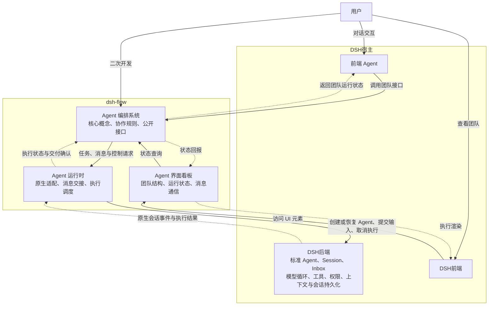
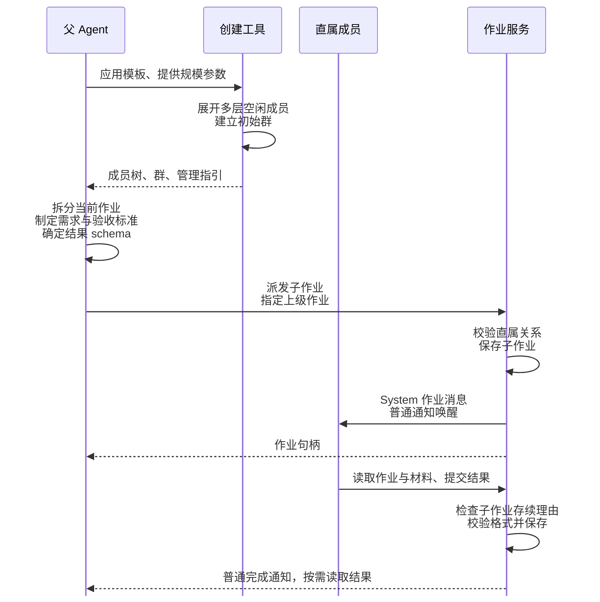
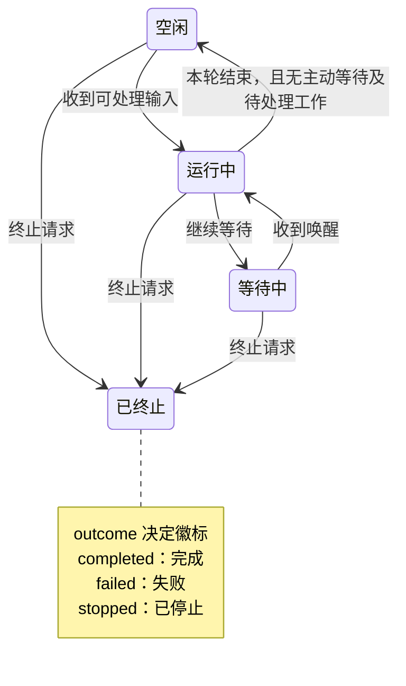
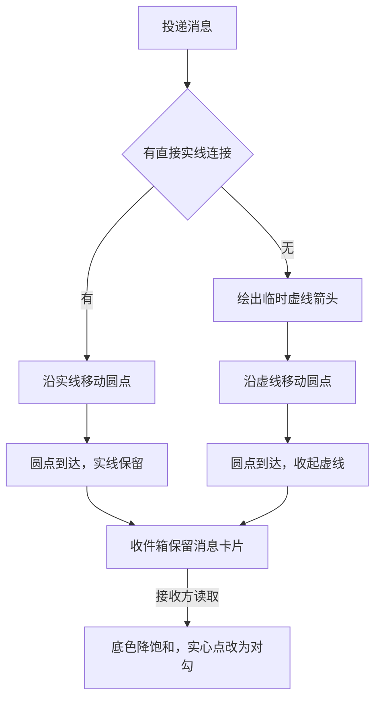
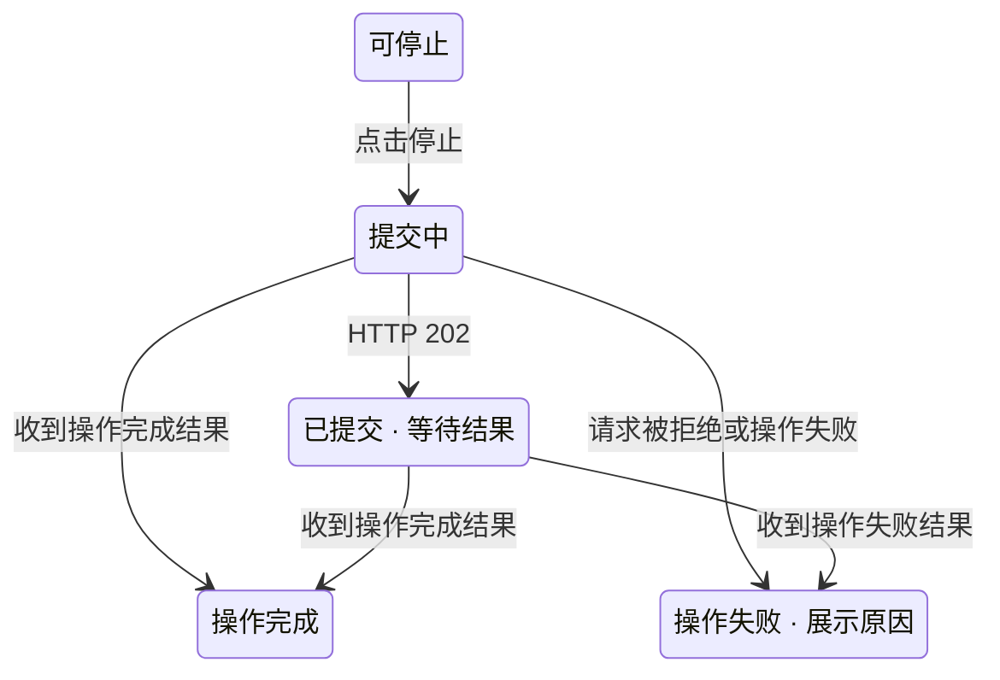
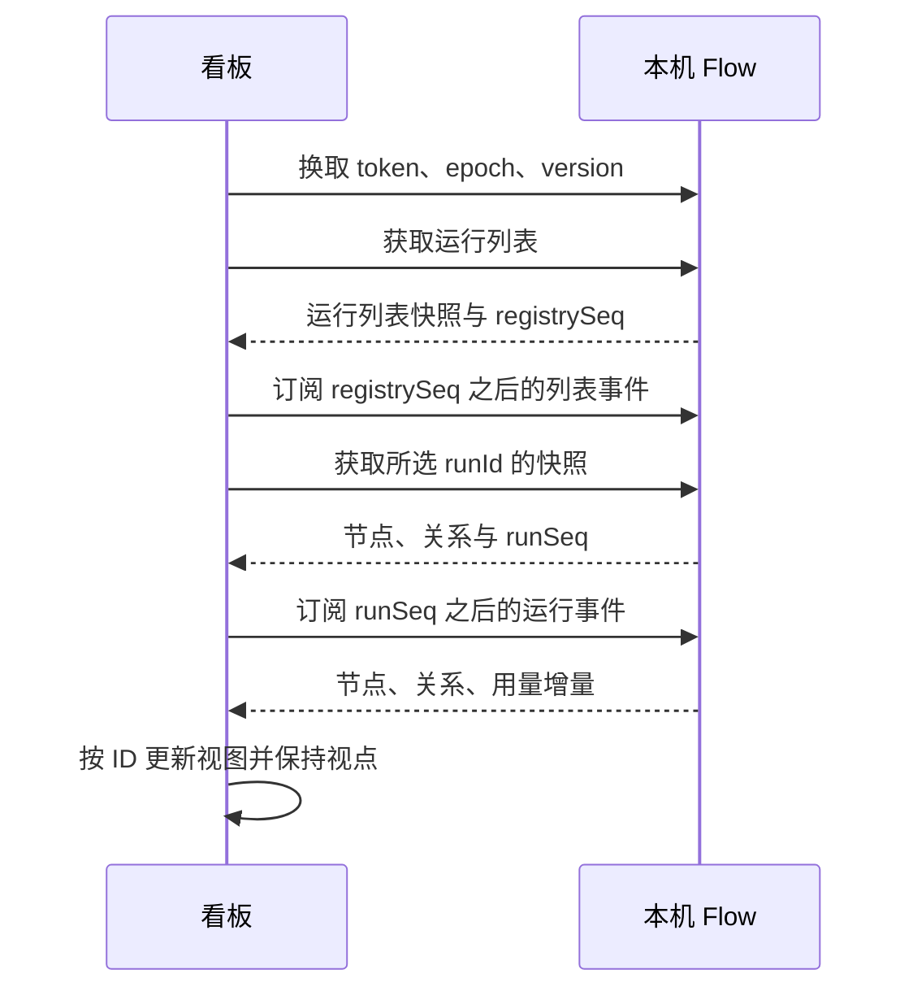
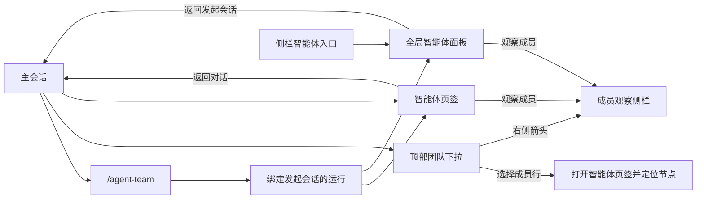
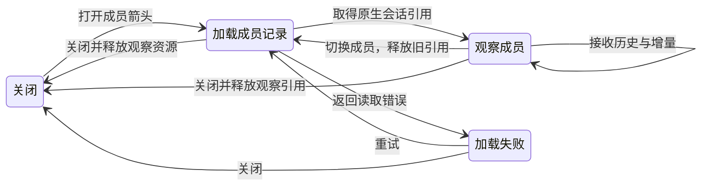
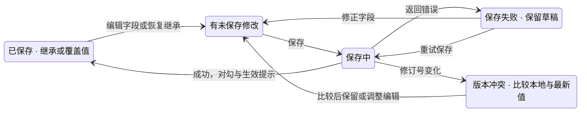

<script setup>
import AgentTreeFigure from "./components/AgentTreeFigure.vue";
import AgentTreeMotion from "./components/AgentTreeMotion.vue";
import DshHostMotion from "./components/DshHostMotion.vue";
</script>

# dsh-flow 设计文档

本文档是 dsh-flow 架构与设计的唯一依据。

- [dsh-flow 设计文档](#dsh-flow-设计文档)
  - [总体定位](#总体定位)
  - [Agent 编排系统](#agent-编排系统)
    - [Agent 智能体](#agent-智能体)
      - [身份信息](#身份信息)
      - [执行模型](#执行模型)
      - [运行状态](#运行状态)
      - [生命周期模型](#生命周期模型)
      - [执行权限模型](#执行权限模型)
      - [上下文派生模型](#上下文派生模型)
      - [主动等待模型](#主动等待模型)
      - [接口定义](#接口定义)
    - [智能体通信模式](#智能体通信模式)
      - [通信模型](#通信模型)
      - [群聊](#群聊)
      - [消息](#消息)
      - [信号](#信号)
  - [团队模式与作业](#团队模式与作业)
    - [团队运行模型](#团队运行模型)
    - [按模板创建团队](#按模板创建团队)
    - [作业模型](#作业模型)
      - [任务内容与派发关系](#任务内容与派发关系)
      - [提交与完成](#提交与完成)
      - [取消、通知与历史记录](#取消、通知与历史记录)
    - [模板定义与管理指引](#模板定义与管理指引)
    - [接口定义](#接口定义-1)
  - [Agent 运行时](#agent-运行时)
    - [收件箱](#收件箱)
    - [上下文](#上下文)
    - [宿主适配器](#宿主适配器)
    - [DSH 后端适配](#dsh-后端适配)
      - [实例创建与工具绑定](#实例创建与工具绑定)
      - [模型与权限配置](#模型与权限配置)
      - [输入与主动等待](#输入与主动等待)
      - [上下文派生](#上下文派生)
      - [事件与用量](#事件与用量)
      - [会话恢复与资源释放](#会话恢复与资源释放)
  - [界面设计](#界面设计)
    - [界面元素设计](#界面元素设计)
      - [整体布局与树形画布](#整体布局与树形画布)
      - [节点卡片](#节点卡片)
      - [状态徽标、主题与选中样式](#状态徽标、主题与选中样式)
      - [节点详情](#节点详情)
      - [响应式布局](#响应式布局)
    - [界面交互设计](#界面交互设计)
      - [节点状态与结果呈现](#节点状态与结果呈现)
      - [选择、折叠与视点](#选择、折叠与视点)
      - [动效设计](#动效设计)
      - [停止操作](#停止操作)
    - [界面与后端接口设计](#界面与后端接口设计)
      - [展示数据](#展示数据)
      - [查询与事件订阅](#查询与事件订阅)
    - [DSH 宿主界面设计](#dsh-宿主界面设计)
      - [插件入口与会话导航](#插件入口与会话导航)
        - [全局智能体面板](#全局智能体面板)
        - [会话内智能体页签](#会话内智能体页签)
      - [成员原生会话观察](#成员原生会话观察)
      - [插件设置](#插件设置)
      - [宿主数据与连接](#宿主数据与连接)
      - [客户端注册与打包](#客户端注册与打包)

## 总体定位

智能体通过模型与工具执行任务，DSH 为其提供会话和原生执行能力。dsh-flow 扩展 DSH 的智能体团队协作，提供 Agent 组织模板、团队可视化面板和共享运行时。用户可使用预置模板处理复杂任务，也可通过公开接口编排团队、与其他系统集成并扩展团队模式。

团队模板规定如何创建成员组织并提供管理经验；作业记录一次正式委派的任务及其交付格式。团队的存续与单份作业的完成分别管理。

dsh-flow 由以下部分组成：

- 界面看板在 DSH 前端展示团队状态并处理用户操作。
- Agent 编排系统提供模板创建、通信及作业接口；会话 Agent 选择团队，团队中的各级 Agent 自主拆分和管理任务。
- Agent 运行时将编排请求转换为 DSH 原生 Agent 请求，并维护团队运行状态。



接口遵循以下对象传递规则：

- 同一运行环境内的接口调用直接传递对象引用，生命周期管理权保持原归属。
- ID 用于持久化、序列化、外部寻址及跨实例恢复，实体按这些需要定义业务 ID。
- 返回对象列表时，默认只复制数组容器，列表元素仍引用原对象。长期保存调用方传入的数组时，也要复制容器。消息内容、已读状态等需要隔离的数据，由对应模块创建记录或快照。
- 对象通过生命周期接口显式释放。

> [!CAUTION]
> 对象释放后，必须拒绝后续执行及变更操作。

## Agent 编排系统

### Agent 智能体

Agent 是 Flow 中独立执行任务的智能体实例，维护身份、逻辑状态和父子关系，通过宿主调用模型与工具。会话承载对话历史和配置，以 `SessionID` 提供稳定身份。提供给模型推理的对话及相关信息称为对话上下文，Agent 对象是当前编排环境中使用该会话工作的实例。

宿主适配器 `HostAdaptor` 将 Flow 请求转换为宿主行为，为原生 Agent 提供统一的执行接口。适配器返回的 `HostAgent` 是与一个原生实例对应的宿主无关运行时对象，Flow Agent 持有该对象并将其传给适配器接口。`Context` 是运行时对象及其生命周期的管理者，负责在同一编排环境中登记、查找和释放对象；具体原生对象和句柄由适配器封装。

父子关系表示 Flow 的逻辑编排关系，用于成员管理、作业逐层派发和递归控制。会话 Agent 是从树外调用编排接口的宿主调用者，顶层 Flow Agent 的父级为 `null`。同一主会话可以管理多棵持续存在的团队树，具体交接见 [团队运行模型](#团队运行模型)。

#### 身份信息

`AgentProfile` 记录 Agent 的身份信息，在 Agent 创建时确定，整个生命周期保持不变。模型及推理参数采用宿主无关的声明，由适配器应用；宿主遵循本文约定的执行行为、初始权限安装和资源生命周期。

```ts
/**
 * 创建时根据输入字段建立独立的只读记录，后续查询共享同一份记录的引用。
 *
 * 适配器无法落实参数值或参数组合时，在创建前失败。
 */
interface AgentProfile {
  /** Agent 的身份提示词。 */
  role: string;

  /**
   * Agent 会话的稳定身份。
   */
  sessionID: SessionID;

  /**
   * 初始执行权限，遵循 [执行权限模型](#执行权限模型)。
   */
  permission: AgentPermission;

  /** 在前端界面显示的 Agent 名字。 */
  name: string;

  model: { provider: string; id: string };

  /**
   * 带版本的推理参数。
   * 目前包括 temperature、reasoningEffort、maxTokens，拒绝未知字段。
   */
  params: ReasoningParams;

  /**
   * 宿主附加配置。
   * 具体适配器按其类型定义校验，拒绝未知字段。
   */
  hostExtras?: HostExtras;
}

/** 按文件访问范围划分的三类基础权限。 */
type AgentPermission =
  | "read-only"
  /** 工作区内读写。 */
  | "workspace-write"
  | "full-access";
```

#### 执行模型

Agent 通过消息交换信息。`Message` 是包含来源、时间、摘要与正文的消息记录，来源可以是用户（`User`）、系统（`System`）或其他 Agent。每个 Agent 的收件箱 `Mailbox` 保存其收到的消息及各自的已读状态。接收方按发送来源评定消息的重要程度，称为来源评级，用于确定消息入箱时的本地优先级；过滤规则决定是否接收消息。消息优先级分为 `high`（优先）、`normal`（默认）和 `low`（不重要）。

Agent 根据收件记录整理通知，经适配器提交给自身模型；通知提供来源和摘要等提示，模型通过读取工具取得消息正文。收件、通知提交和正文读取分别记录。

原生执行由宿主划分为轮次（turn），执行步骤（step）是轮次内推进工作的单元。轮次可包含多个步骤，宿主在其中组织模型请求和工具执行，并在允许的步骤边界接纳中途输入。模型输出可包含文本和工具调用请求，工具调用由宿主运行并形成结果，模型可据此继续工作。Flow 通过适配器的 `turn-end` 事件确认轮次结束。

Flow 通过 `HostAdaptor.send` 向 `HostAgent` 提交初始输入或通知，按输入模式选择处理时机。发送完成表示宿主已接管输入，模型在以下时机处理：

| 输入模式 | 处理时机 |
| --- | --- |
| `followup` | 在下一轮次处理，并唤醒空闲 Agent；这是默认模式。 |
| `steer` | 在下一可接收输入的执行步骤处理，并唤醒空闲 Agent。 |
| `notice` | 插入后续执行步骤，但不主动唤醒 Agent。 |

Agent 也可发起主动等待，即指定消息条件，等待协作者发来匹配消息。主动等待由 Flow 维护，后续的状态、收件和执行准入规则围绕这一等待条件协作。

多个 Agent 可以组成 `Group`，即创建时确定成员的群聊，同时使用群内共享黑板追加和读取信息。群聊消息的来源描述 `AgentInGroup` 同时标识发送 Agent 和所属群。`Signal` 则表示沿逻辑父子树传递的终止控制请求，用于结束 Agent 的逻辑生命周期并协调资源收尾。

#### 运行状态

`AgentStatus` 表示 Flow 编排层的逻辑状态。

```ts
/**
 * 状态转移和终止语义见 [生命周期模型](#生命周期模型)；
 * 主动等待及临时唤醒规则见 [主动等待模型](#主动等待模型)。
 */
type AgentStatus =
  | "running"
  | "waiting"
  /** 空闲：实例存活，没有进一步工作请求，也没有尚未完成的主动等待。 */
  | "idle"
  /**
   * 已终止：在编排层已结束生命周期，不再接受新的业务请求或被消息唤醒。
   * 后端实例可以已经销毁，也可以继续保留在线。
   */
  | "terminated";
```

#### 生命周期模型

Agent 可创建新会话、从持久化会话恢复，或从现存 Agent 派生。派生会创建新的逻辑子 Agent，其中提供身份和模型配置的源 Agent 称为母版。

| 实例建立操作 | 作用 |
| --- | --- |
| `Agent.create` | 按给定身份和配置创建新会话及实例，可导入已有对话快照。 |
| `Agent.resume` | 从持久化会话建立新实例，恢复对话及配置，称为冷恢复。 |
| `fork` | 以自身为母版，复制配置及对话快照，创建逻辑子 Agent。 |
| `herb` | 以调用方为母版，分别总结调用方和另一 Agent 的上下文，将合并结果用于创建逻辑子 Agent。 |

**对象与资源归属。** 每个实例的会话、`Mailbox`、工具注册、事件监听和其他实例资源归属自身，独立于逻辑父 Agent。适配器在稳定的宿主作用域中创建和管理原生实例，并负责其后端生命周期策略。

**初始化与发布。** `create`、`resume`、`fork`、`herb` 成功返回时，`HostAgent`、`Mailbox`、工具绑定、事件监听、父子关系及 `Context` 登记均已就绪。各工厂共用以下装配与发布过程，且每次装配全过程使用本次创建的同一个上层 Agent 和 `Mailbox`：

1. 内部创建上层 Agent 和空 `Mailbox`，再将该 Agent 传给适配器的 `createAgent/resumeAgent`；此时 `getMailbox()` 已可用。
2. 适配器取得对象引用并注册工具回调。
3. 适配器返回后，工厂保存 `HostAgent` 并完成事件订阅。
4. 在同一原子操作中检查父级未终止且未进入释放流程，并登记到 `Context` 和父级的子列表；`herb` 同时检查两个来源 Agent。

> [!CAUTION]
> 注册工具回调时，不调用依赖 `HostAgent` 的 `getProfile()` 等接口。
>
> 工厂失败时，撤销本次新增的登记、父子关联、`Mailbox` 和监听，并通过适配器清理本次创建或恢复实例的 Flow 绑定。适配器按后端策略处理原生资源，清理完成后工厂再拒绝 `Promise`。适配器初始化失败时，自行清理尚未返回实例的工具注册及关联资源。

**初始执行。** `Agent.create` 完成初始化及登记后才处理初始输入。提供 `initmsg` 时，提交该输入并等待宿主接管后返回，不等待模型完成首轮；省略时返回空闲 Agent，不提交输入或启动轮次。

**冷恢复与唤醒。** `Agent.resume` 用于旧实例已释放或进程重启后的恢复。从持久化会话恢复对话与配置后，创建新的 Agent 实例，逻辑父级仅由本次 `parent` 参数建立。冷恢复按持久化的 `AgentProfile` 重新传入完整模型配置，不按当前默认值重新解析。

冷恢复重新建立空 `Mailbox`，其消息、已读状态、过滤规则和来源评级均为空。待通知消息、通知进度、首次评级提示记录及旧通信等待状态同时清空。需要群聊时，在新 `Group` 构造时列入新实例。通信工具按当前 `Context` 确认目标。

> [!NOTE]
> 冷恢复不恢复历史通信对象、`Group` 成员资格或旧子 Agent。历史来源引用不重新绑定，也不据此自动重发旧通信请求。

`HostAdaptor.resumeAgent` 按 [执行权限模型](#执行权限模型) 重新安装权限及工作区边界，安装工具与运行时设施，并将工具回调绑定到传入的 `flowAgent` 及其新建的空 `Mailbox`。它在首次模型执行前完成通知清理与恢复说明：

1. 在实例能够执行模型请求前，按持久化用途标记剔除旧实例尚未消费的 Flow 通知，保留用户指令及任务输入。已进入对话历史的旧消息仍作为历史保留。
2. 随后准备一次恢复说明，在下一次模型请求中提供。说明包含会话历史已恢复、`Mailbox` 和通信关系已重新初始化、历史消息编号在当前 `Mailbox` 中无效，以及历史协作者不保证仍可用。说明使用可识别的 Flow 通知标记，使再次冷恢复时尚未消费的旧说明可由新说明替换。

> [!CAUTION]
> 通信目标不存在时失败，不因历史记录隐式恢复对方。恢复说明不单独启动轮次。

**父级转移。** `transfer` 原子地检查并更新父子关系，保留子 Agent 及其 `HostAgent` 的身份、会话、`Mailbox`、权限、工具绑定和当前执行。后续信号传播和递归释放按新父子树进行。

**终止与资源释放。** 普通状态转移操作在单个 Agent 内串行执行，先原子地将逻辑状态置为目标状态，再执行相应操作。接收终止请求时，Agent 从运行中、等待中或空闲立即转为已终止，撤销等待及计时，并自动退出全部 `Group`。随后按收尾方式处理自身 `Mailbox`，并按当前逻辑父子树分别释放子 Agent 各自的资源。生命周期接口的 `Promise` 表示约定的处理操作完成。

结束 `HostAgent` 与 Flow 的执行关联时，先停止接纳 Flow 的新输入，再按以下两种收尾方式处理当前执行和原生资源：

- `after-turn` 依次拒绝该实例的新执行步骤，保留关闭前已开始轮次所需的 `Mailbox` 和工具绑定，允许该轮次继续调用业务接口；等待当前执行结束后写入持久化，再进入资源清理。该轮次的业务资格按关闭记录判断，不要求 `Context.has` 返回 `true`。
- `immediate` 撤销当前轮次的业务资格并取消原生执行，尝试一次持久化后进入资源清理。

上层 Agent 负责向子 Agent 传播终止信号，并将 `SIGKILL`、`SIGTERM` 分别转译为 `releaseAgent(hostAgent, 'immediate')`、`releaseAgent(hostAgent, 'after-turn')`。终止信号到达时立即合并收尾方式，后续清理由同一次关闭操作执行；异步释放期间继续接收和合并终止控制请求。

释放默认采用 `after-turn`，收尾时限可配置，默认 120 秒；超过时限且尚未进入资源清理时，升级为 `immediate`。`immediate` 的清理时限也可配置，默认 10 秒。

当前轮次结束、收到 `SIGKILL`、升级为 `immediate` 或进入资源清理时，立即撤销该轮次的业务资格。终止后的 `turn-end` 仅推进收尾。资源清理中的取消确认、持久化、实例销毁及工具与事件解绑按后端策略完成，使旧 `HostAgent` 不再可用于执行。

编排关系和运行时绑定随生命周期结束清理。Flow Agent 和 `Mailbox` 的生命周期仍由 `Context` 管理，宿主适配器在 `Context` 整体关闭时释放。释放完成表示 Flow 执行关联清理及所选后端处理已完成。

**关闭操作的并发与幂等。** 适配器按 `HostAgent` 对象身份保存关闭操作的内部记录与完成 `Promise`。首次调用 `releaseAgent` 时建立记录，后续调用先合并处理方式，再返回同一个 `Promise`：

- `after-turn` 正在等待当前轮次收尾：重复 `after-turn` 继续等待；`immediate` 立即撤销业务资格，结束对自然轮次结束的等待，转入资源清理。
- 已经进入资源清理：两种模式均复用原有清理及完成 `Promise`。
- 关闭操作已经完成或失败：返回原有 `Promise` 的完成或失败结果。

当前轮次自然结束与 `immediate` 请求可能同时到达。适配器须原子地完成“撤销业务资格并进入资源清理”，确保只有一个执行路径启动清理；工具执行检查读取同一关闭记录。

> [!CAUTION]
> **清理失败与放弃。** 持久化失败记入关闭结果，不阻止关闭完成。`immediate` 清理在时限内仍未完成时，关闭记录标记为放弃（`abandoned`）并注明原因，完成 `Promise` 以失败结束。依赖该实例释放的后续操作不得继续。

**`Context` 整体关闭。** 关闭当前 `Context` 时，停止接收新的注册与创建请求，解散 `Group`，释放 Agent 及其 `Mailbox`，最后释放宿主适配器。Agent 默认按 `after-turn` 释放，全部成员并行计时，超过约定时限后升级为 `immediate`。完成表示 Flow 管理的运行时资源及绑定已清理，适配器约定的后端处理已完成；重复调用等待同一次关闭操作。

DSH 的资源作用域、会话恢复及释放映射见 [DSH 后端适配](#dsh-后端适配)。

#### 执行权限模型

**创建与派生。** 父级在创建子 Agent 前根据任务所需的操作选择权限，由适配器安装。`Agent.create` 以本次 `p.permission` 为准；`fork`、`herb` 按现有签名继承母版的权限值，由新实例独立安装。

`create`、`fork`、`herb` 创建子 Agent 时，均检查其初始权限不高于逻辑父级 `AgentProfile` 记录的初始权限。比较顺序为 `read-only` < `workspace-write` < `full-access`。适配器通过宿主的文件访问、命令执行及相关工具执行机制安装 `AgentProfile.permission` 的初始值。工作区范围由适配器创建时绑定的宿主工作区确定，与初始权限一同安装。

> [!CAUTION]
> 子 Agent 的初始权限高于逻辑父级时，创建失败。

**运行期间。** `getProfile().permission` 记录创建时安装的初始权限。适配器尽力关闭宿主的权限修改和升权申请入口。

> [!NOTE]
> 适配器不检测或否决权限变更。Flow 不因权限变更拒绝工具执行或否决宿主操作。
>
> 运行中权限不足时，相关操作失败，由子 Agent 报告受限事项；父级重新分配任务或按适当权限创建新 Agent。

**冷恢复。** 始终重新安装持久化的初始权限及其工作区边界。恢复为子 Agent 时，将其权限与新父级 `AgentProfile` 记录的初始权限比较。要更换初始权限，创建新的会话实例。

> [!CAUTION]
> 恢复出的权限高于新父级时，恢复失败。

DSH 的沙箱模式和审批策略映射见 [模型与权限配置](#模型与权限配置)。

#### 上下文派生模型

派生实例复制母版 `AgentProfile` 的 `role`、`name`、`permission`、`model`、`params`、`hostExtras`，并将 `sessionID` 替换为新分配的会话身份。

**fork。** 以自身为母版及逻辑父级，通过 `HostAdaptor.exportHistory` 取得对话快照，再将快照作为 `history` 导入新会话。由此创建的子 Agent 以母版对话为起点，初始化与发布遵循 [生命周期模型](#生命周期模型)。

**herb。** `a.herb(b)` 以调用方 `a`（即 `this`）为母版和子 Agent 的逻辑父级，另一上下文来源为 `b`。它先分别总结双方上下文，再以合并结果作为新会话的初始上下文：

1. 分别调用 `summarizeContext`，由双方各自的模型总结本次捕获的自身上下文。两次总结可并行。
2. 两份总结完成后，通过一次独立的 `mergeContextSummaries` 调用，使用母版模型合并、去重和归纳。保留来源、关键约束、未完成事项和矛盾信息，将不能消解的分歧列入待确认事项。模型输入仅包含合并指令和这两份总结。
3. 将合并总结放入 `System` 来源的初始 `Message.payload`，通过 `Agent.create` 创建子 Agent，不传 `history`。

总结请求捕获调用时该 Agent 已记录且可供模型使用的上下文，以该快照独立生成文字结果，原会话历史保持不变。适配器将快照整理为可独立推理的输入，其中未完成的工具调用作为进行中事项的文字背景，总结请求独立执行，不等待原会话当前轮次或正在执行的工具结束。

总结与合并请求的执行资源由适配器管理，终止时按既有生命周期规则处理。这两类请求只生成文字，不执行工具调用；请求与输出均不通过 `send` 写回来源会话，结果直接返回调用方。取得符合标准格式的完整文字结果后，本次请求才算完成。

双方总结及合并结果均采用以下“Flow 上下文总结 v1”格式。无内容的章节填“无”，信息不足填“未知”；适配器填写实际 Agent 身份，合并结果保留双方来源。

```text
Flow 上下文总结 v1
来源：Agent 名称及 SessionID（合并结果列出双方）

## 目标与约束
## 已知事实与关键决策
## 当前进展与已有产物
## 关键文件、资源及定位信息
## 未完成事项与后续步骤
## 分歧、风险与待确认信息
```

> [!CAUTION]
> 空输出、截断输出或不符合标准格式的输出均使本次调用失败，不能增加 LLM 修订调用来扩展一次性合并过程。

适配器先缓冲总结与合并的辅助调用用量，待子节点出现后记到子节点，并按实际执行模型计价。

> [!CAUTION]
> 总结、合并或子 Agent 创建任一步失败时，已收集用量均记到母版 `a`，包括宿主在失败的辅助调用上回报的用量。

DSH 的辅助模型调用方式见 [上下文派生](#上下文派生)。

#### 主动等待模型

Agent 通过等待工具指定目标及消息条件，等待其他 Agent 发出的点对点消息或群聊消息。群聊消息的来源为 `AgentInGroup`。等待工具接收模型填写的结构化条件，不执行模型提供的任意程序。适配器据此构造只读消息匹配回调 `MailboxQuery`，调用该 Agent 自身的 `wait(condition, timeout)`；Flow 维护等待条件、计时及完成状态。

**发起与完成。** Flow 在一次原子操作中检查当前 `Mailbox` 内符合条件的未读消息，并在没有匹配时登记等待。等待工具根据返回值处理当前轮次：

| 返回值 | 等待工具的处理 |
| --- | --- |
| `matched` | 返回匹配消息的 ID、来源和摘要，保持当前轮次，并将该消息本次尚未提交的通知视为已完成。 |
| `registered` | 立即返回已登记等待的结果，并结束当前轮次，等待随后成功入箱的匹配消息。 |

> [!CAUTION]
> 尚有等待未完成时，再次调用 `wait` 失败，不覆盖原条件。已终止或进入释放流程的 Agent 也不能新建等待。

`timeout` 从登记时开始计时，期限以 Flow 接收和处理为准。期限内匹配消息时，解除等待并取消计时；到期仍未匹配时，解除等待，生成固定 `high` 优先级的 `System` 通知，通过 `steer` 唤醒 Agent。超时通知说明此前等待目标超时未返回，并提供本次等待的发起时间及超时时长。匹配、超时及终止只完成本次等待一次，旧计时回调只属于原等待。

> [!NOTE]
> 超时后不自动重试等待。

**等待期间的执行。** 默认消息和不重要消息仍按 `Mailbox` 规则接收，通知及处理暂缓。无关的优先消息可使 Agent 临时转为运行中，原等待及截止时间保持不变。处理结束后，若仍未匹配或超时，则重新进入等待中。匹配或超时后继续处理工作；没有进一步工作和待处理的合格通知时，才进入空闲。

适配器在输入即将进入模型时查询 `hasPendingWait()`，以尚未完成的等待判断执行准入，临时运行期间也使用这一判断。存在等待时，只放行 Flow 提交的 `high` 通知及等待完成提示，其触发的临时执行可继续到该轮结束。通知依据可信的发送元信息识别；宿主已接管但尚未消费的普通输入和通知保留并暂缓。

等待匹配或超时后，适配器先接管完成提示，再恢复暂缓输入，使完成提示在原生输入队列中排在这些输入之前。释放时清理其中的 Flow 通知，其他输入随会话保留供冷恢复使用；冷恢复时按 [生命周期模型](#生命周期模型) 剔除旧 Flow 通知。收件与等待完成提示的合并规则见 [通信模型](#通信模型)，DSH 的轮次结束及输入暂缓映射见 [输入与主动等待](#输入与主动等待)。

#### 接口定义

```ts
/**
 * 创建、恢复、派生、终止及资源归属遵循 [生命周期模型](#生命周期模型)。
 */
declare class Agent {
  private constructor();

  /** 返回 HostAgent.profile。 */
  getProfile(): Readonly<AgentProfile>;

  getParent(): Agent | null;

  getChildren(): Agent[];

  getStatus(): AgentStatus;

  /**
   * 查询是否有尚未完成的主动等待；临时处理优先消息时仍返回 true。
   * @internal 供适配器查询，不暴露为模型工具。
   */
  hasPendingWait(): boolean;

  /**
   * 返回自身 Mailbox，供适配器绑定读取、过滤和来源评级工具。
   */
  getMailbox(): Mailbox;

  /** 处理及完成语义见 [通信模型](#通信模型)。 */
  recvSignal(s: Signal): Promise<void>;

  /** 收件与通知规则见 [通信模型](#通信模型)。 */
  recvMessage(m: Message): void;

  /**
   * 主动等待其他 Agent 发来的匹配消息；匹配、超时及临时唤醒规则见 [主动等待模型](#主动等待模型)。
   *
   * @param timeout - 由发起等待的 Agent 指定，为以毫秒计的有限正数。
   * @returns 已有匹配时返回 { kind: 'matched', message }，message 为供检索和展示的消息元信息 MessageMeta；
   * 否则返回 { kind: 'registered' }。
   */
  wait(condition: MailboxQuery, timeout: number): WaitResult;

  /**
   * 仅供 Group 创建时建立初始成员关联。
   * @internal
   */
  joinGroup(g: Group): void;

  /**
   * Agent 逻辑终止、释放或 Group 解散时调用，解除双方成员关联。
   * 重复解除不产生额外操作，不作为主动退群的入口。
   * @internal
   */
  quitGroup(g: Group): void;

  /**
   * 初始化与发布遵循 [生命周期模型](#生命周期模型)，初始权限遵循 [执行权限模型](#执行权限模型)。
   *
   * @param ctx - 所属 Context。
   * @param p - 本次实例的身份及初始配置。
   * @param parent - 逻辑父级；根 Agent 传入 null。
   * @param history - 序列化的历史上下文。
   * @returns 已完成初始化及登记的实例；提供 initmsg 时等待宿主接管输入，省略时返回空闲实例。
   * @throws 无法安装初始权限，或初始化、原子登记失败。
   */
  static create(
    ctx: Context,
    p: AgentProfile,
    parent: Agent | null,
    initmsg?: Message,
    history?: string,
  ): Promise<Agent>;

  /**
   * 从持久化会话冷恢复对话与配置，创建新的 Agent 实例。
   * 恢复与通信重建遵循 [生命周期模型](#生命周期模型)，权限重装遵循 [执行权限模型](#执行权限模型)。
   *
   * @param ctx - 新实例所属的 Context。
   * @param parent - 恢复后实例的逻辑父级。
   * @returns 已完成初始化及登记的新实例。
   */
  static resume(ctx: Context, parent: Agent | null, session: SessionID): Promise<Agent>;

  /**
   * 以自身为母版创建逻辑子 Agent，通过显式快照将对话导入新会话。
   * 派生配置见 [上下文派生模型](#上下文派生模型)，初始化及资源归属见 [生命周期模型](#生命周期模型)。
   *
   * @returns 已完成初始化及登记的子 Agent。
   */
  fork(): Promise<Agent>;

  /**
   * 以双方上下文的合并结果创建逻辑子 Agent。
   * 总结格式、执行顺序及辅助用量归属见 [上下文派生模型](#上下文派生模型)。
   *
   * @param agent - 另一来源 Agent；母版和逻辑父级均为 this。
   * @returns 已完成初始化及登记的子 Agent。
   * @throws 总结、合并或子 Agent 创建失败。
   */
  herb(agent: Agent): Promise<Agent>;

  /**
   * 终止一个直接子 Agent，并执行相应的生命周期清理。
   * 先发送 SIGTERM，在约定时限内未完成收尾时发送 SIGKILL。
   * @throws 目标不是调用方的直接子 Agent 时失败。
   */
  kill(agent: Agent): Promise<void>;

  /**
   * 转交直接逻辑子 Agent，原子更新 child 的父引用及新旧父级的子列表。
   * 调用方、child、adopt 必须属于同一 Context，且均未终止或进入释放流程；
   * adopt 不能为 child 或其后代。转交给当前父级时不作变更。
   * 转移后的资源归属、递归控制及终止协调见 [生命周期模型](#生命周期模型)。
   *
   * @throws 前置条件不满足时失败。
   */
  transfer(child: Agent, adopt: Agent): void;
}

/**
 * `matched` 表示调用时已有匹配的未读消息，本次等待已完成；返回元信息不改变该消息的已读状态。
 * `registered` 表示已登记等待，之后由匹配、超时或取消完成。
 */
type WaitResult =
  | { kind: 'matched'; message: MessageMeta }
  | { kind: 'registered' };
```

### 智能体通信模式

#### 通信模型

智能体通过以下路径投递消息、共享黑板信息或传递终止控制请求：

| 通信方式 | 传递路径与处理 |
| --- | --- |
| 点对点消息 | 交给目标 Agent 的 `recvMessage`。 |
| 群聊消息 | `Group.postMessage` 向其他成员的 `recvMessage` 投递。 |
| 共享黑板 | 成员通过 `Group` 追加和读取共享信息。 |
| 控制信号 | `Signal` 由 Agent 的 `recvSignal` 直接处理。 |

Agent 负责接收后的通知调度，`Mailbox` 负责保存、过滤和检索消息，`HostAdaptor` 将通知提交给模型。消息入箱、通知被宿主接管和模型读取正文分别记录。

Agent 的共性协作规则要求：向其他 Agent 请求按要求返回内容时，在请求中一并说明返回格式和验收标准。状态查询、信息共享、讨论和澄清通常使用普通消息，这类约定由 Agent 遵循，不进行程序化格式检查。需要正式委派和状态跟踪的复杂任务使用 [作业](#作业模型)，由运行时强制校验格式。跨分支通信不改变成员管理和作业派发的父子关系。

**收件与来源评级。** `Agent.recvMessage` 将消息交给自身 `Mailbox`，成功入箱后，按消息在入箱时确定的本地优先级安排通知。首次收到并接受尚未评级来源的消息时，先按 `normal` 的时机通知。

该来源首次实际发出的通知同时要求接收方根据当前任务判断其重要性，通过工具调用 `setSourcePriority`，并明确提示“该来源的优先级后续可随时调整”。评级提示随原有通知一并发送，同一批次内同一来源只提示一次。首次提示被宿主接管后，记录提示已完成；接收方尚未完成评级时，该来源继续按 `normal` 处理。

**通知调度与提交。** Agent 按消息优先级确定提交时机、方式及通知内容：

| 消息优先级 | 通知时机与方式 | 通知内容 |
| --- | --- | --- |
| `high`：优先 | 收到后立即以 `steer` 提交；空闲时唤醒 Agent。 | 逐条提供消息来源和摘要。 |
| `normal`：默认 | 没有尚未完成的主动等待时，有正在执行的轮次则等该轮次完成后汇总，原生 Agent 已空闲则立即汇总当前待通知消息；批次以 `followup` 启动下一轮。 | 逐条提供消息来源和摘要。 |
| `low`：不重要 | 与默认消息在同一批次、同一条通知中发送；只有不重要消息时也可形成批次。 | 只报告不重要消息的数量。 |

优先消息和默认消息采用相同的条目格式：`[消息ID] 来源：摘要`。摘要取自 `summary`，消息 ID 供后续工具读取正文。不重要消息在批量通知中统一表示为 `不重要消息：N 条`。

Agent 以 `System` 来源构造单独的通知 `Message`，其 `payload` 包含整理后的通知文本，调用宿主 `send` 时显式传入 `purpose = 'notification'`。优先通知的 `priority` 为 `high`，普通汇总通知为 `normal`；等待完成提示采用下述等待匹配规则的级别。适配器保留通知用途和级别，供执行准入和冷恢复识别。

`steer` 通知由模型在宿主允许的下一个执行步骤边界接收。没有待通知消息时，不生成空批量通知，也不启动额外轮次。Agent 以 `HostAdaptor` 的 `turn-end` 事件确认轮次完成，在原生事件发布与轮次收尾完成后异步提交批量通知。DSH 的轮次事件映射见 [事件与用量](#事件与用量)。

每次汇总固定本次覆盖的消息范围，同一批次最多提交一次。提交中的消息只属于当前批次；宿主接管通知后，Agent 只推进这些消息的通知进度，新收到的消息进入后续批次。通知进度由接收方 Agent 单独维护，模型通过 `get`、`getLastUnread`、`getUnread` 或 `query(..., 'get')` 获取正文时，再按读取规则更新已读状态。

> [!CAUTION]
> 提交失败时，保留这些消息的待通知状态。

**等待期间的通知。** 收件与 [主动等待模型](#主动等待模型) 协作：

1. 其他 Agent 的消息成功入箱后，先判断是否在期限内满足等待条件；即使消息为 `normal/low`，也及时解除已满足的等待。
2. 匹配完成时，Flow 先提交等待完成提示，包含匹配消息的 ID、来源和摘要。该提示同时完成这条消息本次尚未提交的通知。优先消息仍通过 `steer` 通知，其余匹配结果以 `followup` 恢复执行。
3. 等待期间暂缓的普通通知并入同一条完成提示，排在匹配消息之后，并保留原消息评级。

等待完成提示及并入的暂缓通知不受此后新登记的等待阻挡。超时通知直接通过 `send(hostAgent, notification, 'steer', 'notification')` 提交。

> [!CAUTION]
> 普通发送方不能通过填写 `System` 或 `high` 冒充超时通知。

**信号接收与终止。** `Signal` 具有最高优先级。`Agent.recvSignal` 接收控制信号后，立即处理逻辑终止并合并收尾方式。开始终止或释放后停止生成新通知，异步收尾期间仍接收后续终止信号。返回的 `Promise` 表示对应生命周期处理的完成结果，物理清理约定见 [`HostAdaptor.releaseAgent`](#宿主适配器)。

信号类型及递归传播见下方 [`Signal` 定义](#信号)，重复信号合并见 [生命周期模型](#生命周期模型) 中的“关闭操作的并发与幂等”。

#### 群聊

```ts
/**
 * 存续期间不新增或替换成员，仅在 Agent 逻辑终止或释放时自动退群。
 * Agent 逻辑终止时立即退出其所属的全部 Group，同时解除双方成员关联。
 * 退群不终止其他成员，也不自动解散 Group。
 *
 * 群消息由各成员的 Mailbox 按接收规则保存，Group 不另行保存群消息历史。
 *
 * Context 的生命周期处理负责析构 Group：解散群聊，调用所有剩余成员 Agent 的 quitGroup，
 * 解除关联而不终止这些 Agent，并释放黑板内容。
 * 解散后不再接受群消息或任何黑板操作，也无法恢复群聊。
 * 退群和解散均不删除各成员 Mailbox 中已经接收的群聊消息，
 * 这些消息仍按对应 Mailbox 自身的生命周期及读取规则访问。
 *
 * 黑板读写忽略 Message 中的读取状态信息。
 */
declare class Group {
  /**
   * 创建群聊，调用各成员的 joinGroup 建立初始成员关联。
   *
   * @param ctx - 成员所属的同一 Context。
   * @param members - 已完成初始化且未终止或进入释放流程的一组 Agent 对象。
   */
  constructor(ctx: Context, members: Agent[]);

  /**
   * 返回创建时分配的稳定 GroupID，唯一且不复用。
   * 解散后仍可识别已有消息的群聊来源。
   */
  getID(): GroupID;

  /**
   * 以 { agent: source, g: 当前 Group } 为消息来源，按调用时的成员快照，
   * 在同一次同步操作中向除发送者以外的各成员的 recvMessage 投递消息。
   *
   * @param source - 当前群聊中的发送者对象。
   * @throws 发送者不在群聊中，或群聊已解散时，发送失败。
   */
  postMessage(source: Agent, m: Message): void;

  /**
   * 向黑板追加消息记录，同一时间最多只有一个子代理执行追加操作。
   * 记录的 timestamp 由 Group 在追加时分配，在同一黑板内严格递增。
   * 追加黑板内容不会自动投递到成员 Mailbox。
   *
   * @param source - 当前群聊中的发送者对象。
   * @throws 发送者不在群聊中，或群聊已解散时，追加失败。
   */
  postToBlackboard(source: Agent, m: Message): void;

  /**
   * 获取黑板消息快照。
   *
   * @param t - 此前读到的最大时间戳。
   * @returns 提供 t 时返回该时间戳之后的信息，否则返回所有信息。
   */
  readBlackboard(t?: Timestamp): Message[];

  /**
   * 查询指定时间戳之后黑板内容是否有更新。
   */
  hasNewMsgOnboard(t: Timestamp): boolean;
}
```

#### 消息

```ts
/**
 * priority、read 和 read_timestamp 属于接收方的消息记录。
 * 同一消息被多个 Mailbox 接收时，各自创建记录。
 *
 * 创建消息数据快照时，显式复制消息字段及 AgentInGroup 等来源描述容器，
 * 容器中的 Agent、Group 仍引用原对象。不可变内容可共享，可变的 payload 应显式隔离。
 * 这一规则同时适用于 Mailbox 和 Group 黑板的存入与读取。
 */
interface Message {
  /**
   * System、User 为来源描述符。
   *
   * 序列化时，将对象引用转换为 SessionID、GroupID 及展示来源所需的信息快照，不递归序列化对象本体。
   * 序列化后的来源信息可独立用于历史展示。
   */
  source: Agent | AgentInGroup | System | User;

  /** 消息发出的时间戳。 */
  timestamp: Timestamp;

  /**
   * 接收方在入箱时根据自身来源评级填写的本地优先级。
   *
   * 优先级决定通知的时机与内容，不改变 Mailbox 内的时间排序。
   * Flow 直接构造并交给宿主的运行时通知不经过入箱，
   * 其优先级由 [通信模型](#通信模型) 中的通知规则确定。
   */
  priority?: MessagePriority;

  /** 由接收方修改。 */
  read: boolean;

  /** 消息首次读取的时间戳，未读时为空。 */
  read_timestamp: Timestamp | null;

  /** 不超过 50 个字符。 */
  summary: string;

  /** 通知不自动携带原消息的 payload。 */
  payload: unknown;
}

type AgentInGroup = {
  agent: Agent;
  g: Group;
};

type MessagePriority =
  | "normal"
  | "high"
  | "low";
```

#### 信号

```ts
/**
 * 逻辑终止及关闭方式见 [生命周期模型](#生命周期模型)。
 *
 * 两种信号均立即递归传递给所有子 Agent，不等待当前 Agent 自身的收尾。
 * 释放期间保留尚需收尾的子 Agent 引用，后续 SIGKILL 仍须传播给它们。
 * SIGTERM 的收尾在约定时限内未完成时，自动按 SIGKILL 升级，时限可配置。
 */
type Signal =
  /**
   * 采用 immediate 方式处理后端。
   */
  | "SIGKILL"
  /**
   * 采用 after-turn 方式保留当前轮次的收尾。
   */
  | "SIGTERM";
```

## 团队模式与作业

团队模式（pattern）是创建团队时使用的图纸，定义组织结构、成员职责、管理指引和可选的初始群聊关系。`PatternDefinition` 是这份图纸的静态定义，支持组数、每组人数等参数。直接应用模板时，模板根代表发起 Agent；子树可以直接定义，也可以引用其他模板并传入参数。运行时将图纸展开，在根下面创建各级成员，形成高度不限的树状结构。模式仅在创建阶段提供引导。

团队中的管理关系由 Agent 树确定。每个父 Agent 管理自己的直属成员，任何成员都可以继续应用模板扩展自己的子树。不同模板创建的成员统一进入同一棵树；创建完成后，通过 Agent、`Group` 和作业接口管理实际的成员、群和任务。

作业（`Assignment`）是一次正式的任务委派，包含任务背景、需求、验收标准、材料和最终交付的结构定义（schema）。派发者根据本次任务制定 schema；同一个接收 Agent 执行不同作业时可以采用不同格式。作业适用于团队级、长程或复杂任务，运行时记录状态、检查提交格式并保存结果。

组织创建和任务派发是独立操作。模板提供如何管理团队的经验，各级 Agent 自主决定任务拆分、派发、交流方式与推进时机。团队可以持续承接多份作业，作业完成不结束团队或群的生命周期。

每个 Flow Agent 默认具备 `team-strategy` 技能，模板的 `skills` 只声明角色所需的附加技能。该技能指导 Agent 判断是否需要扩充成员、选择模板和规模，并利用已有成员处理后续任务；结合模板提供的管理经验，自主决定任务拆分、协作次序、结果收集和停止继续工作的时机。群聊、轻量信息请求和正式作业的选择遵循 [通信模型](#通信模型) 的共性规则。

### 团队运行模型

`run` 表示一棵持续存在的团队树及其运行环境，持有一个 `Context`、一个顶层 Flow Agent、成员和群、作业记录及事件。`Run` 对象保存运行身份和宿主来源。顶层 Flow Agent 称为团队根，与用户直接对话的会话 Agent 是树外调用者。一个主会话可以对应多棵团队树，会话 Agent 根据任务选择复用已有树或创建新的根。

入口服务 `RunService` 负责会话与团队之间的交接。会话 Agent 先通过团队查询工具选择已有运行；需要新团队时，创建工具立即返回 `runId`，入口服务异步建立 `Context` 和空闲的团队根。根创建时安装团队管理的共性规则，不绑定某份作业。会话 Agent 通过 `flow_team_get` 查询创建状态；运行就绪后，通过独立的作业派发工具向该根交付任务。

由会话 Agent 交给团队根的作业称为顶层作业，其记录中的发送方为代表该宿主来源的 `Run`，没有上级作业。真实会话身份由入口服务从宿主调用上下文取得；任务背景、需求、验收标准、材料和结果 schema 由会话 Agent 提供。入口服务在准备材料并保存作业后，交付 `System` 作业消息，按普通通知规则唤醒根；派发返回作业句柄，不等待模型执行或结果。顶层作业与 `runId` 分别标识任务和团队。

根可以同时承接多份顶层作业，并根据已有成员的职责选择复用或扩充团队。完成一份顶层作业后，入口服务主动向发起会话提交普通完成通知，包含 `runId`、作业 ID 及查询方式。通知使用宿主既有消息处理规则：空闲时以 `followup` 唤起会话 Agent，正在处理其他事情时接续处理。会话 Agent 读取实际结果并向用户汇报。失败及取消状态也通过作业记录和相应通知交付。

团队运行状态为 `starting / active / stopping / stopped / failed`，描述团队的创建、可用性和释放过程。某份作业完成或失败只改变该作业记录。会话 Agent 或用户明确解散团队时，入口服务停止接收新任务，取消尚未结束的作业，解散群并释放 `Context`；已保存结果仍可查询，资源清理进度单独报告。暂时空闲不触发回收，各级父 Agent 仍可通过编排接口管理自己的成员。

> [!CAUTION]
> 新团队初始化失败时，入口服务将运行标为失败并清理本次创建的资源；已有团队的作业派发失败只报告该次任务交付的结果，不释放整个团队。保存或清理失败不得报告为已完成。

进程重启后，旧运行句柄失效，查询时返回“该运行已随重启失效”。会话和作业的历史记录按各自的持久化规则保留，恢复方式见 [作业模型](#作业模型)。

### 按模板创建团队

按模板创建团队时，以现存 Agent 为根，解析参数后逐层创建其下的所有节点。模板可直接定义多层结构，也可通过子树引用复用其他模板。引用位置的节点就是被引用模板的根，其下的成员按传入参数继续展开；每个新节点的逻辑父级由展开后的树确定。根的身份和 `AgentProfile` 保持不变，管理指引通过创建工具的返回内容交给根，进入它的会话上下文。

运行时先解析各层模板引用及参数，校验展开后的层级、角色引用、群成员选择器与配置，再按父级先于子级的顺序创建成员。新成员继承所属运行的默认配置，叠加角色配置及本次显式覆盖，逐层检查父级的初始权限上界。成员通过省略 `Agent.create` 的 `initmsg` 创建为空闲实例，职责及协作、管理指引在初始化时提供；引用其他模板的节点同时获得该模板的根管理指引。所有成员就绪后，运行时展开群成员选择器，创建初始 `Group`。

创建工具返回各路径对应的 Agent、群及交给根的管理指引。节点路径和群键帮助调用者从这次返回值中识别新建对象，后续操作使用这些对象本身。`flow_team_read` 通过 Agent、`Context` 和 `Group` 的查询接口汇总当前成员关系与群信息。

同一根可多次应用不同模板；每次创建都向现有树增加成员。创建后，根和成员依据已进入各自上下文的职责与管理指引，自主派发作业、发送消息、创建或解散群。成员归属及群的存续由当前 Agent 树和 `Context` 管理；已有 `Group` 的固定成员规则仍适用，调整通信组织时可另建群。

Flow Agent 共用所在服务的模型执行容量，实际执行按该容量控制准入。模板不规定固定的人数或树高上限，具体规模由参数决定；空闲实例的初始化不占据模型执行名额。

> [!CAUTION]
> 参数校验失败时不创建成员。创建过程失败时，报告已建立对象及逐项原因，解散本次新群并释放本次新增成员，不影响根及此前已有的成员。创建与根终止并发时，停止新增创建，异步返回的新实例只进入收尾。

以下时序展示组织创建与任务派发的衔接。各级父 Agent 对自己的直属成员重复相同的派发过程。



### 作业模型

#### 任务内容与派发关系

`AssignmentSpec` 保存名称、类型、背景、需求、验收标准、材料引用和结果 schema。作业记录另存 ID、发送方、接收方、上级作业、状态、提交计数、格式校验失败次数、接受的结果、子作业存续理由或失败原因；schema 的方言版本及内容摘要随记录保存。

作业结果的 schema 支持 `type`、`oneOf`、`properties`、`required`、`additionalProperties`、`items`、`enum`、`const`、`minimum`、`maximum` 及注解。校验器方言版本参与摘要计算，不支持的关键字在派发前报错。

树内正式作业只由父 Agent 向当前直属成员派发。派发时必须提供上级作业，运行时检查该作业仍未结束且接收者就是派发者，并在同一次登记中建立子作业关系。Agent 树记录组织关系，作业树记录任务拆分；同一个 Agent 可以同时持有多份未结束作业，自己安排顺序或交替推进，运行时逐份记录。

供接收者读取的输入内容称为材料，`MaterialRef` 记录原始材料身份、内容摘要和可读取位置。`AssignmentService.prepare` 验证任务、关系、schema 及材料并保存记录，`deliver` 再将任务及提交要求作为 `System` 作业消息交给接收者。接收者通过 `flow_assignment_read` 读取作业，通过 `flow_material_read(materialId)` 将引用内容呈现为宿主可处理的文本、图片或文件；访问仍服从接收者的宿主权限。上游结果可按作业 ID 查询，派发者将实际结果或材料引用交给后续任务。

作业的发送方、接收方与上级作业一经登记就保持不变。`fork` 不继承作业，`transfer` 不隐式取消或改派既有作业；转移后新增作业按新的直接父子关系检查。

#### 提交与完成

接收者通过 `flow_submit` 提交本次作业要求的结果。提交前，Agent 应取消不再需要的子作业；仍要继续的子作业逐项给出存续理由。运行时在提交时读取最新的直接子作业状态，要求每份未结束子作业都有非空理由，缺少任一项就拒绝提交并返回对应 ID。理由随被接受的提交保存，用于追踪上级作业完成后仍在继续的工作。

通过子作业处置检查后，运行时校验结果格式。首次格式不合格后固定允许两次纠正，最后一次仍不合格则作业失败。错误在同一次工具调用中返回字段路径和原因，由 Agent 自行纠正；缺少存续理由等前置检查失败不消耗格式纠正机会。工具传输重放返回原回执，不重复计数；真实模型提交计入提交记录及用量。

格式合格且结果保存成功后，接受首份合格结果，作业完成。内容是否满足需求与验收标准由派发者判断，必要时通过后续沟通或新作业补充。运行时不增加强制的内容验收流程。

作业状态如下，`pending` 覆盖尚未提交、执行中及格式纠正过程，具体执行安排由接收 Agent 决定。

| 状态 | 含义 |
| --- | --- |
| `pending` | 尚未结束，可处理并提交。 |
| `submitted` | 结果已通过检查并保存，作业已完成。 |
| `failed` | 格式纠正机会用尽、接收者终止或交付失败，记录具体原因。 |
| `cancelled` | 作业已取消，不再接受结果。 |

同一作业的子作业登记、提交和取消按作业关系协调排序，提交检查与终态保存使用一致的子作业状态。作业只接受一次从 `pending` 进入终态的变更。接收者逻辑终止时，其未结束作业失败；作业服务通过 `Context.onAgentTerminated` 观察。作业状态与 Agent 的运行、等待、空闲和终止状态分别记录。

#### 取消、通知与历史记录

发送方可以主动取消自己派发的作业。运行时沿作业父子关系递归遍历，将所有未结束的后代作业一并取消，保留已结束记录及已提交结果。取消只作用于这棵作业子树，不终止 Agent，也不影响其承接的其他作业。取消后的提交返回已取消状态。

作业读取、提交与 `Mailbox` 的通知进度分别记录。交付、完成、失败及递归取消产生的通知沿既有消息机制处理；取消通知告知接收者停止相应工作，不能撤销已经发生的模型调用或外部操作。异步终态向仍活跃的发送方发送普通 `System` 提示，提示携带查询信息，多个完成可合并通知。发送方主动取消时，工具回执即为本次取消结果。顶层作业的通知由入口服务交给发起会话，按 [团队运行模型](#团队运行模型) 唤起会话 Agent。

持久记录保存任务内容、schema、输入、派发关系、完整提交结果及未结束子作业的存续理由。冷恢复读取时，已保存结果可查询，未完成作业作为未绑定历史记录保留中断事实，旧 `run` 句柄不恢复。继续旧工作时，先按 `Agent.resume` 恢复所需会话与当前组织关系，再由会话 Agent 派发新的顶层作业，各级父 Agent 在其下显式准备后继作业；通过 `resumesAssignmentId` 记录历史来源，同时建立当前作业父子关系。

### 模板定义与管理指引

模式包保存模板配置及其引用的指引文件，采用以下组织方式。

```text
patterns/<package>/
  pattern.yaml
  guidance.md
  roles/*.md
```

`parameters` 直接按名称声明参数；指引可使用正文或 `{ file: 相对路径 }` 引用包内文件。加载时以包根目录解析文件和模板引用，编译为不可变的 `PatternDefinition`。

| 配置字段 | 约定 |
| --- | --- |
| `apiVersion` | 模板格式版本，取值为 `v1`。 |
| `id` | 带命名空间的模板名称，在当前模板目录内唯一，也是 `use.id` 的引用值。 |
| `description / whenToUse` | 说明组织特点及适用场景，帮助 Agent 选择模板。 |
| `parameters` | 按参数名列出 `type`、`description` 和可选的 `default`。 |
| `roles` | 成员职责与协作、管理指引，以及预设、附加技能、模型、推理参数、初始权限。配置依次采用运行默认值、角色配置、本次显式覆盖。 |
| `root` | 用 `instructions` 提供根管理指引，其余字段直接命名直属成员，例如 `leads`。 |
| 成员节点的 `role / count` | `role` 指定本模板中的角色，`count` 指定该名称下创建的成员数量，默认 `1`。 |
| 成员节点的 `use` | 引用另一个模板，以当前节点为根创建子树；其下的 `id` 指定模板，可选的 `with` 按对方参数名传值。 |
| `groups` | 可选的初始群定义，包含 `key`、`members` 及可选 `forEach`。成员在创建完成后解析为固定 Agent 集合。 |

每个参数必须声明 `type` 和 `description`；类型支持 `string`、`integer`、`number`、`boolean`、`array`、`object` 和 `null`。所有参数都必须最终有值：调用者未传值时使用 `default`，没有默认值则报缺失参数。默认值本身也须符合声明类型，显式传值优先于默认值；传入未声明的参数名会报错。

`root` 下面各级直接以字段名定义子节点。`instructions` 是根的保留字段，`role`、`count`、`use` 是成员节点的保留字段；这些名称不用于子节点命名。成员节点可以继续内联定义下级成员，也可以用 `use` 引用子树，两种定义方式择一使用。

`count` 和 `use.with` 的参数值支持 Jinja 风格的纯变量占位符，例如 `"{{ groups }}"`。占位符写成带引号的 YAML 字符串，内部是当前模板的参数名。创建器在 YAML 解析后读取参数并进行整值替换，保留整数、数组或对象等原始类型；`count: "{{ groups }}"` 在 `groups` 为 `2` 时得到整数 `2`。节点数量须为非负整数，`0` 表示不创建该节点及其后代。

`use` 是包含 `id` 和可选 `with` 的对象，例如 `use: { id: builtin/shared-review, with: { members: 2 } }`。创建器按 `use.id` 从当前目录解析图纸。被引用模板的 `root` 对应当前节点，只在其下展开成员。该节点的身份和配置由外层 `role` 定义，被引用模板的 `root.instructions` 接在该角色指引之后，一并交给这个 Agent；其下成员的角色在被引用模板自己的 `roles` 中解析。

`with` 位于 `use` 之下，为这次模板引用提供参数。它可直接传入常量，如 `with: { members: 2 }`，也可通过 `with: { members: "{{ membersPerGroup }}" }` 转交当前模板的参数。传入值求值后，按照被引用模板的声明补充默认值并校验类型。对方没有参数或所有参数都有默认值时，可以省略 `with`；否则必须提供缺少默认值的参数。被引用模板内部的变量从这组参数读取，各层分别解析。

展开后的节点路径由字段名和从零开始的序号组成，例如 `root/leads/0/contributors/1`。群成员选择器使用这些路径，`*` 匹配某一级序号。未指定 `forEach` 时，以模板根为选择起点；指定后，为每个匹配节点创建一个群，`.` 表示该节点，`./` 表示其下的相对路径。被引用模板以引用位置的节点为自己的 `root`，展开路径附加到该节点路径下；外层群也可引用完整展开后的成员路径。群身份由运行时生成，模板中的群键和节点路径仅用于创建时解析与结果寻址。

内置和用户模板使用同一加载器。加载时检查参数声明、文件、角色、节点及 `use` 引用，解析模板并检查引用无环；创建时先完成各层参数求值、类型和数量校验，再检查完整展开后的群成员。

以下模板为每个组长引用 [资料共享与核验模板](/patterns/shared-review/pattern.yaml)，将外层的 `membersPerGroup` 传给它的 `members` 参数。外层创建协调群，被引用模板分别建立各组讨论群。

```yaml
apiVersion: v1
id: builtin/hierarchical-research
description: 各组长按引用模板组织资料收集、核验和审查成员，分别处理研究子问题。
whenToUse: 任务可拆分为多个需要内部协作的研究方向。
parameters:
  groups:
    type: integer
    description: 群组数量，每个研究方向对应一个群组
    default: 1
  membersPerGroup:
    type: integer
    description: 每组资料收集成员数量，核验者和审查者另行创建
roles:
  lead:
    instructions: |
      根据父节点交付的作业，向直属资料收集、核验和审查成员派发子作业。
      明确各份作业的背景、需求、验收标准和结果格式，核对证据后汇报。
    permission: read-only
root:
  instructions: |
    根据研究方向选择组数与每组资料收集者数量。创建后向组长分别派发作业，由组长继续分工。
    通过协调群交换跨组信息，读取各组结果后判断是否需要补充研究或交叉核验。
    提交自己的作业前，取消不再需要的子作业，并逐项说明仍需继续的子作业理由。
  leads:
    role: lead
    count: "{{ groups }}"
    use:
      id: builtin/shared-review
      with: { members: "{{ membersPerGroup }}" }
groups:
  - key: coordination
    members:
      - root
      - root/leads/*
```

例如传入 `groups: 2`、`membersPerGroup: 3`，就会创建两名组长，每名组长下有三名资料收集者、一名核验者和一名审查者。首组的成员路径包括 `root/leads/0/contributors/0`、`root/leads/0/verifier/0`，讨论群在本次返回值中的键为 `root/leads/0/discussion`。继续嵌套引用时仍按相同规则展开，创建后直接使用实际的 Agent 和群。

研究型 Agent 可用 `flow_pattern_define` 提交同格式的候选模板和依赖文件，经同一编译器校验后得到仅在当前 `run` 可用的引用。候选定义的注册、按模板创建成员及向成员派发评估作业分别进行。运行创建时选定可用模板目录及配置，按模板创建成员时读取所选定义。

首批计划提供以下 14 份设计参考模板。各包提供组织结构与管理经验，实际任务、交付 schema、轮次和结果取舍由 Agent 按任务制定。

| 模板 ID | 协作形式 | 组织与管理指引 |
| --- | --- | --- |
| [builtin/independent-vote](/patterns/independent-vote/pattern.yaml) | 独立采样与投票 | 创建独立求解者和评审者，根组织独立初答、证据核验和计票。 |
| [builtin/heterogeneous-ensemble](/patterns/heterogeneous-ensemble/pattern.yaml) | 异构模型集成 | 创建使用不同模型的求解者和汇总者，根按本次任务说明权重与合成依据。 |
| [builtin/debate](/patterns/debate/pattern.yaml) | 辩论 | 创建辩论者和评审者；根决定何时交换论点、要求修订或交付结论。 |
| [builtin/expert-router](/patterns/expert-router/pattern.yaml) | 专家协调 | 建立不同专长的成员，根根据任务选择需要的专家和核验者。 |
| [builtin/pipeline](/patterns/pipeline/pattern.yaml) | 流水线分工 | 建立计划、制作、核验和汇总角色，根按依赖与实际结果安排交接。 |
| [builtin/hierarchical](/patterns/hierarchical/pattern.yaml) | 多层管理 | 为各组长引用资料共享与核验模板并传参，一次创建完整子树，随后逐层派发作业。 |
| [builtin/mixture-of-agents](/patterns/mixture-of-agents/pattern.yaml) | 分层合成 | 建立提议、提炼和汇总成员；信息处理层次由根组织，不改变作业只能向直属成员派发的关系。 |
| [builtin/generate-review-revise](/patterns/generate-review-revise/pattern.yaml) | 生成、审查与修订 | 保留作者及独立审查、核验成员，根根据反馈继续派发修订任务。 |
| [builtin/tool-specialists](/patterns/tool-specialists/pattern.yaml) | 工具专家 | 角色声明职责、预设、技能和初始权限，通过作业交接材料及真实工具产物。 |
| [builtin/search-swarm](/patterns/search-swarm/pattern.yaml) | 分组搜索 | 创建各搜索组及组长，以局部群共享线索，由各级父节点按先到结果调整工作。 |
| [builtin/workflow-search](/patterns/workflow-search/pattern.yaml) | 组织方案搜索 | 创建模板设计和评估成员，根根据真实创建与作业结果选择后续方案。 |
| [builtin/sparse-routing](/patterns/sparse-routing/pattern.yaml) | 稀疏通信 | 创建观察、路由建议和处理角色，跨分支信息通过定向消息或局部群转交。 |
| [builtin/shared-review](/patterns/shared-review/pattern.yaml) | 资料共享与核验 | 创建收集、核验和审查成员，通过群消息与黑板共享资料，通过作业交付核验结果。 |
| [builtin/tournament-evolution](/patterns/tournament-evolution/pattern.yaml) | 锦标赛与演化 | 创建候选生成、比较和选择成员，根保留谱系与多样性，根据证据安排下一轮。 |

### 接口定义

按模板创建团队与派发作业使用独立工具。工具侧的 Agent、群、材料和作业引用序列化为 ID，由适配器解析对象并注入真实调用者；模型参数不提供可冒充的发送方或根。下列接口围绕所属 `Run` 工作。

```ts
/** 按图纸创建成员所需的输入。 */
interface PatternApplyRequest {
  /** 包含已解析的子树模板定义；实际参数在创建前逐层求值。 */
  definition: PatternDefinition;
  /** 按名称传入参数，未传项使用各自默认值；必需参数仍须有值。 */
  parameters?: JsonObject;
  /** RoleOverride 沿用 roles 的配置字段，按完整展开路径覆盖新建节点，包括被引用模板中的节点；不覆盖 root 或改变层级。 */
  overrides?: Record<string, RoleOverride>;
}

/**
 * flow_pattern_apply(patternId, parameters?, overrides?, requestId) 调用此函数。
 * 根必须为当前调用 Agent；先展开引用并校验各层参数，再通过 Agent.create 和 Group 创建成员及初始群。
 * 完成时成员和群已就绪，各成员已获得职责及指引，返回交给根的管理指引。
 * 同一根在同一 run 内重用相同 requestId 和参数，返回原调用结果；同键不同参数报错。
 * 创建与收尾约定见 [按模板创建团队](#按模板创建团队)。
 */
declare function applyPattern(root: Agent, request: PatternApplyRequest, requestId: string): Promise<{
  /** 本次调用的节点路径到 Agent 的对应关系，含现存 root。后续使用 Agent 对象。 */
  agents: Record<string, Agent>;
  /** 本次调用的“起点节点路径/群键”到 Group 的对应关系。后续使用 Group 对象。 */
  groups: Record<string, Group>;
  /** 作为工具结果进入根 Agent 会话上下文的管理指引。 */
  instructions: string;
}>;

/** 任务的完整交付约定，由派发者按本次任务制定。 */
interface AssignmentSpec {
  name: string;
  type: string;
  background: string;
  requirements: string;
  acceptanceCriteria: string;
  resultSchema: JsonSchema;
  materials?: MaterialRef[];
  /** 当前作业仍须建立当前实例与上级作业关系。 */
  resumesAssignmentId?: AssignmentID;
}

/** 树内派发必须给出上级作业；Run 代表真实宿主会话派发顶层作业。 */
type AssignmentRequest =
  | { sender: Agent; recipient: Agent; parentAssignment: Assignment; spec: AssignmentSpec }
  | { sender: Run; recipient: Agent; parentAssignment: null; spec: AssignmentSpec };

interface AssignmentSubmission {
  /** JSON 值的结构由本次作业的 resultSchema 决定。 */
  result: JsonValue;
  /** 逐项说明直接子作业中仍 pending 的作业；工具使用 assignmentId。 */
  continuingChildren: { assignment: Assignment; reason: string }[];
}

/**
 * 工具 flow_assign(recipientId, parentAssignmentId, spec, requestId) 依次调用 prepare 和 deliver。
 * 查询工具为 flow_assignment_read(assignmentId) 和 flow_assignments({ parentAssignmentId?, status? })。
 * 提交工具为 flow_submit(assignmentId, result, continuingChildren)，
 * 取消工具为 flow_assignment_cancel(assignmentIds, reason)。
 * 工具在适配器初始化时一次性安装，同一 Agent 按每份作业的 schema 提交。
 */
interface AssignmentService {
  /**
   * 验证对象属于当前 run 且 Agent 活跃，保存后不启动模型。树内检查直属关系、上级作业未结束且接收者是发送方；
   * 顶层只允许 Run 向自己的根派发，记录已验证的宿主来源。
   * 材料及所选模型的呈现能力在保存前验证，schema 方言和摘要随记录保存。
   * 同一发送方的同一 requestId 与相同参数返回原作业，同键不同参数报错。
   */
  prepare(request: AssignmentRequest, requestId: string): Promise<Assignment>;

  /**
   * 交付包含完整任务、schema 与材料索引的 System 消息；完成表示已入箱。
   * 同一活跃作业重复交付不重复入箱，通知提交失败沿既有通知机制重试。
   * 交付前再次核对作业未结束及接收者可用；交付失败记录原因并结清该作业。
   */
  deliver(assignment: Assignment): void;

  /** 查询所属运行中的作业快照，供逐层追踪任务拆分、进展与结果。 */
  read(caller: Agent | Run, assignment: Assignment): AssignmentSnapshot;

  /** 支持按上级作业和状态查询所属运行中的作业。 */
  list(caller: Agent | Run, query?: AssignmentQuery): AssignmentSnapshot[];

  /** 返回不含活跃对象的历史快照，作为显式恢复的来源。 */
  readArchive(id: AssignmentID): AssignmentArchiveReadResult;

  /**
   * 检查调用者是接收者、作业仍 pending，以及所有未结束直接子作业均有非空存续理由。
   * 子作业检查与结果保存须协调其间的新增、提交和取消，遗漏时返回未交代的 ID。
   * 随后校验本次 result；首次格式失败后固定有两次纠正机会，用尽则 failed。
   * 校验错误返回字段路径和原因，不自动发起模型请求。
   * 持久化成功后进入 submitted，返回接受回执；存储失败返回错误，不报告完成。
   * 传输重放复用原回执，不重复计数；模型另行提交已结束作业时拒绝提交，并返回既定终态。
   * 任务完成及子作业处置见 [提交与完成](#提交与完成)。
   */
  submit(caller: Agent, assignment: Assignment, submission: AssignmentSubmission): Promise<SubmissionReceipt>;

  /**
   * 只有真实发送方可以主动取消自己派发的作业。
   * 运行时递归取消作业子树中所有 pending 记录，保留已结束状态与结果。
   * 已结束的中间节点不截断后代遍历；取消不终止 Agent。
   * 返回本次涉及作业的既定或新产生终态，重复调用不重复通知。
   */
  cancel(sender: Agent | Run, assignment: Assignment, reason: string): Promise<AssignmentOutcome[]>;
}

/**
 * 入口工具为 flow_team_create、flow_teams、flow_team_get、flow_team_assign、
 * flow_team_assignment_read、flow_team_assignment_cancel 和 flow_team_release。
 * HostOrigin 由宿主注入真实会话及调用身份，模型仅提供业务参数。
 * 作业查询和取消通过所属 Run 调用 AssignmentService，结果提交由团队根完成。
 */
interface RunService {
  /**
   * 立即返回含 runId 和 starting 状态的句柄，异步创建空闲根；不接收首份任务。
   * 同一来源、requestId 和相同参数复用原运行句柄，同键不同参数报错。
   * 根采用发起会话的模型与未覆盖配置，RunDefaults 提供本次显式配置覆盖。
   */
  create(origin: HostOrigin, defaults: RunDefaults, requestId: string): RunHandle;
  list(origin: HostOrigin): RunSnapshot[];
  read(origin: HostOrigin, run: Run): RunSnapshot;

  /**
   * 只接收该会话已有且 active 的运行。使用 Run 作为 sender，根为 recipient，parentAssignment 为 null。
   * 调用作业服务准备并交付；完成表示作业已保存并入箱，不等待模型执行。
   */
  assign(origin: HostOrigin, run: Run, spec: AssignmentSpec, requestId: string): Promise<AssignmentSnapshot>;
  readAssignment(origin: HostOrigin, run: Run, assignment: Assignment): AssignmentSnapshot;
  cancelAssignment(origin: HostOrigin, run: Run, assignment: Assignment, reason: string): Promise<AssignmentOutcome[]>;

  /**
   * 仅由所属会话 Agent 或用户显式调用。取消未结束作业，解散群并释放 Context。
   * Promise 完成表示资源处理完成；重复调用等待同一次释放，失败如实报告。
   */
  release(origin: HostOrigin, run: Run): Promise<void>;
}

/** 模板目录工具为 flow_patterns 和 flow_pattern_define。 */
interface PatternCatalog {
  /** 列出模板 ID、用途和参数声明。 */
  list(): PatternCatalogListResult;
  /** 按当前目录内唯一的模板 ID 解析定义。 */
  resolve(id: string): PatternResolveResult;
  /** 解析包内文件及 use 引用，校验参数声明、默认值和引用无环，返回不可变定义，不创建成员。 */
  compile(document: PatternDocument, assets: PatternAssets): PatternCompileResult;
}

```

## Agent 运行时

### 收件箱

`Mailbox` 接收、保存、过滤与检索 Agent 的消息。所属 Agent 负责调度通知，并通过 `HostAdaptor` 向模型提交。

```ts
/**
 * Mailbox 按 [Message](#消息) 的快照约定显式创建记录及快照。
 * 消息按 `timestamp` 从早到晚排序，时间戳相同时按接收顺序排列。
 * 入箱时 `read` 为 `false`、`read_timestamp` 为空。
 *
 * 查询与过滤回调不得修改消息及其嵌套数据。
 * `get`、`getLastUnread` 和 `query(..., 'get')` 的消息选择、已读更新及返回快照的生成作为一次原子操作完成。
 * `getUnread` 对每次迭代产出的单条消息执行同样的原子操作，只更新实际返回的消息。
 *
 * 析构函数停止接收消息，释放 Mailbox 占用的运行时资源。
 */
declare class Mailbox {
  /**
   * 初始消息列表、过滤规则与来源评级记录均为空。
   */
  constructor();

  /**
   * 接收一条消息，在不修改调用方对象的前提下，根据当前 Mailbox 对该来源的评级确定本地 `priority`，
   * 尚未评级时使用`normal`，再检查过滤规则；命中任一规则时丢弃并返回 `null`，
   * 否则保存消息并返回其在当前 Mailbox 内的唯一标识。
   * 由 Flow 构造的 `System` 编排指令（如作业消息、团队开场说明）不受过滤规则和来源评级影响，
   * 固定按 `normal` 保存和通知。
   * 该接口由所属 Agent 的 `recvMessage` 调用，返回仅表示收件完成。
   */
  put(m: Message): MessageID | null;

  /**
   * 获取指定消息的元信息，不返回 `payload`，不改变已读状态；消息不存在时返回 `null`。
   */
  peak(id: MessageID): MessageMeta | null;

  /**
   * 获取指定消息的完整内容，并将其标记为已读；首次读取时记录 `read_timestamp`，再次读取时保持该时间戳不变；
   * 消息不存在时返回 `null`。
   */
  get(id: MessageID): Message | null;

  /**
   * 获取当前排序中最后一条未读消息的完整内容，并执行与 `get(id)` 相同的已读更新；没有未读消息时返回 `null`。
   */
  getLastUnread(): Message | null;

  /**
   * 返回未读消息的迭代器，按时间从早到晚逐条返回完整消息。
   * 迭代范围在创建时确定，不包含之后收到的消息；创建迭代器不改变已读状态，每次产出消息时执行与 `get(id)` 相同的已读更新，
   * 跳过已被其他读取操作标记为已读的消息。
   */
  getUnread(): IterableIterator<Message>;

  /**
   * 通过回调函数批量筛选消息，未提供 `q` 时匹配全部消息。
   * `mode` 默认为 `peak`，返回元信息列表，不改变已读状态；采用 `get` 时返回完整消息列表，
   * 并对本次返回的消息执行与 `get(id)` 相同的已读更新。
   */
  query(q?: MailboxQuery, mode?: 'peak' | 'get'): MessageMeta[] | Message[];

  /**
   * 统计回调函数匹配的消息数量，未提供 `q` 时统计全部消息，不改变已读状态。
   */
  count(q?: MailboxQuery): number;

  /**
   * 整体替换当前过滤规则，仅作用于此后接收的消息。
   */
  setFilters(rules: MessageFilter[]): void;

  getFilters(): MessageFilter[];

  /**
   * 查询当前 Mailbox 对指定来源的评级；尚未评级时返回 `null`。
   *
   * @remarks
   * 来源评级按现有 `source` 识别来源：单个 Agent 按对象身份匹配；
   * `AgentInGroup` 按 Agent 与 Group 的对象组合匹配；
   * `User` 与 `System` 分别按其来源类别匹配。
   */
  getSourcePriority(source: Message['source']): MessagePriority | null;

  /**
   * 设置或调整当前 Mailbox 对该来源的评级，由接收方模型通过对应工具调用。
   * 新评级作用于此后接收的消息；已入箱消息保留接收时的评级，不因调整而重发通知。
   */
  setSourcePriority(source: Message['source'], priority: MessagePriority): void;
}

interface MessageMeta {
  /**
   * Mailbox 为每条已接收消息分配的稳定检索键，在当前 Mailbox 内唯一。
   * 同一 SessionID 冷恢复后的新 Mailbox 不得将旧 MessageID 分配给新消息；
   * 用历史编号查询当前 Mailbox 返回 `null`。
   */
  id: MessageID;

  source: Message["source"];

  timestamp: Message["timestamp"];
  priority: MessagePriority;
  read: Message["read"];

  read_timestamp: Message["read_timestamp"];
  summary: Message["summary"];
}

/**
 * 返回 `true` 表示将该消息纳入结果。
 */
type MailboxQuery = (m: Readonly<Message>) => boolean;

/**
 * 返回 `true` 表示匹配并丢弃该消息。
 */
type MessageFilter = (m: Readonly<Message>) => boolean;
```

### 上下文

`Context` 记录当前系统中的 Agent、`Group`、`Mailbox`、宿主上下文及宿主适配器，并管理插件所拥有对象的生命周期。宿主上下文 `HostContext` 是后端提供的原生上下文对象，具体类型由后端确定；`Context` 借用该对象，并以不透明引用保存。

```ts
declare class Context {
  /**
   * 创建空的对象注册表，尚未绑定宿主适配器。
   */
  constructor();

  /**
   * 关闭当前 Context，停止接收新的注册与创建请求。
   * 完成表示 Flow 管理的运行时资源及绑定已清理，适配器约定的后端处理已完成。
   * 重复调用等待同一次关闭操作。
   * 释放顺序、并行收尾与超时升级见 [生命周期模型](#生命周期模型)。
   */
  dispose(): Promise<void>;

  /**
   * 在 Agent 逻辑状态转为已终止后同步通知一次，不等待宿主收尾。
   * 返回取消订阅函数，不重放历史；监听异常不撤销终止。
   * 作业服务据此结束接收方未完成作业；尚在进行的成员创建操作据此停止向已终止节点添加成员。
   * 订阅后仍须核对已知对象的当前状态。
   */
  onAgentTerminated(listener: (agent: Agent) => void): (() => void);

  /**
   * 在后端启动阶段保存适配器，同时将其提供的 `host` 登记为借用的宿主上下文。
   * 每个 Context 绑定一个适配器；重复注册同一实例不执行额外操作，注册另一实例则报错。
   * 注册完成后，Agent 才可创建或恢复。
   */
  registerHostAdaptor(adaptor: HostAdaptor): void;

  /**
   * 尚未注册或 Context 已关闭时调用失败。
   */
  getHostAdaptor(): HostAdaptor;

  /**
   * 获取适配器对应的宿主上下文；上层 Agent 的执行操作通过 `getHostAdaptor()` 完成。
   */
  getHostContext(): HostContext;

  /**
   * 同步登记一个已完成初始化的对象引用，并显式由 Context 接管其生命周期；
   * Agent 及其 Mailbox 由异步工厂负责登记。
   * 重复登记同一实例不执行额外操作，拒绝已由其他 Context 管理的对象。
   * Agent 的 `sessionID` 和 Group 的 `GroupID` 均不得被当前 Context 中另一已登记的同类对象占用。
   *
   * @remarks
   * 对象登记及业务 ID 索引更新是原子操作。
   */
  register(obj: Agent | Group | Mailbox): void;

  /**
   * 按对象身份检查该实例是否仍已登记且未进入释放流程。
   */
  has(obj: ContextObject): boolean;

  /**
   * 根据会话 ID 查找当前已登记且未进入释放流程的 Agent；未找到时返回 `null`。
   */
  getAgent(session: SessionID): Agent | null;

  /**
   * 根据群聊标识查找当前活跃的 Group；未找到时返回 `null`。
   */
  getGroup(id: GroupID): Group | null;

  /**
   * 返回当前已登记且未进入释放流程的对象列表。
   * 可用只读回调筛选，未提供回调时返回全部对象。
   */
  list(q?: (obj: ContextObject) => boolean): ContextObject[];

  /**
   * 按对象引用释放当前 Context 管理的实例，完成后移除登记。
   * 释放不属于当前 Context 的对象时失败；重复释放同一实例等待同一次释放操作。
   * 对象释放范围、关闭期间的业务资格、终止请求合并与超时升级，
   * 见 [生命周期模型](#生命周期模型)。
   */
  release(obj: Agent | Group | Mailbox): Promise<void>;
}

type ContextObject = Agent | Group | Mailbox | HostContext | HostAdaptor;
```

### 宿主适配器

宿主适配器通过统一接口连接 Agent 团队编排与宿主后端，使插件可适配 DSH、Pi Agent、Codex Agent SDK 等后端。`HostAdaptor` 实现类接收原生宿主上下文及所属 Flow `Context`，在后端启动时实例化并注册到该 `Context`，具体构造方式由后端决定。

Flow 通过适配器的原生执行接口管理单个原生 Agent。适配器按 `HostAgent` 的对象身份验证其归属与生命周期，拒绝其他适配器的对象以及已释放对象的新执行请求。父子树的递归信号传播、`Group` 通信、`Mailbox` 过滤及通知调度由 Flow 实现。原生实例的所有权及关闭阶段的工具资格见 [生命周期模型](#生命周期模型)，DSH 的资源作用域映射见 [实例创建与工具绑定](#实例创建与工具绑定)。

模型通过宿主工具调用绑定的 Flow 对象。工具的定义、参数说明、执行函数、注册与清理由具体适配器实现，统一 `HostAdaptor` 接口不传递工具定义或工具执行函数。一次工具调用按以下过程处理：

1. 适配器从宿主执行上下文确认调用者，并与已绑定的原生实例及上层 Agent 对应，调用者不由模型参数指定。
2. 进入业务逻辑前，通过所属 `Context` 确认上层 Agent 已完成登记且可用。初始化尚未完成、立即关闭或已释放时拒绝执行。
3. 将模型提供的可序列化参数转换为运行时调用所需的参数。消息 ID 在该 Agent 自身的 `Mailbox` 中解析，其他 Agent、`Group` 的标识通过所属 `Context` 的查询接口解析为对象引用。查询与过滤工具的结构化参数由适配器转换为 `MailboxQuery`、`MessageFilter` 等程序回调。
4. 工具执行函数直接调用绑定的 Agent、`Mailbox` 等对象的公开接口，再将结果转换为宿主要求的返回格式。消息存取、来源评级、过滤和协作规则由这些业务对象实现。

```ts
interface HostAdaptor {
  /**
   * 后端类型标识，例如 `dsh`、`pi`、`codex`。
   */
  readonly backend: string;

  /**
   * 当前实现绑定的原生宿主上下文，供 Context 登记；不向上层暴露可操作的原生 Agent 句柄。
   */
  readonly host: HostContext;

  readonly capabilities: Readonly<HostCapabilities>;

  /**
   * 为传入的上层 Agent 独立创建原生实例，使用 `p.sessionID` 作为新会话身份，
   * 支持持久化时亦以该身份定位存储；可选导入已有上下文。
   * 适配器通过 `flowAgent.getMailbox()` 取得其 Mailbox，在初始化阶段完成本后端工具注册，
   * 并将工具执行函数绑定到这些对象。
   * 返回初始化完成的 HostAgent 对象，其会话、配置、权限和工具均已就绪；此时尚未提交初始消息。
   * 后端无法安装所要求的初始权限时创建失败；若会话已存在则失败，恢复已有会话应调用 `resumeAgent`。
   * 初始权限安装及权限入口的处理见 [执行权限模型](#执行权限模型)；
   * 原生实例的所有权见 [生命周期模型](#生命周期模型)，导入上下文见 [上下文派生模型](#上下文派生模型)。
   *
   * DSH 的创建、工具绑定及模型配置映射见 [DSH 后端适配](#dsh-后端适配)。
   */
  createAgent(flowAgent: Agent, p: AgentProfile, history?: string): Promise<HostAgent>;

  /**
   * 为传入的新上层 Agent 从持久化会话独立冷恢复原生实例，返回新的 HostAgent 对象，
   * 保存的身份信息通过其 `profile` 获取。
   * 恢复对话历史和必要配置，并重建权限、工具与运行时设施。
   * 首次模型执行前完成旧 Flow 待处理通知的剔除和恢复说明的准备。
   * 原权限信息缺失或无法重新安装、会话不存在或已有活跃实例时失败。
   * 冷恢复流程见 [生命周期模型](#生命周期模型)；
   * 初始权限的共同规则见 [执行权限模型](#执行权限模型)，工具绑定规则见 [`createAgent`](#宿主适配器)。
   * DSH 的冷恢复、模型配置及工具安装映射见 [DSH 后端适配](#dsh-后端适配)。
   *
   * @remarks
   * `session` 是当前宿主内的稳定会话标识，支持持久化时亦用于定位会话存储；
   * 适配器内部负责转换为后端的原生 ID 类型。
   */
  resumeAgent(flowAgent: Agent, session: SessionID): Promise<HostAgent>;

  /**
   * 结束指定 HostAgent 与 Flow 的执行关联，先停止接纳 Flow 的新输入。
   * `mode` 默认为 `after-turn`；释放方式、自动升级、调用合并及失败处理
   * 见 [生命周期模型](#生命周期模型)。
   * 完成表示关联清理及所选后端处理已完成。
   * 重复调用合并并共享同一个完成 Promise。
   * 所引用的 Flow Agent 和 Mailbox 仍由 Context 管理其生命周期。
   */
  releaseAgent(agent: HostAgent, mode?: 'immediate' | 'after-turn'): Promise<void>;

  /**
   * 清理适配器创建或恢复的全部 Agent 与 Flow 的执行关联及相关事件监听，按后端策略处理原生实例，释放适配器自身资源。
   * 由 Context 关闭流程最后调用。
   */
  dispose(): Promise<void>;

  /**
   * 将消息转换为指定 HostAgent 的宿主输入，接收上层构造的初始输入或通知消息；该发送路径不为通知主动读取 Mailbox，
   * 通知时机由 Flow 决定，等待工具、轮次结束及执行准入见 [主动等待模型](#主动等待模型)。
   * `followup` 在下一轮次处理并唤醒空闲 Agent，`steer` 在下一可接收输入的执行步骤处理并唤醒空闲 Agent，
   * `notice` 插入后续执行步骤但不主动唤醒；默认采用 `followup`。
   * `purpose` 默认为 `input`，初始任务输入使用该值；
   * Mailbox 通知及等待完成、超时提示显式使用 `notification`，
   * 适配器将用途及通知的 `priority` 写入可持久化的原生来源元信息，供执行准入和冷恢复识别。
   * 完成仅表示宿主已接管输入，不修改 Mailbox 的已读状态。
   * DSH 的输入模式映射见 [输入与主动等待](#输入与主动等待)。
   */
  send(agent: HostAgent, m: Message, mode?: 'followup' | 'steer' | 'notice', purpose?: 'input' | 'notification'): Promise<void>;

  /**
   * 查询指定 HostAgent 的原生执行状态；不属于当前适配器或已释放的对象查询失败。
   * Flow 的“等待中”“已终止”等状态由上层 Agent 自行维护，原生 `idle` 不得覆盖尚未解除的主动等待。
   */
  getStatus(agent: HostAgent): 'idle' | 'running';

  /**
   * 等待指定 HostAgent 当前的原生执行及相关维护操作结束。
   * 期间若有新输入继续触发执行，则继续等待。
   */
  whenIdle(agent: HostAgent): Promise<void>;

  /**
   * 将该对象对应会话中调用时已记录的事件及恢复所需的身份、配置元信息写入持久化存储，包括初始权限及其工作区边界；
   * 实现内部使用 `agent.profile.sessionID` 定位存储。
   * 该 Promise 成功完成时，上述内容已写入持久化存储，不隐含停止 Agent。
   *
   * @remarks
   * 不支持持久化时，本方法报错。
   * 初始权限安装及运行时边界见 [执行权限模型](#执行权限模型)；
   * 冷恢复的通信重建规则见 [生命周期模型](#生命周期模型)。
   */
  persist(agent: HostAgent): Promise<void>;

  /**
   * 导出该对象对应会话的上下文快照，可传给 `createAgent`。
   * 返回值采用由适配器定义、带格式版本的序列化表示，包含对话历史及必要元信息；导出不改变原 Agent。
   * 正在进行的轮次按后端规则整理为可导入的快照，不直接复制执行栈或未完成的工具调用。
   *
   * @remarks
   * 实现方应校验来源和格式版本；导入历史时，新会话身份以创建参数为准。
   */
  exportHistory(agent: HostAgent): Promise<string>;

  /**
   * 要求该 Agent 按 [上下文派生模型](#上下文派生模型) 约定的标准文字格式总结自身上下文。
   * `usage` 为该次调用的用量，宿主未声明支持用量时为空。
   * 取得符合标准格式的完整文本后才算完成。
   * 上下文捕获、独立请求、资源管理及失败处理见 [上下文派生模型](#上下文派生模型)。
   * DSH 的具体调用映射见 [上下文派生](#上下文派生)。
   */
  summarizeContext(agent: HostAgent): Promise<{ summary: string; usage: Usage[] }>;

  /**
   * 以母版 `agent` 的模型配置执行一次独立 LLM 调用，按统一格式合并归纳 `own` 和 `other` 两份总结。
   * 宿主未声明 `capabilities.usage` 时 `usage` 为空。
   * 取得符合标准格式的完整文本后才算完成。
   * 输入范围、独立请求、资源管理及失败处理见 [上下文派生模型](#上下文派生模型)。
   * DSH 的具体调用映射见 [上下文派生](#上下文派生)。
   */
  mergeContextSummaries(agent: HostAgent, own: string, other: string): Promise<{ summary: string; usage: Usage[] }>;

  /**
   * 订阅指定 HostAgent 的后续事件，返回取消订阅函数，不重放历史。
   * 适配器按原生事件顺序通知；监听回调仅用于观察，回调异常不改变原生执行结果。
   * 释放 HostAgent 时自动取消相应订阅。
   *
   * @remarks
   * 包含 `agent: HostAgent`、`timestamp` 和 `type`，
   * 其中 `agent` 为触发事件的同一运行时对象。
   * `type = 'status'` 时携带 `status: 'idle' | 'running'`；
   * `type = 'output'` 时携带一条已完成的助手输出`text: string`；
   * `type = 'turn-end'` 时携带 `reason: 'completed' | 'cancelled' | 'failed'`；
   * `type = 'error'` 时携带错误描述 `message: string`。
   *
   * 可选的用量事件每次模型调用一条，只计该次调用，仅在宿主声明支持用量时发送。
   * 合计采用宿主给出的总量，宿主未提供总量时合计为不可用。
   * 缓存读取已包含在输入量中，只作分项。
   * 事件标明实际执行该次调用的模型，包括适配器改路由的调用和 `herb` 辅助调用。
   *
   * `fork` 产生的实例只统计导入快照之后的调用。
   * 适配器缓冲 `herb` 的总结与合并用量，在子 Agent 出现后立即计入该子 Agent，按实际执行的模型计价。
   *
   * DSH 的用量来源映射见 [事件与用量](#事件与用量)。
   * 事件写入日志或跨通信边界传输时，将对象引用转换为 `agent.profile.sessionID`。
   */
  subscribe(agent: HostAgent, listener: (event: Readonly<HostEvent>) => void): (() => void);
}

/**
 * 宿主无关的运行时对象接口，由具体适配器通过 `createAgent/resumeAgent` 创建并返回。
 * 它与一个原生 Agent 实例对应，具体原生对象、句柄及所有权记录封装在适配器实现内部，不由调用方拼装。
 */
interface HostAgent {
  readonly profile: Readonly<AgentProfile>;
}

/**
 * 适配器的可选能力声明；未声明的项视为不支持。
 */
interface HostCapabilities {
  /**
   * 是否发送用量事件。
   */
  usage?: boolean;

  /**
   * 是否提供宿主 UI 扩展点，使 Flow 看板可挂载到宿主前端。
   */
  uiPanel?: boolean;
}
```

### DSH 后端适配

`DshHostAdaptor` 实现 `HostAdaptor`，连接 Flow 编排对象与 DSH 原生 Agent。统一接口见 [宿主适配器](#宿主适配器)；通用行为由 [Agent 智能体](#agent-智能体) 的各模型及 [智能体通信模式](#智能体通信模式) 规定。

#### 实例创建与工具绑定

DSH 的原生实例生命周期归属于调用 `create/resume` 的 `Context`，因此适配器始终使用自身持有的稳定宿主 `Context`，在新实例的作用域中独立安装配置及工具。Flow 的父子树不登记为 DSH 的 `parentAgent` 关系，历史快照中的 `parentSession` 等来源信息仅记录创建来源。

后端启动时先创建 Flow `Context`，再构造并注册适配器，随后通过 `Agent.create` 创建智能体：

```ts
const ctx = new Context();
const adaptor: HostAdaptor = new DshHostAdaptor(dshContext, ctx);
ctx.registerHostAdaptor(adaptor);

// Agent 仅依赖 Context 和 HostAdaptor 接口。
const agent = await Agent.create(ctx, profile, null, initialMessage);
// 返回时初始化及登记已完成，初始输入已由宿主接管。
```

DSH 实现可通过 `dshContext.agents.create/resume` 创建或恢复 Agent，在 `setup(agentCtx, nativeAgent)` 回调中使用 `agentCtx.tools.register(...)` 安装适配器内部定义的工具。按模板创建团队和作业派发分别绑定独立工具，成员创建时安装共性协作规则与角色指引。整棵团队的释放工具只绑定到会话入口和用户操作；树内 Agent 通过成员管理工具控制自己的直属子节点。

作业材料读取工具 `flow_material_read(materialId)` 通过工具结果的 `render` 将文本、图片或文件呈现为 DSH 内容块 `ContentBlock`。材料索引、可读取内容及通知范围见 [作业模型](#作业模型)。

#### 模型与权限配置

DSH 适配器在创建、恢复和 `fork` 时按 `AgentProfile` 显式传入完整模型配置，每次写入推理强度。

> [!CAUTION]
> DSH 不支持的参数，如 `seed`、`top_p`，在创建前失败。

DSH 的三档文件沙箱模式分别为 `read-only`、`workspace-write`、`danger-full-access`，适配器将 Flow 的 `full-access` 映射到第三档。只写沙箱模式时，审批策略会被补成配置默认值，因此适配器在创建及冷恢复的 `setup` 中同时写入所选沙箱模式和 `never` 审批策略，拒绝需要原生审批的请求。`fork` 的初始数据（`seed`）会带上母版日志中的 `sandbox/mode` 等权限事件，必须显式覆盖。

运行期间，适配器尽力在 Agent 作用域拒绝 `/permission` 修改，通过 `tools.guard` 拒绝可修改权限配置的管理工具。DSH 的 `setSandboxMode`、权限预设切换等入口仍可改变会话模式，`danger-full-access` 下的命令也可修改配置。

#### 输入与主动等待

`HostAdaptor.send` 的 `followup`、`steer`、`notice` 三种输入模式，在 DSH 中分别映射为原生 `followup`、`steer`、`inject`。

顶层作业的完成通知由入口服务向原会话 Agent 提交原生 `followup`，使空闲会话主动接续处理；会话忙碌时沿宿主既有规则处理下一轮输入。通知携带团队及作业身份，由会话 Agent 查询实际结果后汇报。

Flow 的等待工具调用 `flowAgent.wait(condition, timeout)`，根据返回值完成本次工具调用。返回 `registered` 时，工具通过执行上下文的 `concludeTurn()` 结束当前轮次，并立即返回成功结果；返回 `matched` 时，直接返回匹配消息的元信息，不调用 `concludeTurn()`。原生工具不等待后续回复，否则 `steer` 只能排队，不能进入下一执行步骤。

DSH 的原生输入队列 `Inbox` 保存待执行输入，执行步骤前的 `agent/pre-step` 钩子接收的消息已从队列取出。`concludeTurn()` 不会清除已排队的下一步骤输入。等待期间，适配器在该钩子查询 `hasPendingWait()`，按 [主动等待模型](#主动等待模型) 放行合格输入，其他普通输入和通知则保留并暂缓，不能只拒绝步骤而假定消息会自动放回。该查询在 Agent 临时处理优先消息时仍反映尚未完成的等待。匹配或超时解除等待后，适配器先接管等待完成提示，再恢复暂缓输入。

#### 上下文派生

`herb` 通过辅助模型请求总结并合并双方上下文。DSH 适配器可分别使用双方的 `session.deriveMessages()` 快照及对应模型配置生成总结。总结请求可沿用 DSH 对话历史压缩实现 `compaction-basic` 的输入构造和模型调用方式：读取会话当前有效上下文，附加总结要求，通过 `ctx.llm.stream(...)` 执行辅助模型调用，再由流式结果组装器 `BlockAssembler` 收集结果。

两份总结完成后，适配器以这两份总结构造一次合并请求。标准总结模板、两份总结的合并规则以及子 Agent 的创建流程见 [上下文派生模型](#上下文派生模型)。

> [!CAUTION]
> 辅助调用过程不调用会修改原会话的 `compactNow()`。

#### 事件与用量

DSH 适配器将已记录的原生 `turn/end` 映射为 `HostAdaptor` 的 `turn-end` 事件。

> [!CAUTION]
> 不能用结束前的 `agent/turn-stopping` 钩子代替 `turn/end`，否则其中的 `steer` 会延长当前轮次。

用量事件从 `assistant/message.usage`、`assistant/attempt` 中的用量记录及 `compaction/summary.usage` 取值；`herb` 的辅助调用取自 `BlockAssembler` 的用量。

#### 会话恢复与资源释放

Flow 适配器在调用 DSH 原生释放前处理当前轮次收尾及模式升级。DSH 将同步发出取消请求的 `cancel()` 与异步等待执行结束的 `whenIdle()` 分开，原生 `dispose()` 复用同一次释放 Promise，适配器进入原生释放后也复用该操作。

原生 `dispose()` 会清空 `Inbox`，因此适配器须提前保存其中非 Flow 来源的待处理输入，供冷恢复时还原用户及任务输入，并在 `dispose()` 之前完成会话持久化。准备完成后，DSH 后端可使用持有的 `AgentHandle.dispose()` 等待原生执行退出、会话写入和资源清理。

冷恢复时，DSH 先加载持久化会话，再执行尚未发布实例的 `setup`。适配器在冷恢复中放回此前保存的非 Flow 来源待处理输入；对于原生队列中旧的 Flow 通知，可在该回调中检查 `nativeAgent.inbox.nextTurn/nextStep`，按消息 `source` 中的 Flow 通知标记调用 `inbox.remove(message.id)`。移除通知时记录取消结果并保留历史日志，用户及任务输入也继续保留。随后通过不主动唤醒的 `inject` 准备恢复说明。

## 界面设计

Agent 看板用树形结构展示团队组织关系，用节点卡片展示身份、任务和执行状态，通过消息投递动效与收件箱呈现通信。

各宿主均提供独立 Web 面板；支持 GUI 扩展的宿主还提供原生面板。DSH 的集成见 [DSH 宿主界面设计](#dsh-宿主界面设计)。

### 界面元素设计

#### 整体布局与树形画布

一张卡片对应一个 Agent 实例，实例在工厂登记并发布后出现。树按逻辑父子关系排布，顶层 Agent 是团队根；运行标识作为树外标签展示，不增加虚构的 Agent 层级。

<AgentTreeFigure src="/images/agent-tree-design/overview.svg" alt="Agent 看板总览设计图，标注运行栏、统计、树形画布、连线、折叠、视口控制和详情区" caption="图 1 · 看板布局与元素定位" />

| 图中标注 | 元素 | 设计要素 |
| --- | --- | --- |
| A | 运行栏 | 左侧为团队运行选择器，展示团队名称、发起会话、运行状态及未结束作业数。默认选择最新活跃团队，其次选择最近一次运行。用户选择后保持该团队；某份作业完成不切换团队或结束运行。 |
| B | 运行统计 | 团队图标、蓝色旋转指示和琥珀色时钟分别显示全部 Agent 数、运行中数量与等待中数量。叠层图标显示整次运行的 token 合计，金额作为次要指标。统计范围覆盖展开、折叠和已终止实例。数字采用等宽数字排版，图标说明通过悬停、聚焦和可访问标签提供。 |
| C | 树形画布 | 根节点居中，直接子级横排，后代沿各自分支纵向排列。运行根标识下展示本次运行的顶层 Agent 及其子树。 |
| D | 关系连线与群框 | 父子关系使用浅蓝实线与空心端点，线宽 `1.5px`；首层从父卡底部中心分向子卡顶部，深层沿左侧竖线圆角转入子卡。消息使用直径 `6px` 的蓝色圆点，临时通信箭头使用 `4px / 4px` 的虚线。群聊使用浅黄色填充 `#fff8d8`、描边 `#e6cc67` 的圆角框包围组内成员，框顶显示 `GroupID`。 |
| E | 写作者 · +3 子代理 | 折叠后标题保持代理名称，并追加 `· +N 子代理`，N 为隐藏后代总数；例如“写作者 · +3 子代理”。标题下显示分支的运行与等待数量，以及分支用量。持续标记是需保留展示的告警事件记录；状态徽标汇总这些标记。展开后恢复原名称，折叠入口显示直接子节点数量。 |
| F | 视口控制 | 使用 `−`、当前比例、`+`、四角适应图标与向外展开箭头，分别控制缩小、比例、放大、适应视口与展开全部。图标按钮提供完整操作名称。画布空白区域用于平移，滚动与触控手势用于浏览大树。 |
| G | 节点详情区 | 随节点选择打开，与树保持并列。展示完整信息、关联对象及停止入口。 |

根与首层间距 `40px`。首层分支列宽 `248px`，其中卡片宽 `216px`，后代缩进预留 `32px`。列间距 `8px`。深层每级缩进 `32px`，相邻卡片纵向间距 `12px`。兄弟节点按发布顺序排列。连线端点根据卡片的实际边界计算，随卡片高度、容器宽度和缩放一起更新。

群框位于连线与卡片下方，圆角 `12px`。先计算组内可见成员卡片的联合包围盒，再向上、右、下、左各扩展 `24px`。群图标、`GroupID` 与成员数嵌在顶部边框上。群框外缘与相邻非成员卡片至少间隔 `8px`，分支间距据此调整。节点展开、折叠或高度变化时重新计算包围盒，边框平滑移动到新位置。

同一群优先绘制一个整体群框和一个标签，不因跨分支拆框。仅在整体框会包含非成员卡片，或无法保留上述间距时，沿成员卡片分段绘制；每段保留相同的四周留白，用相同 `GroupID` 标识同一群。标签靠近最上方的可见成员，折叠分支时显示隐藏成员数量。

通信箭头绕开卡片内容。消息的一端位于折叠分支时，箭头落在对应的可见祖先卡片上，标签标明实际发送者与接收者。

#### 节点卡片

<AgentTreeFigure src="/images/agent-tree-design/card.svg" alt="Agent 卡片解剖设计图，标注模型标识、组合状态徽标、任务、输入与输出 token、运行时长、折叠、附加信息及黑板写入气泡" caption="图 2 · 节点卡片的信息层级与尺寸" />

卡片、详情头部及用量调用记录中的模型名均采用“厂商 Logo + 模型名”的格式；模型 Logo 与厂商 Logo 使用对应模型系列及厂商的标识，系列共用标识时复用厂商 Logo。图中 `deepseek-chat` 使用 DeepSeek 标识。

| 图中标注 | 元素 | 设计要素 |
| --- | --- | --- |
| 1 | 模型标识与身份行 | 左侧采用模型 Logo，尺寸 `22 × 22px`，与名称间距 `8px`。名称取 `AgentProfile.name`，字号 `13px`、行高 `16px`、字重 500。名称下方显示 `12 × 12px` 的厂商 Logo 和模型名，间距 `4px`，字号 `11px`、行高 `14px`。长名称与模型单行省略，聚焦或悬停展示全文；折叠标题可换行容纳子代理数量。 |
| 2 | 组合状态徽标 | 徽标右对齐，距卡片右边 `10px`，默认距顶边 `10px`。标题较长时移到模型行右侧，模型名按剩余宽度省略。加入清理与告警段时，徽标向左扩展，右边缘位置不变。高 `18px`、圆角 `4px`，主状态以 `16px` 图标及底色表示，持续标记以琥珀色警示图标加数量表示，两段间距 `4px`；例如蓝色旋转指示与 `⚠1` 共处一个徽标。完整状态名在悬停、聚焦和可访问标签中提供；选择告警段展示事件列表。 |
| 3 | 任务摘要 | 字号 `12px`、行高 `16px`，按内容显示一至两行摘要，完整任务在概况页签展开。 |
| 4 | token 与时间 | 底部依次展示 `▲ 3.8k`、`▼ 1.34k`、`1m23s`，分别对应输入 token、输出 token 和运行时长。上下三角使用 `8 × 6px` 实心图形，与数字间距 `4px`；箭头、用量数字与时间使用相同的次要文字灰度，浅色主题为黑色 45%、深色主题为白色 45%。数字字号 `11px`。悬停与可访问标签显示“输入 token”和“输出 token”。事件发生时间放在次行，以历史时钟图标搭配 `10:25:14`。 |
| 5 | 折叠入口 | 底部右侧显示数量和箭头，视觉高度 `20px`，触控点击区域至少 `32px`。箭头方向与展开状态同步。 |
| 6 | 附加信息 | 等待行以时钟搭配目标和剩余时间，例如“验证者 · 42s”；作业行以剪贴板显示作业摘要与未结束数量，展开后按作业列出名称、状态和提交次数，`↻1` 表示提交 1 次；权限以盾牌搭配“只读”等权限值。各图标的悬停、聚焦及可访问标签提供“等待目标”、“提交次数”、“初始权限”等含义。按内容自然增高。 |
| 7 | 徽标中的持续标记段 | 折叠分支的徽标汇总本节点及隐藏后代的标记，并保留对应代理名称。 |
| 8 | 黑板写入气泡 | 卡片右上角显示直径 `28px` 的圆形气泡，使用浅黄色底、细描边和浅阴影。气泡内为黑板 Emoji，由绿板、木框和白色粉笔笔迹组成。气泡中心定位在卡片右上角外侧，避开标题和状态；可访问标签为“正在写入群 {`GroupID`} 的黑板”。 |

卡片宽 `216px`、圆角 `8px`，上、右、下、左内边距为 `10 / 10 / 8 / 10px`，内容行距 `6px`。身份、任务、附加信息和底部指标依次排列，高度随内容增加。模型、普通附加行和指标行高 `14px`，带底色的附加行高 `20px`。分隔线高 `1px`，上下各留 `6px`。

事件时间与折叠入口共用底部次行，高 `20px`、上方间距 `6px`，任一项出现即显示该行。状态徽标移到模型行时，该行高度改为 `18px`。

静态设计图与动效卡片共用这组尺寸，放大时等比缩放字体、图标与间距。卡片使用细描边和浅阴影，字体采用系统无衬线字体及系统中文字体回退。

卡片中的输入 token 与输出 token 分别累计本实例各次调用的 `inputTokens` 与 `outputTokens`。流式用量采用该次调用的最新累计值，随采样更新。数字采用等宽数字，达到千量级使用 `k`，聚焦或悬停展示完整数值。缺失的用量方向显示 `—`；支持用量且尚无调用时显示 `0`。

运行时长为当前时间与 `createdAt` 的差值。逻辑终止后以 `terminatedAt` 固定。格式随时长切换：不足一分钟显示 `45s`，不足一小时显示 `1m23s`，达到一小时显示 `1h02m03s`。每秒更新一次，重新连接后以快照中的时间恢复。

#### 状态徽标、主题与选中样式

<AgentTreeFigure src="/images/agent-tree-design/appearance.svg" alt="六种状态徽标、清理与持续标记、浅深色卡片和悬停选中聚焦样式设计图" caption="图 3 · 状态、标记与主题样式" />

| 图中标注 | 元素 | 设计要素 |
| --- | --- | --- |
| K | 主状态 | 运行中使用蓝色与旋转指示；等待中使用琥珀色与时钟；空闲使用灰色与圆点；完成使用绿色与对勾；失败使用红色与警示图标；已停止使用灰色与停止图标。 |
| L | 组合徽标与事件 | 主状态、清理阶段及持续标记共用一个状态徽标。终止结果图标为主段；清理次段使用扫帚搭配进度环、闪电、对勾、叉号或斜线，分别表示收尾中、强制清理、清理完成、清理失败和已放弃；告警段用警示图标和数量表示自动拒绝、清理被放弃和持久化失败。各段完整含义通过悬停、聚焦及可访问标签提供，事件列表保留原因和时间。 |
| M | 主题及交互样式 | 浅色卡片 `#ffffff`、画布 `#fafafa`、连线 `#82bcff`；深色卡片 `#1c1c1f`、画布 `#202023`、连线 `#4f8fdb`。悬停增强阴影，选中增加蓝色边框，键盘聚焦增加 `2px` 轮廓。 |

浅色主题的正文为黑色 61%、次要文字为黑色 45%、描边为黑色 6%；深色主题的正文为白色 62%、次要文字为白色 45%、分隔线为白色 8%。已停止节点的连线弱化，名称、任务和结果保持正常阅读对比度。原生面板跟随宿主主题，独立 Web 面板跟随系统主题。

运行栏、节点卡片与详情头部用相同的图标和颜色表示同一含义。图标旁只放对象名称、数值或属性值；完整含义集中在图例、悬停提示与可访问标签。页签、任务内容、事件原因与停止操作使用文字。常规图标为 `12 × 12px`、线宽 `1.5px`；图标按钮的点击区域至少为 `32 × 32px`。

#### 节点详情

详情头部保留节点名称、状态和关闭入口。页签切换保持当前节点。关闭详情后，焦点返回原卡片。

<AgentTreeFigure src="/images/agent-tree-design/details.svg" alt="节点详情概况、收件箱和用量三个页签的内容与操作设计图" caption="图 4 · 详情页签与信息组织" />

**概况（H）。** 展示角色、带厂商 Logo 的模型名、初始权限，以及作业列表、输出、错误和清理信息。每份作业分别展示背景、需求、验收标准、schema、状态和结果。群信息列出 `GroupID`、成员及带时间的黑板记录，已解散群在群图标上叠加斜线，并提供“已解散”提示。停止入口标明目标及其当前逻辑后代；已终止节点显示执行结果。

作业详情按 `parentAssignmentId` 展示任务拆分与进展，列出未结束子作业的存续理由。节点可同时关联多份作业，Agent 树仍按当前组织关系绘制。

**当前节点的收件箱（I）。** 标题为“{代理名称}的收件箱”。每条已接收消息使用独立卡片，展示发送者、发送时间和摘要，卡片底色表示接收方优先级，灰度及点／勾表示阅读状态。群消息在发送者旁显示 `GroupID`。按发送时间从新到旧排列，相同时间按入箱顺序排列。

<AgentTreeFigure src="/images/agent-tree-design/inbox.svg" alt="当前Agent收件箱消息卡片设计图，标注发送者与时间、摘要、优先级与已读状态和摘要展开，并展示未读、已读及展开样式" caption="图 4a · 收件箱消息卡片" />

| 图中标注 | 元素 | 设计要素 |
| --- | --- | --- |
| I1 | 发送者与时间 | 顶部左侧为发送者名称或 System/User，字号 `13px`、行高 `16px`、字重 500；群消息附 `GroupID`。右侧显示发送时间，字号 `11px`，使用等宽数字。 |
| I2 | 消息摘要 | 字号 `12px`、行高 `18px`，占满卡片正文宽度，左右各留 `12px`。按可用宽度自然换行，段落两端对齐、末行左对齐；默认显示两行，超出部分省略，展开后呈现完整摘要并随内容增高。 |
| I3 | 优先级与阅读状态 | `high / normal / low` 分别使用红、绿、蓝卡片底色，已读时切换为对应的低饱和灰色。未读以顶部时间右侧的 `6px` 实心点表示，已读改为小对勾。优先级与阅读状态的完整文字放在卡片的悬停、聚焦和可访问说明中。 |
| I4 | 摘要展开 | 内容超过两行时，在右下角提供向下箭头，展开后切换向上箭头；完整操作名称为“展开摘要 / 收起摘要”。箭头独占底部操作行，摘要使用上方完整宽度。操作后保持列表位置。查看与展开读取展示快照，已读状态随该 Agent 的 `Mailbox` 事件更新。 |

消息卡片填满详情区的内容宽度，圆角 `8px`，内边距 `12px`，卡片间距 `12px`，内容区间距 `8px`。发送者与时间共用顶部行，摘要单独占满下一行；摘要区域 `width: 100%`、`min-width: 0`，采用 `text-align: justify`、`text-align-last: left` 和 `overflow-wrap: anywhere`，随卡片宽度排版。消息正文颜色保持一致。描边使用同色相的低饱和度细线。

| 接收方优先级 | 浅色·未读底色 | 浅色·已读底色 | 深色·未读底色 | 深色·已读底色 |
| --- | --- | --- | --- | --- |
| high · 红 | `#fff0f0` | `#f3eeee` | `#3a2528` | `#2d292b` |
| normal · 绿 | `#eef9f0` | `#eef2ef` | `#22372a` | `#282e2a` |
| low · 蓝 | `#eef5ff` | `#eef0f3` | `#233248` | `#292d33` |

新消息进入列表顶部；用户正在查看较早消息时，顶部显示带数量的向上箭头，选择后定位到新消息，完整操作提示为“查看 N 条新消息”。空收件箱以收件箱线框图标搭配“暂无收到的消息”。

**用量（J）。** 自身与分支合计分区展示，下面按调用列出模型、输入、输出、缓存、总 token 与金额。合计采用宿主报告的 `totalTokens`，缓存读取包含在输入量中，金额按每次调用的实际模型与配置单价计算。缺失分项显示 `—`；缺失合计或计价信息时显示“不可用”。

#### 响应式布局

<AgentTreeFigure src="/images/agent-tree-design/responsive.svg" alt="以560像素画布宽度切换的宽屏与窄屏树布局，以及窄屏详情覆盖设计图" caption="图 5 · 宽屏、窄屏与覆盖详情" />

| 图中标注 | 元素 | 设计要素 |
| --- | --- | --- |
| N | 宽屏树 | 画布可用宽度达到 `560px` 时，首层横向展开，深层分支向下缩进；详情与画布并列。 |
| O | 窄屏树 | 画布可用宽度小于 `560px` 时，各层纵向排列，逐级缩进 `32px`，卡片间距 `12px`。卡片按最深可见层级统一分配宽度，深树通过横向滚动或平移浏览。运行栏和统计换行。 |
| P | 覆盖详情 | 窄屏选择节点后，详情覆盖画布；关闭后恢复原视点、折叠状态和节点焦点。 |

### 界面交互设计

画布加载时展示加载提示。运行列表为空时，展示“暂无团队运行”。

断线时保留最后快照，运行栏显示“连接中断，正在重连”和数据时间，停止入口处于禁用样式。重连成功后更新树与操作状态。失效运行显示“该运行已随重启失效”；协议不兼容时展示连接错误。统计与连接变化使用非打断式播报，时间和高频用量通过当前值读取。

#### 节点状态与结果呈现

活跃实例的主徽标显示运行中、等待中或空闲；已终止实例的主徽标显示最终结果。作业完成、失败或取消只更新对应作业，不将存活的 Agent 显示为已终止。清理标签随资源收尾进度更新，主徽标保持最终结果，历史节点在树中持续保留。



图 6 · Agent 逻辑状态转换与终止结果。

等待行显示 `waiting.target` 和由 `deadline` 计算的剩余时间。优先消息处理期间主徽标显示运行中，等待行保留目标与截止时间。倒计时归零时显示“等待后端更新”。

Flow 在 Agent 终止时，根据终止前最后一轮或最后一次作业，按以下顺序确定最终结果：

1. 用户或父级取消的，记为已停止。
2. 最后一轮失败、出现错误或作业失败的，记为失败。
3. 作业已提交或最后一轮完成的，记为完成。
4. 其余记为已停止。

更早的错误或失败作业保留为历史标记。

#### 选择、折叠与视点

树使用 `tree / treeitem / group` 语义，节点名称与状态组成可访问标签，分支提供 `aria-expanded`，选中节点提供 `aria-selected`。上下方向键移动焦点，向右展开或进入子级，向左折叠或返回父级，Home/End 跳到首尾节点；Enter 选择节点，Enter/Space 切换折叠，Escape 关闭覆盖详情。键盘和触屏均可完成选择、折叠、详情与视口操作。

| 触发 | 界面变化 |
| --- | --- |
| 选择卡片 | 卡片出现蓝色选中框，详情区展示该实例，突出显示相关连线和关系标签。 |
| 选择消息发送者或群成员 | 展开目标祖先分支，目标进入视口并成为选中节点；历史消息保留发送者的身份文字。 |
| 投递消息 | 有直接实线连接时，圆点沿该实线从发出方移到接收方；没有直接连线时，先绘出虚线箭头，再移动圆点，圆点到达后收起虚线。接收方收件箱随入箱事件更新。 |
| 选择消息卡片 | 在卡片外缘增加蓝色选中轮廓，保留优先级底色与阅读状态，并按同一连线路径重放圆点投递过程。 |
| 写入黑板 | 开始写入时，在写入方卡片右上角显示黑板气泡；写入期间保持可见，结束时收起，并更新群概况中的黑板记录。 |
| 选择群框 | 突出显示同群成员卡片，概况展示该群的成员与黑板记录。 |
| 折叠分支 | 后代从深到浅退出画面，父卡显示分支汇总，后续事件继续更新对应数值。 |
| 展开分支 | 按发布顺序呈现后代的最新状态，连线随卡片展开。 |
| 折叠包含选中节点的分支 | 选择与键盘焦点移到折叠入口所在的父节点。 |
| 适应视口 | 根据可见卡片和连线的包围范围计算缩放与位置，留出画布边距。 |
| 平移、缩放或收到增量 | 保留用户视点，节点内容原位更新，结构变化时调整受影响的分支。 |
| 更换父级 | 节点及其当前子树平滑移动到新父级下，保留节点身份、选择与折叠状态。 |
| 恢复或重试产生实例 | 冷恢复形成新卡片；父 Agent 决定新建成员重试时，新卡片位于失败实例的逻辑父级下。旧实例继续展示其结果与历史信息。 |

用户通过会话入口选择复用已有团队或新建团队，再派发新的作业。

#### 动效设计

<AgentTreeMotion />

图 7 · 节点加入、分支折叠、父级转移、停止收尾、实线投递、临时通信和黑板写入的动态示意。

| 场景 | 时间与动作 | 视觉连续性 |
| --- | --- | --- |
| 节点加入 | 连线从父节点端点向子节点绘制 `420ms`；卡片延后 `140ms` 开始，以 `360ms` 从下方 `8px` 上移并淡入；同批节点错峰 `80ms`。 | 连线先出现，卡片随后进入；父节点位置不变。 |
| 分支折叠 | 后代从深到浅在 `280ms` 内淡出，连线向父节点收回。 | 代理名称与分支汇总保持可见，周围卡片随之移动到新位置。 |
| 父级转移 | 节点及后代在 `400ms` 内移动到新父级位置，连接点逐帧更新。 | 卡片内容保持稳定，主连线连续跟随移动。 |
| 状态变化 | 徽标图标、背景及可访问说明同步切换；旋转指示与运行状态同步。 | 用量原位更新。 |
| 停止与收尾 | 提交反馈、逻辑终止、清理进度与操作结果分别更新。 | 主徽标保持终止结果，清理标签呈现后续进度。 |
| 实线投递 | 圆点在 `800ms` 内从发出方沿已有实线路径移到接收方，到达后以 `200ms` 淡出。 | 原有实线、空心端点及节点位置保持稳定。 |
| 临时通信 | 虚线箭头以 `240ms` 从发送端绘至接收端，随后圆点沿箭头移动 `1160ms`；圆点到达后，虚线在 `400ms` 内沿路径收回并淡出。 | 生成、投递、消失依次执行，消息卡片在接收方收件箱中保留。 |
| 消息已读 | 接收方读取后，卡片底色在 `180ms` 内降低饱和度，顶部时间右侧的实心点切换为对勾。 | 保留优先级色相，正文颜色、卡片位置与展开状态保持稳定。 |
| 黑板写入 | 气泡以 `200ms` 缩放淡入，写入期间轻微呼吸；写入结束后以 `180ms` 缩小淡出。 | 主状态与持续标记保持原位，浅黄色群框持续包围成员。 |

结构动效使用 `cubic-bezier(0.32, 0.72, 0.24, 1)`。启用减少动态效果设置时，位置和显示状态直接切换，运行中以静态图标和文字表示。



图 7a · 消息投递动效的路径选择。

#### 停止操作

停止入口显示目标名称和影响范围，范围包括目标 Agent 及其当前逻辑后代。目标覆盖团队全部实例时，文案为“解散团队”，取消该运行的未结束作业并释放整棵树。点击后，按钮与操作反馈按下图转换。



图 8 · 停止操作反馈的状态转换。

收到逻辑终止事件时，节点立即显示完成、失败或已停止，以及对应的清理标签。操作结果到达时更新按钮反馈，并保持结果状态。

### 界面与后端接口设计

原生面板与独立 Web 面板共用本机看板协议、展示数据、界面组件和交互规则，连接 Flow 的本机接口，以相同顺序接收快照和事件。

进程标识 `epoch` 区分 Flow 进程的不同启动代次。运行 ID 标识该进程中一棵团队树的存续期，对应入口返回的运行句柄；作业 ID 标识一次任务，实例 ID 标识运行内的 Agent。浏览器以进程、团队和对象身份定位展示内容。`version` 是本机看板协议的版本，供客户端判断所接收数据的兼容性。

看板通过快照建立完整视图，通过事件流接收后续变化。运行列表事件流报告运行的出现、结束和失效，每次运行的事件流报告该运行内的变化。`seq` 是事件流内严格递增的序号，用作事件排序和接续的游标；运行列表与各次运行分别维护自己的游标。

#### 展示数据

| 界面元素 | 数据及更新规则 |
| --- | --- |
| 运行栏与统计 | `RunInfo.id / name / entry / rootSummary / status / startedAt / endedAt / pendingAssignmentCount`；节点数量和用量按团队存续期汇总，顶层作业分别列出。 |
| 节点与主连线 | `AgentCard.id / parentId / name / role / model / permission / task`；实例 `id` 作为卡片键，`sessionID` 用于会话身份展示。 |
| 模型标识 | `model.provider / model.id` 对应厂商与模型 Logo。 |
| 状态与等待 | `status / waiting / outcome / termination`；`status` 决定活跃节点的主徽标，`outcome` 决定终止节点的主徽标，`waiting` 更新等待行。 |
| 清理与标记 | `cleanup / markers`；呈现阶段、原因、截止时间、持久化错误与事件时间。 |
| 用量与时间 | `usage[].inputTokens / outputTokens` 更新卡片中的输入和输出用量，`totalTokens` 与快照 `prices` 用于计算详情合计及金额；`createdAt / terminatedAt` 用于计算运行时长，`markers[].timestamp` 提供底部最近事件时间。 |
| 作业与群 | 节点通过 `assignmentIds / groups` 关联作业和群；快照 `assignments` 保存 `sender / recipient / parentAssignmentId / status / submissions / schemaFailures / result / continuingChildren` 等记录，支持同一节点多份作业及任务树追踪。`GroupView.members` 决定浅黄色群框范围。 |
| 收件箱与通信 | 当前 `AgentCard.messages` 为该实例的收件箱展示记录，消息 `id / source / summary / timestamp` 分别对应卡片身份、发送者、摘要与时间；`priority` 决定红、绿、蓝底色，`read` 决定底色灰度与点／勾。Agent 来源携带发送者实例 ID，群来源同时携带 `GroupID`；接收者为当前实例 ID。根据两端的 `parentId` 关系选择已有实线或临时虚线，再按发送方向移动圆点。已读状态由接收方 `Mailbox` 更新。 |
| 黑板写入反馈 | `blackboardWrites: { id, groupId, startedAt }[]` 表示实例正在进行的黑板写入。开始写入时加入记录，结束时移除记录；列表非空时显示气泡。群黑板记录通过 `GroupView.blackboard` 更新。 |
| 输出与错误 | `outputs / errors` 展示交付内容与错误；组合徽标中的告警段由 `markers` 汇总。 |

运行列表展示当前进程中的各棵团队树，每项包含运行状态、创建时间、结束时间、发起会话和根 Agent 摘要。状态按 `starting / active / stopping / stopped / failed` 显示为创建中、活跃、解散中、已解散或失败；活跃团队的结束时间为空。作业结果单独显示，全部作业完成后团队仍可保持活跃。

**事件发布。** Flow 将每次运行的看板事件按顺序追加到本地文件，用于回放。

实例出现事件包含逻辑父级、创建方式、恢复来源、重试来源、herb 的另一来源、名称、模型、初始权限、任务摘要。创建方式包括创建、分叉、herb、恢复和重试。实例出现事件须先于该实例的其他事件。

后续事件包括状态、轮次结束、错误、用量、自动拒绝标记、更换父级、终止、清理、群变更、作业变更、持续标记、操作结果、运行结束和运行失效。状态事件包含运行中、等待中、空闲，以及等待目标和截止时间。

终止事件包含 Flow 判定的最终结果，即完成、失败或已停止，以及信号、发起方、处理方式和是否由上级传播。终止事件最多发布一次。清理事件包含阶段、原因、截止时间、持久化是否失败及失败原因。清理被放弃的标记持续保留；等待超时并升级为立即清理时，Flow 发出对应的清理说明。

用量事件每次模型调用一条，记录实际执行的模型。流式用量事件发布该次调用的最新累计采样。`herb` 辅助调用在子节点出现后立即记入子节点。宿主不报告用量时，不发布用量事件。

#### 查询与事件订阅

进程启动时生成随机令牌，启动信息提供服务地址，面板与页面分别通过令牌接口取得认证信息。独立页面及各宿主声明的页面来源构成允许来源集合。查询、订阅与操作使用 `Authorization: Bearer <token>`，变更状态的操作同时校验令牌与页面来源。

客户端先读取运行列表快照，以其中的游标订阅后续列表事件；选择运行后，读取该运行的完整快照，再从该快照的游标接续运行内事件。



图 9 · 从完整快照接续事件流。

| 接口 | 输入与结果 | 界面动作 |
| --- | --- | --- |
| `GET /api/token` | `{ token, epoch, version }` | 获取当前进程的凭据与协议版本。 |
| `GET /api/runs` | `{ version, epoch, seq, runs }` | 建立运行列表和运行列表游标。 |
| `GET /api/events?after=<seq>&epoch=<epoch>` | 运行出现、结束、失效的事件流 | 更新运行列表，推进列表游标。 |
| `GET /api/runs/<runId>` | `RunSnapshot`，包含 `version / seq / run / nodes / groups / assignments / prices / operations` | 建立所选运行的完整视图，读取 `run.epoch`。 |
| `GET /api/runs/<runId>/events?after=<seq>` | `RunEvent`，包含 `runId / seq / type` 及展示记录 | 更新运行内的节点、关系、用量与操作结果，推进该运行游标。 |
| `POST /api/runs/<runId>/stop` | `{ operationId, agentId }` → `202 { operationId, status: 'accepted' }` | 显示已提交，通过事件或快照更新完成结果。 |

> [!CAUTION]
> 删除协议原有内容或改变原有含义属于不兼容变更，客户端拒绝连接。

**前端应用。** 前端按序应用事件，以游标衔接快照和后续更新。前端跳过重复序号。新增事件或字段时，旧客户端忽略未知部分；收到未知事件类型时，仍推进游标。

前端保存所选运行、所选节点、折叠集合、详情页签及视口位置。新快照按实例 ID 保留对应展示状态；切换运行后恢复该运行保存的视点。后端事件中的 `node / group / assignment` 分别按 ID 替换整项展示记录。收到流式用量事件后，以整项节点记录更新卡片。订阅代次用于区分前端先后建立的订阅；切换运行或重建快照时更新该代次，将后续响应归入对应视图。

初次加载及重连时恢复已有收件箱与正在进行的黑板写入；实时消息事件按消息 ID 触发一次投递动画。写入结束或节点终止时，清除对应黑板写入活动。

**重连。** 连接中断后，优先从上次接收的游标续订。无法从当前游标补齐事件时，按以下规则恢复：

- 运行列表增量无法续订时，重新读取运行列表后再订阅。
- 单次运行的起点过旧或待补事件已不在保留范围内时，先通过运行列表或运行列表增量确认该运行是否仍有效。仍有效时，重新读取快照，替换本地树，再订阅新快照之后的增量。

进程重启或认证失效后，面板与页面先重新换取令牌，再读取运行列表，最后重新订阅。

**停止请求。** 前端为一次停止操作生成 `operationId`，重复提交复用该标识，Flow 对同一次操作只处理一次。Flow 根据当前父子关系解析目标，非顶层 Agent 通过父级 `kill`，顶层 Agent 通过入口服务的 `release` 取消未结束作业并释放整个 `Context`。结果通过事件返回，重连时可通过快照恢复。

`operation-result.operation` 为 `{ id, target, status, error? }`，`id` 对应请求中的 `operationId`，`status` 取 `completed / failed`。快照 `operations` 提供同一操作的结果。`outcome` 展示节点最终结果，`cleanup` 展示资源收尾进度，`operation` 展示操作反馈。

### DSH 宿主界面设计

DSH 提供独立 Web 面板、全局智能体面板及会话内智能体视图。树形画布、节点卡片、详情页签、消息和动效共用前述 [界面元素设计](#界面元素设计) 和 [界面交互设计](#界面交互设计)。宿主集成提供插件入口、会话导航、原生会话观察与设置。宿主导航和操作栏使用 `13px` 文字和 `11px` 分组标签。

#### 插件入口与会话导航

| 入口 | 布局与行为 |
| --- | --- |
| 插件管理 | `dsh-flow` 以 DSH 插件形式安装、启用和管理。插件详情提供配置表单，插件同时注册后端服务、`/agent-team` 技能与客户端界面。 |
| `/agent-team` | 在主会话的斜杠菜单中提供团队技能。会话 Agent 查询并选择已有团队，或独立创建新的 Flow 根，再派发顶层作业。同一会话可管理多棵长期存在的团队树；成员配置继承该运行的默认值。树内每个 Agent 均可使用 `team-strategy`、按模板创建团队的工具及独立的作业派发工具。 |
| 全局“智能体”入口 | 侧栏面板列表显示“智能体”，选中后在中央主区域打开“智能体团队”面板。运行选择器列出当前 Flow 进程中的全部运行。 |
| 会话内“智能体”页签 | 与主会话的对话视图并列，展示该会话发起的团队运行。切换主会话时同步切换运行列表、节点选择与详情；返回对话定位到运行的发起会话。 |
| 会话顶部团队下拉 | 使用紧凑灰色触发器，显示当前会话的运行数量与下拉箭头。展开后按运行展示成员，行主体选择并定位对应节点，右侧独立箭头打开成员观察侧栏。下拉收起后焦点返回触发器。 |

会话内页签与全局面板共用运行数据和节点身份，分别保存所属视图的运行选择、折叠状态及视点。没有团队时显示 `/agent-team` 任务示例。有团队时，画布占据主内容区，图／列表切换、缩放、适应视口和折叠控件位于画布边缘。



图 10 · DSH 的全局入口、会话内入口与成员观察导航。

##### 全局智能体面板

<AgentTreeFigure src="/images/agent-tree-design/dsh-global.svg" alt="DSH 全局智能体面板设计图，标注侧栏入口、全局运行选择器、树与详情联动、返回发起会话" caption="图 10a · DSH 全局智能体面板" />

| 图中标注 | 元素 | 设计要素 |
| --- | --- | --- |
| N1 | 全局入口 | “智能体”与宿主会话导航并列；激活时使用浅蓝底和蓝色图标。切换入口保留侧栏宽度及会话列表位置。 |
| N2 | 运行选择器 | 标题下显示运行名称、状态与所属会话；展开列表按运行展示任务，选中项使用对勾。菜单贴齐触发器，长名称在可用宽度内省略，完整名称由悬停与聚焦提示提供。 |
| N3 | 返回发起会话 | 运行栏通过会话名称和返回箭头定位该运行的发起会话；完整操作名称为“返回发起会话”。切换运行时同时更新对应会话。 |
| N4 | 树与详情 | 画布使用主体卡片与父子连线；选择成员时，卡片显示蓝色描边，右侧详情更新为该成员。原生观察箭头位于详情头部。底部视图控件复用缩放、适应视口与拖动入口。 |

<DshHostMotion scene="global" />

图 10b · 打开全局面板、展开运行选择器、切换运行与定位成员。菜单在 `120ms` 内淡入并下移到位。选择运行后，原画布淡出，所选运行的画布以 `180ms` 淡入。定位成员时淡入对应详情。切换开始时即更新当前运行身份。

##### 会话内智能体页签

<AgentTreeFigure src="/images/agent-tree-design/dsh-session.svg" alt="DSH 会话内智能体页签设计图，标注对话与智能体页签、团队下拉、成员定位与观察箭头、当前会话运行" caption="图 10c · DSH 会话内页签与团队下拉" />

| 图中标注 | 元素 | 设计要素 |
| --- | --- | --- |
| T1 | 会话页签 | “对话”与“智能体”并列，选中项使用蓝色文字及底部细线。页签切换保留主会话标题，内容区以 `180ms` 淡入；返回对话恢复原阅读位置。 |
| T2 | 当前会话运行 | 运行选择器展示当前主会话发起的运行，树、统计与详情随运行同步。切换主会话后恢复该会话保存的运行、节点选择与视点。 |
| T3 | 团队触发器 | 灰色紧凑按钮包含团队图标、运行数量和箭头；展开时箭头在 `120ms` 内旋转，菜单从触发器下沿进入。数量与下拉中的运行分组一致。 |
| T4 | 成员行 | 名称、模型 Logo 与状态沿用节点卡片的样式和含义；行主体定位成员，右端独立箭头打开观察侧栏。两处分别提供焦点与悬停反馈，箭头点击区域为 `32 × 32px`。 |

<DshHostMotion scene="session" />

图 10d · 从对话切换到智能体页签、展开团队下拉并定位成员。选中成员后菜单淡出，节点描边与详情随选择更新。

#### 成员原生会话观察

选中节点后，可从 DSH 详情区打开成员原生会话记录。节点详情与成员观察共用右侧面板区域，打开观察侧栏时切换为原生会话阅读器。宿主阅读器展示完整会话记录，并持续接收增量。内部成员会话归入智能体类别，主会话列表仍按用户会话组织。

观察侧栏使用独立只读引用，运行实例继续管理成员执行。侧栏头部展示成员名称、模型厂商 Logo、模型名，以及与节点一致的组合状态徽标。成员切换器在当前侧栏切换会话，关闭时释放当前观察引用。



图 11 · 成员观察侧栏的加载、切换与关闭。

<AgentTreeFigure src="/images/agent-tree-design/dsh-observer.svg" alt="DSH 成员观察侧栏设计图，标注成员身份与切换、原生用户助手思考工具记录、增量跟随和关闭返回" caption="图 11a · 成员原生会话观察侧栏" />

| 图中标注 | 元素 | 设计要素 |
| --- | --- | --- |
| O1 | 观察头部 | 顶部为成员切换器、右侧组合状态徽标和关闭图标，下一行展示厂商 Logo 与模型名；与树中选中成员对应。关闭后焦点返回原观察入口。 |
| O2 | 原生记录 | 用户、助手、思考、工具记录按会话顺序连续排列。用图标区分角色与工具类型，代码与工具结果使用等宽字体；展开工具记录保留其上方位置。 |
| O3 | 增量与阅读位置 | 位于末尾时跟随新内容，查看历史时保持当前滚动位置；新内容通过底部带数量的向下箭头提示，选择后回到末尾。 |
| O4 | 画布与观察 | 右栏滑入时维持树中选中卡片及画布视点，右栏占据节点详情所在区域；关闭后恢复相应详情或完整画布。成员已结束时继续显示已有会话记录。 |

<DshHostMotion scene="observer" />

图 11b · 侧栏进入、记录加载、成员切换与关闭返回。侧栏在 `220ms` 内从右侧滑入或收起。切换成员时，身份在原位更新，记录以 `160ms` 交叉淡入。加载占位使用与记录相同的行宽和行距，新记录在末尾以 `160ms` 淡入。

#### 插件设置

设置表单放在 `dsh-flow` 插件详情内。可编辑值以宿主配置（`profile`）为准。字段显示当前值及其继承关系，清空覆盖值或选择“恢复继承”后使用上层配置。模型选项前显示对应厂商 Logo。

| 设置组 | 内容与生效方式 |
| --- | --- |
| 运行与角色默认值 | 角色职责、预设、技能、模型及推理参数、工作目录和初始权限在新运行开始前解析为默认快照；创建成员时按该快照、模板角色和本次覆盖解析配置。既有 Agent 的 Profile 保持不变。 |
| 模式包来源 | `patternSources` 指定内置包之外的模式目录。加载时展示配置诊断与可用模式，模板目录供创建团队时读取；同名模板通过命名空间区分，目录内 ID 唯一。 |
| 执行容量 | `maxConcurrentAgents` 为服务级共享容量，默认 `4`；保存后应用于后续执行准入，正在执行的成员继续完成。 |
| 清理时限 | 优雅收尾及立即清理时限进入新运行快照，由核心编排层与宿主适配器使用同一配置。 |
| 服务连接 | 服务端口、状态目录、静态目录、允许来源及价格表保存后显示“重启生效”；用户重启服务后采用新值。 |

<AgentTreeFigure src="/images/agent-tree-design/dsh-settings.svg" alt="DSH 插件设置设计图，标注配置分组、继承和覆盖字段、配置生效提示以及保存反馈" caption="图 12 · dsh-flow 插件设置" />

| 图中标注 | 元素 | 设计要素 |
| --- | --- | --- |
| S1 | 设置分组 | 插件详情内按运行默认值、角色配置、执行与清理、服务连接组织导航；选中项与内容标题对应，分组切换保留未保存编辑；快照、执行准入和重启图标表示各组配置的生效时机。 |
| S2 | 表单字段 | 标签字号 `12px`、控件文字 `13px`，控件高 `34px`，并排字段间隔 `24px`；模型选择器始终带厂商 Logo，各参数行的标签与控件分别对齐。 |
| S3 | 继承与覆盖 | 继承值采用次要文字色与链环图标；编辑后以蓝色描边表示本地覆盖、圆点表示未保存，行尾回转箭头恢复继承。保存成功后去除未保存圆点，保留覆盖值及其来源。 |
| S4 | 保存操作条 | 底部操作条保持可见；未修改时保存禁用，有修改时启用蓝色按钮。保存时按钮内显示旋转指示，成功切换对勾；失败提示原因，冲突在字段附近并列展示本地值和最新值。 |

快照、执行准入和重启图标的悬停与聚焦提示分别为“新运行生效”、“后续执行生效”、“重启生效”；保存反馈列出需要重启的连接配置。

> [!CAUTION]
> 保存失败时在对应字段或表单顶部显示原因。版本冲突时提供重新读取和比较后保存操作。

<DshHostMotion scene="settings" />

图 12a · 修改继承字段、提交保存及结果反馈。可切换成功、失败与版本冲突分支。字段描边和覆盖标记在 `120ms` 内变化，保存按钮内容以 `160ms` 交叉淡入；表单与操作条的位置保持稳定。



图 12b · 配置编辑、保存及冲突处理的状态转换。

#### 宿主数据与连接

面板在浏览器中直接连接宿主进程内 Flow 的本机服务，使用 [查询与事件订阅](#查询与事件订阅) 规定的运行发现、快照、事件订阅与停止接口。DSH 会话服务提供原生会话记录，Flow 提供团队结构与状态数据。

| 集成数据 | DSH 界面用途 |
| --- | --- |
| `RunInfo.origin.callerSessionId` | 从原生工具调用者取得，在首次运行事件前写入运行列表、快照与事件。会话页签据此筛选运行，全局面板据此返回发起会话。 |
| `origin.submissionId / sourceMessageId` | 关联原生提交与来源消息，支持同次提交复用运行身份及定位任务材料。 |
| 成员来源记录 | 关联发起会话、成员 `sessionID` 与 Flow 实例 ID，支持内部会话分类、历史读取及侧栏成员切换。 |
| 原生会话读取引用 | DSH 会话阅读器取得历史与后续增量，观察侧栏获取和释放读取引用。 |
| 插件配置表单 | 通过宿主配置服务读取宿主配置（`profile`）及其修订号并提交字段变更，根据保存结果显示成功、失败或冲突反馈。 |

Flow 端口可在插件设置中修改，宿主在页面启动时向客户端提供服务地址；面板据此换取令牌并建立连接。DSH 桌面端在启动时读取这份地址配置，端口变更后重启桌面端。DSH 网页来源默认允许 `http://127.0.0.1:3080` 及对应 localhost 地址，并支持配置；桌面来源为 `dsh-app://app`。这些来源与独立 Web 面板来源共同加入 Flow 的允许来源集合。

#### 客户端注册与打包

客户端模块通过 DSH 插件加载器注册以下界面，各视图作为组件挂载到宿主页面。

- 中央主区域的全局面板。
- 侧栏面板列表的“智能体”入口。
- 会话视图的“智能体”页签。
- 顶部操作区的团队下拉。
- 右侧的成员观察侧栏。
- 插件详情中的设置表单。

客户端包声明网页入口并导出注册模块，模块标识与包名一致。客户端打包为生产模式的单个浏览器脚本，包含样式。

DSH 0.2.0-rc.2 的共享外部依赖为 `react`、`react/jsx-runtime`、`react-dom`、`react-dom/client`、`@deepseek-ai/cordis`、`@deepseek-ai/dsh-client-store`、`@deepseek-ai/dsh-client-ui-slots`、`@deepseek-ai/dsh-client-ui-primitives` 和 `@deepseek-ai/dsh-client-ui-dockkit`。其余运行依赖随客户端打包，包括 `zod` 与 `@tanstack/react-virtual`。

原生面板使用宿主的 React 18.3.1，独立 Web 面板自行打包同版本 React。共享看板组件使用自身的界面样式。

<style>
.design-doc .vp-doc h5 {
  margin: 28px 0 12px;
  font-size: 17px;
  line-height: 26px;
  scroll-margin-top: 88px;
}
.design-doc .vp-doc h6 {
  margin: 24px 0 12px;
  font-size: 15px;
  line-height: 24px;
  color: var(--vp-c-text-2);
  scroll-margin-top: 88px;
}
</style>
