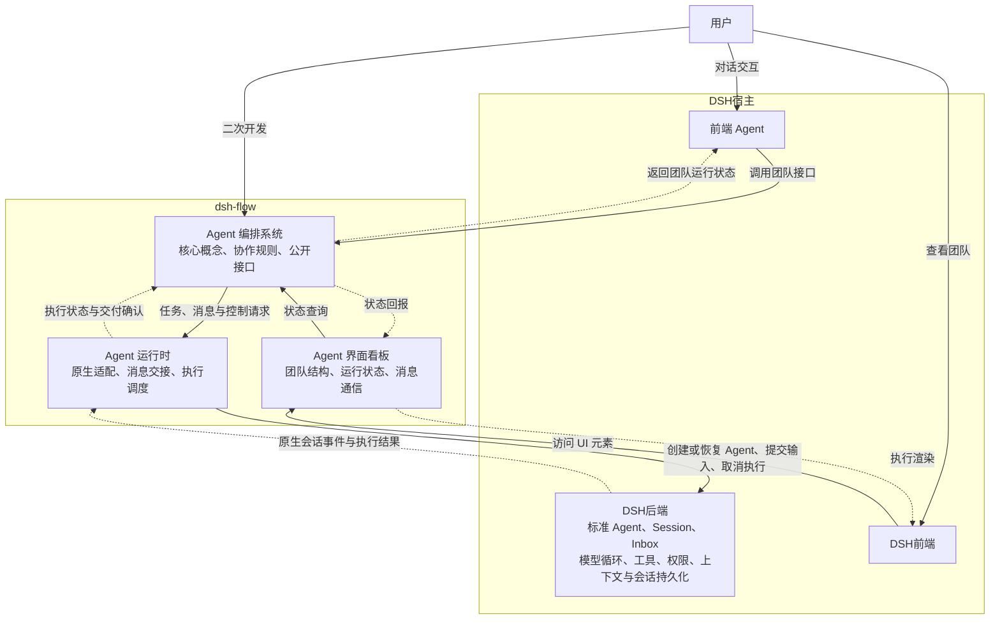

# dsh-flow 设计文档

本文档记录了对 dsh-flow 的整体架构设计，作为本仓库最高可信设计决策来源。除用户明确要求外，agent 不得修改本文档。在与其他文档、代码等冲突时，以本文档定义为准。

- [dsh-flow 设计文档](#dsh-flow-设计文档)
  - [总体定位](#总体定位)
  - [架构设计](#架构设计)
    - [Agent 编排系统](#agent-编排系统)
      - [Agent 智能体](#agent-智能体)
      - [`AgentProfile`: Agent 身份信息](#agentprofile-agent-身份信息)
      - [`AgentStatus`: Agent 运行状态](#agentstatus-agent-运行状态)
      - [`Group`: 群聊](#group-群聊)
      - [`Message`: 信息](#message-信息)
      - [`Signal`: 信号量](#signal-信号量)
    - [Agent 运行时](#agent-运行时)
      - [Mailbox](#mailbox)
      - [Context 上下文](#context-上下文)
      - [HostAdaptor 宿主适配器](#hostadaptor-宿主适配器)
    - [Agent 界面看板](#agent-界面看板)

> [!NOTE]
> Agent 使用该文档的方式
> - 将该文档作为最高可信来源，查阅概念定义和架构设计
> - 提示用户本文档需要增订或明确的部分
> - 在用户显式要求时参与该文件的修订


## 总体定位

dsh-flow 旨在扩展 dsh 中标准智能体团队的能力，提供预置的 agent 组织模板、agent 团队可视化面板以及共性 agent 团队运行时基础设施，方便用户在处理复杂任务时直接复用成熟的 agent 团队组织形式，降低 agent 团队组织架构决策难度，复用已有研究的经验成果。在此基础上，dsh-flow 提供了高度抽象的公开接口，用户可通过公开接口设计自己的团队编排，并与其他系统部分合作，以此扩展插件的现有模式。

## 架构设计

dsh-flow 包括三个方面：面向用户的界面看板，后端 agent 运行时，以及 agent 编排系统。其中，看板系统负责与 dsh 前端界面交互，在前端上显示当前智能体团队运行状态，并响应用户交互请求；agent 编排系统负责决策团队架构方案，与用户主 agent 交互完成任务分解和团队构建；最后是后端 agent 运行时，该层次将 agent 团队编排转译为 dsh 原生 agent 的业务请求，并维护团队特有的运行状态。

本文中的接口统一遵循以下对象传递约定：

- 同一运行环境内的接口调用直接传递对象引用，不因传参或返回而复制对象，也不因此转移对象的生命周期管理权。
- ID 用于持久化、序列化、外部寻址及跨实例恢复时的稳定身份。仅为有这些需求的实体定义业务 ID，不为所有运行时对象分配通用 ID。
- 除接口另有说明，返回对象列表时只创建数组容器的副本，列表元素仍引用原对象；接收并长期保存调用方的数组时，也应隔离数组容器。需要隔离的消息内容、已读状态等数据由对应模块显式创建记录或快照。
- 对象释放通过生命周期接口显式完成，不依赖垃圾回收。释放不会使调用方已有的引用自动变成空值，对象应自行拒绝关闭后的执行及变更操作。



### Agent 编排系统

Agent 编排系统是 dsh-flow 的核心组件，其定义了智能体等核心概念及其交互逻辑，概念清单如下：

#### Agent 智能体

- **定义**：Agent 是团队的基本组成单位，其在上层对应于一个用户可见的智能体对象，在底层对应于一个由 Flow 创建或恢复的 DSH 原生 Agent。宿主主 Agent 作为编排接口的外部调用方，其创建的顶层 Flow Agent 的父级为 `null`。
- **接口**：Agent 支持以下公开接口：
  - 基础信息查询类：
    - `getProfile() -> Readonly<AgentProfile>`: 获取 Agent 的只读身份信息引用，身份信息在该实例生命周期内保持不变
    - `getParent() -> Agent | null`: 获取父 Agent 的对象引用，根 Agent 返回 `null`
    - `getChildren() -> Agent[]`: 获取子 Agent 的对象列表，可以为空；返回数组容器副本，元素为当前子 Agent 的引用
  - 状态信息查询类：
    - `getStatus() -> AgentStatus`: 获取 Agent 运行状态
  - 通信类：
    - `recvSignal(s: Signal)`: 接收一个信号
    - `recvMessage(m: Message)`: 接收一个消息
    - `joinGroup(g: Group)`: 加入一个群聊，由 Group 对象在创建时调用
    - `quitGroup(g: Group)`: 退出一个群聊，由 Group 对象在销毁时调用
  - 生命周期类：
    - 静态异步工厂 `Agent.create(ctx: Context, p: AgentProfile, parent: Agent | null, initmsg: Message, history?: string) -> Promise<Agent>`: 通过身份信息、父 Agent 对象和初始消息创建 Agent，可选传递序列化的历史上下文；根 Agent 的父级为 `null`
    - 静态异步工厂 `Agent.resume(ctx: Context, parent: Agent | null, session: SessionID) -> Promise<Agent>`: 通过持久化会话 ID 恢复为新的 Agent 实例，父级直接使用对象引用；旧实例的引用不会自动指向恢复后的新实例
    - 析构函数。Agent 总是遵循持久化语义，析构函数会调用宿主的持久化接口完成 session 导出
    - `fork() -> Promise<Agent>`：以自身为母版创建一个子 Agent，继承当前对话上下文及配置，但不包含通信关系。对话通过显式快照导入新会话，子 Agent 使用新的 `sessionID`、独立的运行状态和 Mailbox；不可变配置可复用引用
    - `herb(agent: Agent) -> Promise<Agent>`: 以自身为母版创建一个子 Agent，其上下文由自己的上下文与传入 Agent 的上下文快照共同组成；参数和异步结果均为 Agent 对象，子 Agent 的会话、运行状态与 Mailbox 独立
    - `kill(agent: Agent)`: 销毁一个子 Agent
    - `transfer(child: Agent, adopt: Agent)`: 将一个子 Agent 转移给另一个 Agent 

Agent 内部持有宿主适配器返回的 `HostAgent` 对象，并将该对象传给宿主执行接口；`getProfile()` 复用其 `profile` 引用，编排层仍使用上层 Agent 对象。Agent 的注册、父子关系和 Group 成员关系均使用对象引用，序列化这些关系时才转换为业务 ID。

Agent 的构造函数为内部实现，不提供公开的同步构造入口。上述异步工厂及 `fork/herb` 成功返回时，宿主实例、Mailbox、工具绑定和事件监听均已就绪，父子关系及 Context 登记已完成，调用方可直接使用返回的 Agent，无需再次等待 `ready()` 或手动登记。初始化完成前，不将该 Agent 发布到 Context 注册表或父 Agent 的子列表。

`Agent.create` 在初始化及登记完成后提交 `initmsg`，等待宿主接管该输入后返回，不等待模型完成首轮执行；不得在宿主初始化回调内提前启动首轮。工厂失败时，撤销本次新增的登记、父子关联、Mailbox、工具绑定和监听，并释放本次创建或恢复的宿主实例，清理后再拒绝 Promise。

#### `AgentProfile`: Agent 身份信息

- **定义**：AgentProfile 是 Agent 身份信息的描述，其在 Agent 创建阶段确定，伴随 Agent 整个生命周期。创建时根据输入字段显式建立独立的只读身份记录，后续查询共享同一份记录的引用
- **成员**：AgentProfile 包含以下成员：
  - `role`: Agent 身份描述，一段提示词
  - `sessionID: SessionID`: Agent 会话的稳定身份，用于持久化、恢复及外部寻址；运行时调用已有 Agent 时直接使用对象
  - `permission`: Agent 权限，目前包括 只读、工作区内读写、完全访问 3 类基础权限
  - `name`: Agent 名字，一个用于呈现在前端界面上的用户友好的名字

#### `AgentStatus`: Agent 运行状态

目前包含 运行中、等待中、空闲、已终止 4 种基本状态，其中：

- 运行中代表 Agent 正在工作
- 等待中代表 Agent 被其他事件阻塞
- 空闲代表 Agent 实例存活，但没有进一步的工作请求
- 已终止代表 Agent 实例已销毁，与其相关的运行时基础设施均已停止；重启时需要重新加载这些基础设施

Agent 的状态转移是原子的、瞬时的，无论状态转移操作本身是否是原子的、瞬时的。对于状态转移操作，首先需要原子地将 Agent 状态置为目标状态，之后再执行实际的状态转移操作；对于单个 Agent 而言，状态转移操作是串行的，即在上个状态转移操作完成之前，下一个操作处于阻塞状态。

#### `Group`: 群聊

群聊是区别于点对点通信的另一种区域通信形式，加入群聊的各个 Agent 均可见其他 Agent 在群聊中发送的所有消息，每个 Agent 只能看见自己加入后的新增消息。此外，群聊还有一块共享式的信息区域**黑板（blackboard）**，Agent 可抢占式在现有内容上追加。Group 提供以下接口：

- 构造函数`construct(ctx: Context, members: Agent[])`：传入一组 Agent 对象，保存成员数组的副本，成员仍引用原对象，调用各自的 `joinGroup` 完成构造
- `getID() -> GroupID`: 获取当前群聊的稳定归档标识；创建时分配，用于持久化、历史查询和外部寻址，运行时加入群聊或发消息直接使用 Group 对象
- 析构函数：解散当前 Group，调用所有成员 Agent 的 `quitGroup` 函数。Group 也遵循持久化语义，在群聊解散后，原有消息仍可查看，但无法向其中发送新的消息，也无法恢复群聊。
- `postMessage(source: Agent, m: Message)`: 向群聊中发送一条消息。`source` 为发送者对象，未在群聊中的成员会发送失败
- `postToBlackboard(source: Agent, m: Message)`: 向黑板上追加一条独立的消息数据记录，来源 Agent、Group 保留对象引用。`source` 为发送者对象，未在群聊中的成员会发送失败
- `readBlackboard(t?: Timestamp) -> Message[]`: 获取黑板上的消息数据快照，避免调用方修改黑板内的记录；来源 Agent、Group 仍保留原对象引用。`t` 为可选参数，提供时返回该时间戳之后的信息，否则返回所有信息
- `hasNewMsgOnboard(t: Timestamp) -> bool`: 查询时间戳之后黑板内容是否有更新

注意，黑板信息读写接口采用 Message 对象是为了简化实现，其中保存的对象的读取状态相关信息无意义，信息的使用者需要注意这一点。

`GroupID` 在当前插件的持久化存储中唯一且不复用；群聊解散后，该 ID 仍标识原有归档，不代表存在可继续收发消息的 Group 实例。

#### `Message`: 信息

`Message`建模了当前系统内的单条信息，是信息传递的基本单位，具体包括以下字段：

- `source: Agent | AgentInGroup | System | User`: 信息的来源，可以是用户、单个 Agent、一个群聊中的 Agent 或者系统运行时。其中 `AgentInGroup = { agent : Agent, g: Group }`, `System, User`为描述符
- `timestamp`: 消息发出的时间戳
- `read`: 是否被接收方已读，该状态由接收方修改
- `read_timestamp`: 消息被首次读取的时间戳
- `summary`: 消息摘要，不超过 50 个字符
- `payload`: 具体的消息内容

`source` 中的 Agent、Group 均为运行时对象引用。序列化消息时，将这些引用转换为 `SessionID`、`GroupID` 及展示来源所需的信息快照，不递归序列化对象本体。归档数据是独立的数据表示，历史展示不要求原 Agent、Group 仍然存活。`read` 和 `read_timestamp` 属于接收方的消息记录，同一消息被多个 Mailbox 接收时，各自创建记录，不共享这两个字段的可变状态。

创建消息数据快照时，显式复制消息字段及 `AgentInGroup` 等来源描述容器，容器中的 Agent、Group 仍引用原对象；不可变内容可共享，可变的 `payload` 应显式隔离。这一规则同时适用于 Mailbox 和 Group 黑板的存入与读取。

#### `Signal`: 信号量

信号量是一种特殊的信息，其表征了一些预定义的、Agent 需要立刻无条件相应的信息，例如立刻停止当前轮次、立即销毁自身等。这类信息具有最高优先级，且可在 Agent 运行过程中被插入，Agent 需要立刻中断并跳转到对应的信号处理程序中。当前预定义的信号量有：

- `SIGKILL`: 立刻终止 Agent 及其所有子 Agent。该信号立刻递归传递给所有子 Agent
- `SIGTERM`: Agent 需要在完成当前轮次后终止自身及所有子 Agent。该信号立刻递归传递给所有子 Agent

### Agent 运行时

Agent 运行时负责将上层的编排语义转译为 dsh 原生 agent 模型上，并维护整体运行状态、记录各上层对象的运行信息、维持交互语义约束，具体包括如下概念：

#### Mailbox

Mailbox 是 Agent 用于接受并存储消息的容器，其按时间顺序依次排列所有接受到的消息，并支持按来源、按时间范围、按已读状态等多种方式检索消息；批量检索时默认采用 peak 语义，即可以读到元信息，不返回完整信息，且不改变已读状态，在采用 get 语义时，返回完整信息并将状态改为已读。此外，Agent 可为自己的 Mailbox 设置过滤规则，默认 drop 掉匹配规则的信息。其包括的接口如下：

- 生命周期类：
  - 构造函数 `construct()`: 创建 Mailbox，初始消息列表与过滤规则均为空
  - 析构函数：停止接收消息，释放 Mailbox 占用的运行时资源
- 消息接收类：
  - `put(m: Message) -> MessageID | null`: 接收一条消息，先检查过滤规则；命中任一规则时丢弃并返回 `null`，否则保存消息并返回其在当前 Mailbox 内的唯一标识。该接口由所属 Agent 的 `recvMessage` 调用，返回仅表示收件完成
- 消息检索类：
  - `peak(id: MessageID) -> MessageMeta | null`: 获取指定消息的元信息，不返回 `payload`，不改变已读状态；消息不存在时返回 `null`
  - `get(id: MessageID) -> Message | null`: 获取指定消息的完整内容，并将其标记为已读；首次读取时记录 `read_timestamp`，再次读取时保持该时间戳不变；消息不存在时返回 `null`
  - `getLastUnread() -> Message | null`: 获取当前排序中最后一条未读消息的完整内容，并执行与 `get(id)` 相同的已读更新；没有未读消息时返回 `null`
  - `getUnread() -> IterableIterator<Message>`: 返回未读消息的迭代器，按时间从早到晚逐条返回完整消息。迭代范围在创建时确定，不包含之后收到的消息；创建迭代器不改变已读状态，每次产出消息时执行与 `get(id)` 相同的已读更新，跳过已被其他读取操作标记为已读的消息。未迭代到的消息保持原状态，没有可返回消息时迭代结束
  - `query(q?: MailboxQuery, mode?: 'peak' | 'get') -> MessageMeta[] | Message[]`: 通过回调函数批量筛选消息，未提供 `q` 时匹配全部消息。`mode` 默认为 `peak`，返回元信息列表；采用 `get` 时返回完整消息列表，并对本次返回的消息执行与 `get(id)` 相同的已读更新。无匹配消息时返回空列表
  - `count(q?: MailboxQuery) -> number`: 统计回调函数匹配的消息数量，未提供 `q` 时统计全部消息，不改变已读状态
- 过滤规则配置类：
  - `setFilters(rules: MessageFilter[])`: 整体替换当前过滤规则，仅作用于此后接收的消息；传入空列表时取消全部过滤规则
  - `getFilters() -> MessageFilter[]`: 获取当前过滤规则列表的副本

上述接口使用以下参数与返回类型：

- `MessageID`: Mailbox 为每条已接收消息分配的稳定检索键，在当前 Mailbox 内唯一，用于从元信息或外部请求定位并读取完整消息。跨 Mailbox 寻址时还需指定所属 Mailbox；不为 Mailbox 对象本身另建通用 ID
- `MessageMeta`: 包含 `id`、`source`、`timestamp`、`read`、`read_timestamp` 和 `summary`，其中 `id` 为对应的 `MessageID`
- `MailboxQuery = (m: Readonly<Message>) -> bool`: 只读消息匹配回调，返回 `true` 表示将该消息纳入结果，返回 `false` 表示排除。调用方可在回调中组合来源、时间范围、已读状态等条件；执行回调本身不改变消息的已读状态
- `MessageFilter = (m: Readonly<Message>) -> bool`: 只读过滤函数，返回 `true` 表示匹配并丢弃该消息；多条规则之间采用“或”关系

消息按 `timestamp` 从早到晚排序，时间戳相同时按接收顺序排列。每个 Mailbox 独立保存消息及其已读状态，入箱时 `read` 为 `false`、`read_timestamp` 为空，因此同一条群聊消息在不同 Agent 的 Mailbox 中可具有不同的已读状态。检索返回消息快照；`get`、`getLastUnread` 和 `query(..., 'get')` 的消息选择、已读更新及返回快照的生成作为一次原子操作完成。`getUnread` 对每次迭代产出的单条消息执行同样的原子操作，只更新实际返回的消息。

上述记录及快照由 Mailbox 按 Message 的快照约定显式创建。查询与过滤回调不得修改消息及其嵌套数据；`Readonly<Message>` 表达只读约束，不会自动冻结或复制数据。过滤规则列表复制数组容器，列表中的回调函数仍为原函数引用。

`Signal` 由 Agent 的 `recvSignal` 接口直接处理，不经过普通消息的入箱与过滤流程。


#### Context 上下文

上下文集中记录当前系统中的 Agent、Group、Mailbox、宿主上下文及宿主适配器，并管理插件所拥有对象的生命周期。注册、枚举和释放均直接使用对象引用；对于需要从持久化数据或外部请求定位的 Agent、Group，提供按业务 ID 查找活跃对象的入口。

Context 提供以下接口：

- 生命周期类：
  - 构造函数 `construct()`: 创建空的对象注册表，尚未绑定宿主适配器
  - `dispose() -> Promise<void>`: 关闭当前 Context，停止接收新的注册与创建请求，解散 Group，释放 Agent 及其 Mailbox，最后释放宿主适配器。完成表示当前 Context 管理的运行时资源均已释放，必要的持久化写入已完成；重复调用等待同一次关闭操作
- 宿主注册与查询类：
  - `registerHostAdaptor(adaptor: HostAdaptor) -> void`: 在后端启动阶段保存适配器对象引用，同时将其提供的 `host` 登记为借用的宿主上下文，不分配 ID。每个 Context 绑定一个适配器；重复注册同一实例不执行额外操作，注册另一实例则报错。注册完成后，Agent 才可创建或恢复
  - `getHostAdaptor() -> HostAdaptor`: 返回注册时传入的同一适配器对象；尚未注册或 Context 已关闭时调用失败
  - `getHostContext() -> HostContext`: 获取适配器对应的宿主上下文，供后端集成代码使用；上层 Agent 的执行操作通过 `getHostAdaptor()` 完成
- 对象注册与查询类：
  - `register(obj: Agent | Group | Mailbox) -> void`: 同步登记一个已完成初始化的对象引用，并显式由 Context 接管其生命周期；Agent 及其 Mailbox 由异步工厂负责登记。重复登记同一实例不执行额外操作，拒绝已由其他 Context 管理的对象。Agent 的 `sessionID` 和 Group 的 `GroupID` 均不得被当前 Context 中另一已登记的同类对象占用
  - `has(obj: ContextObject) -> bool`: 按对象身份检查该实例是否仍已登记且未进入释放流程，不通过字段内容判断两个对象相等
  - `getAgent(session: SessionID) -> Agent | null`: 根据会话 ID 查找当前已登记且未进入释放流程的 Agent；未找到时返回 `null`，不隐式创建或恢复实例
  - `getGroup(id: GroupID) -> Group | null`: 根据归档标识查找当前活跃的 Group；未找到或群聊已解散时返回 `null`，历史归档查询由持久化层处理
  - `list(q?: (obj: ContextObject) -> bool) -> ContextObject[]`: 返回当前已登记且未进入释放流程的对象列表；数组容器为副本，元素保留原引用。可用只读回调筛选，未提供回调时返回全部对象
- 对象释放类：
  - `release(obj: Agent | Group | Mailbox) -> Promise<void>`: 按对象引用释放当前 Context 管理的实例，完成后移除登记；释放不属于当前 Context 的对象时失败，重复释放同一实例不重复析构。释放 Agent 时同步处理其持有的 Mailbox 及子 Agent，群聊关系按 Agent、Group 的接口约定解除。宿主适配器仅在 Context 整体关闭时释放

上述接口使用以下类型：

- `ContextObject = Agent | Group | Mailbox | HostContext | HostAdaptor`: Context 可登记的对象类型
- `HostContext`: 宿主后端提供的原生上下文对象，其具体类型由后端实现确定；Flow 将其作为不透明引用保存

Agent 恢复后，原 `SessionID` 可查找到新登记的 Agent，但已释放实例的引用仍指向旧对象。对象登记及业务 ID 索引更新是原子操作；异步释放期间，对象拒绝新的执行及变更请求。Context 借用宿主上下文，不负责关闭宿主进程或主会话；Agent 析构涉及的持久化由宿主适配器完成。

#### HostAdaptor 宿主适配器

宿主适配器提供了对宿主后端的一种统一抽象，使得中端 agent team 语义与实际的宿主接口相隔离，以便当前插件可适配多种后端实现，如 DSH、Pi Agent、Codex Agent SDK等。

`HostAdaptor` 定义为接口，不提供构造函数或具体的宿主实现。各后端 harness 分别提供实现类，例如 `DshHostAdaptor implements HostAdaptor`、`PiHostAdaptor implements HostAdaptor`、`CodexHostAdaptor implements HostAdaptor`。实现类接收各自的原生宿主上下文，在后端启动时实例化并注册到 Context。以下为统一接口设计，不代表各后端目前均已实现这些能力。

- 宿主信息类：
  - `readonly backend: string`: 后端类型标识，例如 `dsh`、`pi`、`codex`
  - `readonly host: HostContext`: 当前实现绑定的原生宿主上下文，供 Context 登记；不向上层暴露可操作的原生 Agent 句柄
- Agent 生命周期类：
  - `createAgent(p: AgentProfile, parent?: HostAgent, history?: string) -> Promise<HostAgent>`: 按身份信息创建原生 Agent，使用 `p.sessionID` 作为新会话的持久化身份，父级直接传入已有 HostAgent 对象，可选导入已有上下文。返回初始化完成的 HostAgent 对象，其会话、配置、权限和工具均已就绪，可接收输入；此时尚未提交初始消息。若会话已存在则失败，恢复已有会话应调用 `resumeAgent`
  - `resumeAgent(session: SessionID, parent?: HostAgent) -> Promise<HostAgent>`: 从持久化会话 ID 恢复原生 Agent，返回新的 HostAgent 对象，保存的身份信息通过其 `profile` 获取。恢复对话历史和必要配置，重新安装工具、权限与运行时设施；完成后可接收输入。会话不存在或已有活跃实例时失败，不能重复创建同一会话的执行实例
  - `releaseAgent(agent: HostAgent, mode?: 'immediate' | 'after-turn') -> Promise<void>`: 释放本适配器创建或恢复的指定 HostAgent 对应实例。先停止接纳新输入；`immediate` 取消当前执行，`after-turn` 等当前轮次结束且不再启动后续轮次，已经空闲时无需等待；之后完成会话持久化并释放原生句柄。默认采用 `immediate`。完成表示释放流程已结束，重复调用不重复释放
  - `dispose() -> Promise<void>`: 释放适配器创建或恢复的全部 Agent 及相关事件监听，释放适配器自身资源；不销毁 `host`。由 Context 关闭流程最后调用
- 输入与执行查询类：
  - `send(agent: HostAgent, m: Message, mode?: 'followup' | 'steer' | 'notice') -> Promise<void>`: 将消息转换为指定 HostAgent 的宿主输入。`followup` 在下一轮次处理并唤醒空闲 Agent，`steer` 在下一可接收输入的执行步骤处理并唤醒空闲 Agent，`notice` 插入后续执行步骤但不主动唤醒；默认采用 `followup`。完成仅表示宿主已接管输入，不表示模型已读取或任务已完成，也不修改 Mailbox 的已读状态
  - `getStatus(agent: HostAgent) -> 'idle' | 'running'`: 查询指定 HostAgent 的原生执行状态；不属于当前适配器或已释放的对象查询失败。Flow 的“等待中”“已终止”等状态由上层 Agent 自行维护
  - `whenIdle(agent: HostAgent) -> Promise<void>`: 等待指定 HostAgent 当前的原生执行及相关维护操作结束。期间若有新输入继续触发执行，则继续等待，因此该接口不能单独用于实现“当前轮次结束后终止”
- 会话持久化与上下文导出类：
  - `persist(agent: HostAgent) -> Promise<void>`: 将该对象对应会话中调用时已记录的事件及恢复所需的身份、配置元信息写入持久化存储；实现内部使用 `agent.profile.sessionID` 定位存储。完成表示这些内容已写入完成，不隐含停止 Agent
  - `exportHistory(agent: HostAgent) -> Promise<string>`: 导出该对象对应会话的上下文快照，可传给 `createAgent`。返回值采用由适配器定义、带格式版本的序列化表示，包含对话历史及必要元信息；导出不改变原 Agent。正在进行的轮次按后端规则整理为可导入的快照，不直接复制执行栈或未完成的工具调用
- 事件观察类：
  - `subscribe(agent: HostAgent, listener: (event: Readonly<HostEvent>) -> void) -> (() -> void)`: 订阅指定 HostAgent 的后续事件，返回取消订阅函数，不重放历史。适配器按原生事件顺序通知；监听回调仅用于观察，回调异常不改变原生执行结果。释放 HostAgent 时自动取消相应订阅

上述接口使用以下类型与约定：

- `HostAgent`: 宿主无关的运行时对象接口，由具体适配器通过 `createAgent/resumeAgent` 创建并返回，公开只读字段 `readonly profile: Readonly<AgentProfile>`，供调用方读取身份信息。它与一个原生 Agent 实例对应，具体原生对象、句柄及所有权记录封装在适配器实现内部，不由调用方拼装，也不重复登记到 Context
- `SessionID`: 当前宿主持久化存储内的稳定会话标识；适配器内部负责转换为后端的原生 ID 类型
- `HostEvent`: 包含 `agent: HostAgent`、`timestamp` 和 `type`，其中 `agent` 为触发事件的同一运行时对象。`type = 'status'` 时携带 `status: 'idle' | 'running'`；`type = 'output'` 时携带一条已完成的助手输出 `text: string`；`type = 'turn-end'` 时携带 `reason: 'completed' | 'cancelled' | 'failed'`；`type = 'error'` 时携带错误描述 `message: string`。事件写入日志或跨通信边界传输时，将对象引用转换为 `agent.profile.sessionID`
- `history` 是适配器可识别的上下文交换格式，不是任意拼接的宿主事件日志。实现方应校验来源和格式版本；导入历史时，新会话身份以创建参数为准，不沿用历史所属会话的 ID。跨后端导入不在当前统一契约中保证

适配器按 HostAgent 的对象身份验证其归属与生命周期，拒绝其他适配器的对象以及已释放对象的新执行请求。即使新旧对象具有相同的 `sessionID`，也不能通过旧引用操作恢复后的新实例。持有 HostAgent 引用不改变原生实例的所有权，原生实例由创建或恢复它的适配器负责释放。

HostAdaptor 只操作单个原生 Agent，不负责父子树的递归信号传播、Group 通信或 Mailbox 过滤。上层 Agent 将 `SIGKILL`、`SIGTERM` 分别转译为 `releaseAgent(hostAgent, 'immediate')`、`releaseAgent(hostAgent, 'after-turn')`，并负责向子 Agent 传播。释放完成必须包含持久化完成，不能将“已发出取消请求”视为释放完成。宿主不具备所需的持久化或权限能力时，实现应明确报错，不得静默降低接口语义。原生会话恢复不自动恢复 Flow 的群聊关系、Mailbox 已读状态等协作数据。

后端启动时的装配过程如下，其中具体实现类的构造方式由各后端自行决定：

```typescript
const ctx = new Context();
const adaptor: HostAdaptor = new DshHostAdaptor(dshContext);
ctx.registerHostAdaptor(adaptor);

// Agent 仅依赖 Context 和 HostAdaptor 接口。
const agent = await Agent.create(ctx, profile, null, initialMessage);
// 返回时初始化及登记已完成，初始输入已由宿主接管。
```

DSH 实现可通过 `dshContext.agents.create/resume` 创建或恢复 Agent，将三种输入模式映射为原生 `followup/steer/inject`，通过会话持久化接口完成写入，并由持有的 `AgentHandle` 释放实例。具体后端类型、句柄和事件格式均封装在实现类内部。

### Agent 界面看板

Agent 界面看板提供了一个智能体标签页，用户可以在此标签页中直观查看当前已派发的智能体团队架构、智能体运行状态及消息通信情况，具体包含以下设计要素：
