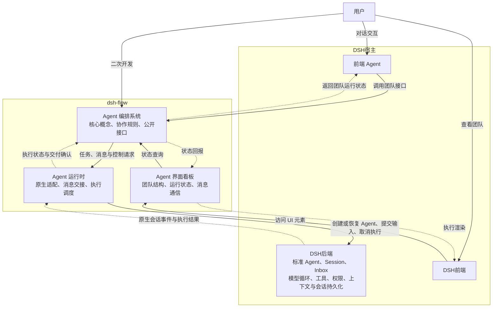

# dsh-flow 设计文档

本文档记录了对 dsh-flow 的整体架构设计，作为本仓库最高可信设计决策来源。除用户明确要求外，agent 不得修改本文档。在与其他文档、代码等冲突时，以本文档定义为准。

- [dsh-flow 设计文档](#dsh-flow-设计文档)
  - [总体定位](#总体定位)
  - [架构设计](#架构设计)
    - [Agent 编排系统](#agent-编排系统)
      - [Agent 智能体](#agent-智能体)
      - [`AgentProfile`: Agent 身份信息](#agentprofile-agent-身份信息)
      - [`AgentStatus`: Agent 运行状态](#agentstatus-agent-运行状态)
      - [`Group`: 群聊](#group-群聊)
      - [`Message`: 信息](#message-信息)
      - [`Signal`: 信号量](#signal-信号量)
    - [Agent 运行时](#agent-运行时)
      - [Mailbox](#mailbox)
      - [Context 上下文](#context-上下文)
      - [HostAdaptor 宿主适配器](#hostadaptor-宿主适配器)
    - [Agent 界面看板](#agent-界面看板)

> [!NOTE]
> Agent 使用该文档的方式
> - 将该文档作为最高可信来源，查阅概念定义和架构设计
> - 提示用户本文档需要增订或明确的部分
> - 在用户显式要求时参与该文件的修订


## 总体定位

dsh-flow 旨在扩展 dsh 中标准智能体团队的能力，提供预置的 agent 组织模板、agent 团队可视化面板以及共性 agent 团队运行时基础设施，方便用户在处理复杂任务时直接复用成熟的 agent 团队组织形式，降低 agent 团队组织架构决策难度，复用已有研究的经验成果。在此基础上，dsh-flow 提供了高度抽象的公开接口，用户可通过公开接口设计自己的团队编排，并与其他系统部分合作，以此扩展插件的现有模式。

## 架构设计

dsh-flow 包括三个方面：面向用户的界面看板，后端 agent 运行时，以及 agent 编排系统。其中，看板系统负责与 dsh 前端界面交互，在前端上显示当前智能体团队运行状态，并响应用户交互请求；agent 编排系统负责决策团队架构方案，与用户主 agent 交互完成任务分解和团队构建；最后是后端 agent 运行时，该层次将 agent 团队编排转译为 dsh 原生 agent 的业务请求，并维护团队特有的运行状态。

本文中的接口统一遵循以下对象传递约定：

- 同一运行环境内的接口调用直接传递对象引用，不因传参或返回而复制对象，也不因此转移对象的生命周期管理权。
- ID 用于持久化、序列化、外部寻址及跨实例恢复时的稳定身份。仅为有这些需求的实体定义业务 ID，不为所有运行时对象分配通用 ID。
- 除接口另有说明，返回对象列表时只创建数组容器的副本，列表元素仍引用原对象；接收并长期保存调用方的数组时，也应隔离数组容器。需要隔离的消息内容、已读状态等数据由对应模块显式创建记录或快照。
- 对象释放通过生命周期接口显式完成，不依赖垃圾回收。释放不会使调用方已有的引用自动变成空值，对象应自行拒绝关闭后的执行及变更操作。



### Agent 编排系统

Agent 编排系统是 dsh-flow 的核心组件，其定义了智能体等核心概念及其交互逻辑，概念清单如下：

#### Agent 智能体

- **定义**：Agent 是团队的基本组成单位，其在上层对应于一个用户可见的智能体对象，在底层对应于一个由 Flow 创建或恢复的 DSH 原生 Agent。宿主主 Agent 作为编排接口的外部调用方，其创建的顶层 Flow Agent 的父级为 `null`。
- **接口**：Agent 支持以下公开接口：
  - 基础信息查询类：
    - `getProfile() -> Readonly<AgentProfile>`: 获取 Agent 的只读身份信息引用，身份信息在该实例生命周期内保持不变
    - `getParent() -> Agent | null`: 获取父 Agent 的对象引用，根 Agent 返回 `null`
    - `getChildren() -> Agent[]`: 获取子 Agent 的对象列表，可以为空；返回数组容器副本，元素为当前子 Agent 的引用
  - 状态信息查询类：
    - `getStatus() -> AgentStatus`: 获取 Agent 运行状态
  - 通信类：
    - `getMailbox() -> Mailbox`: 获取自身 Mailbox 的同一对象引用，供宿主适配器绑定消息读取、过滤和来源评级工具；不复制 Mailbox，也不转移其生命周期管理权
    - `recvSignal(s: Signal)`: 接收一个信号
    - `recvMessage(m: Message)`: 将消息交给自身 Mailbox，成功入箱后按消息优先级安排通知；被过滤的消息不通知模型。通知只提供消息提示，正文由模型通过读取工具按需获取
    - `joinGroup(g: Group)`: 加入一个群聊，由 Group 对象在创建时调用
    - `quitGroup(g: Group)`: 退出一个群聊，由 Group 对象在销毁时调用
  - 生命周期类：
    - 静态异步工厂 `Agent.create(ctx: Context, p: AgentProfile, parent: Agent | null, initmsg: Message, history?: string) -> Promise<Agent>`: 通过身份信息、父 Agent 对象和初始消息创建 Agent，可选传递序列化的历史上下文；根 Agent 的父级为 `null`
    - 静态异步工厂 `Agent.resume(ctx: Context, parent: Agent | null, session: SessionID) -> Promise<Agent>`: 通过持久化会话 ID 恢复为新的 Agent 实例，父级直接使用对象引用；旧实例的引用不会自动指向恢复后的新实例
    - 析构函数：结束 Agent 在 Flow 中的生命周期，清理其编排关系及运行时绑定。原生 Agent 的停止、持久化或保留由宿主适配器按后端能力实现，不作为逻辑终止的前提
    - `fork() -> Promise<Agent>`：以自身为母版创建一个子 Agent，继承当前对话上下文及配置，但不包含通信关系。对话通过显式快照导入新会话，子 Agent 使用新的 `sessionID`、独立的运行状态和 Mailbox；不可变配置可复用引用
    - `herb(agent: Agent) -> Promise<Agent>`: 以自身为母版创建一个子 Agent，其上下文由自己的上下文与传入 Agent 的上下文快照共同组成；参数和异步结果均为 Agent 对象，子 Agent 的会话、运行状态与 Mailbox 独立
    - `kill(agent: Agent)`: 终止一个子 Agent，并执行对应的生命周期清理
    - `transfer(child: Agent, adopt: Agent)`: 将一个子 Agent 转移给另一个 Agent 

Agent 内部持有宿主适配器返回的 `HostAgent` 对象，并将该对象传给宿主执行接口；`getProfile()` 复用其 `profile` 引用，编排层仍使用上层 Agent 对象。Agent 的注册、父子关系和 Group 成员关系均使用对象引用，序列化这些关系时才转换为业务 ID。

Agent 的构造函数为内部实现，不提供公开的同步构造入口。上述异步工厂及 `fork/herb` 成功返回时，宿主实例、Mailbox、工具绑定和事件监听均已就绪，父子关系及 Context 登记已完成，调用方可直接使用返回的 Agent，无需再次等待 `ready()` 或手动登记。初始化完成前，不将该 Agent 发布到 Context 注册表或父 Agent 的子列表。

工厂先在内部创建上层 Agent 和空 Mailbox，再将该 Agent 引用传给适配器的 `createAgent/resumeAgent`。此时 `getMailbox()` 已可用；适配器只取得对象引用并注册工具回调，不调用依赖 HostAgent 的 `getProfile()` 等接口，也不执行工具业务。适配器返回后，上层工厂保存 HostAgent、完成事件订阅、父子关系及 Context 登记。整个过程中使用同一个上层 Agent 和 Mailbox 对象。

`Agent.create` 在初始化及登记完成后提交 `initmsg`，等待宿主接管该输入后返回，不等待模型完成首轮执行；不得在宿主初始化回调内提前启动首轮。工厂失败时，撤销本次新增的登记、父子关联、Mailbox 和监听，并通过适配器清理本次创建或恢复实例的 Flow 绑定，按后端策略处理原生资源，清理后再拒绝 Promise。适配器初始化失败时，由适配器自行清理尚未返回实例的工具注册及关联资源。

#### `AgentProfile`: Agent 身份信息

- **定义**：AgentProfile 是 Agent 身份信息的描述，其在 Agent 创建阶段确定，伴随 Agent 整个生命周期。创建时根据输入字段显式建立独立的只读身份记录，后续查询共享同一份记录的引用
- **成员**：AgentProfile 包含以下成员：
  - `role`: Agent 身份描述，一段提示词
  - `sessionID: SessionID`: Agent 会话的稳定身份，用于持久化、恢复及外部寻址；运行时调用已有 Agent 时直接使用对象
  - `permission`: Agent 权限，目前包括 只读、工作区内读写、完全访问 3 类基础权限
  - `name`: Agent 名字，一个用于呈现在前端界面上的用户友好的名字

#### `AgentStatus`: Agent 运行状态

AgentStatus 表示 Flow 编排层的逻辑状态，不反映后端实例是否仍在线或实际清理是否完成。目前包含 运行中、等待中、空闲、已终止 4 种基本状态，其中：

- 运行中代表 Agent 正在工作
- 等待中代表 Agent 被其他事件阻塞
- 空闲代表 Agent 实例存活，但没有进一步的工作请求
- 已终止代表 Agent 在编排层已结束生命周期，不再接受新的业务请求或被消息唤醒；后端实例可以已经销毁，也可以继续保留在线

Agent 的状态转移是原子的、瞬时的，无论状态转移操作本身是否是原子的、瞬时的。对于状态转移操作，首先需要原子地将 Agent 状态置为目标状态，之后再执行实际的状态转移操作；对于单个 Agent 而言，状态转移操作是串行的，即在上个状态转移操作完成之前，下一个操作处于阻塞状态。

接收终止请求时，Agent 从运行中、等待中或空闲立即转为已终止，不增加“终止中”状态。后续的后端执行、清理进度或错误均不改变这一逻辑状态；原生状态事件不得将其重新置为运行中或空闲。生命周期接口的 Promise 表示约定的处理操作完成，不统一承诺后端实例已经物理销毁。

#### `Group`: 群聊

群聊是区别于点对点通信的另一种区域通信形式，加入群聊的各个 Agent 均可见其他 Agent 在群聊中发送的所有消息，每个 Agent 只能看见自己加入后的新增消息。此外，群聊还有一块共享式的信息区域**黑板（blackboard）**，Agent 可抢占式在现有内容上追加。Group 提供以下接口：

- 构造函数`construct(ctx: Context, members: Agent[])`：传入一组 Agent 对象，保存成员数组的副本，成员仍引用原对象，调用各自的 `joinGroup` 完成构造
- `getID() -> GroupID`: 获取当前群聊的稳定归档标识；创建时分配，用于持久化、历史查询和外部寻址，运行时加入群聊或发消息直接使用 Group 对象
- 析构函数：解散当前 Group，调用所有成员 Agent 的 `quitGroup` 函数。Group 也遵循持久化语义，在群聊解散后，原有消息仍可查看，但无法向其中发送新的消息，也无法恢复群聊。
- `postMessage(source: Agent, m: Message)`: 向群聊中发送一条消息。`source` 为发送者对象，未在群聊中的成员会发送失败
- `postToBlackboard(source: Agent, m: Message)`: 向黑板上追加一条独立的消息数据记录，来源 Agent、Group 保留对象引用。`source` 为发送者对象，未在群聊中的成员会发送失败
- `readBlackboard(t?: Timestamp) -> Message[]`: 获取黑板上的消息数据快照，避免调用方修改黑板内的记录；来源 Agent、Group 仍保留原对象引用。`t` 为可选参数，提供时返回该时间戳之后的信息，否则返回所有信息
- `hasNewMsgOnboard(t: Timestamp) -> bool`: 查询时间戳之后黑板内容是否有更新

注意，黑板信息读写接口采用 Message 对象是为了简化实现，其中保存的对象的读取状态相关信息无意义，信息的使用者需要注意这一点。

`GroupID` 在当前插件的持久化存储中唯一且不复用；群聊解散后，该 ID 仍标识原有归档，不代表存在可继续收发消息的 Group 实例。

#### `Message`: 信息

`Message`建模了当前系统内的单条信息，是信息传递的基本单位，具体包括以下字段：

- `source: Agent | AgentInGroup | System | User`: 信息的来源，可以是用户、单个 Agent、一个群聊中的 Agent 或者系统运行时。其中 `AgentInGroup = { agent : Agent, g: Group }`, `System, User`为描述符
- `timestamp`: 消息发出的时间戳
- `priority?: MessagePriority`: 接收方在入箱时根据自身的来源评级填写的本地优先级；尚未评级的来源按 `normal` 处理。发送方不决定该值，入站消息携带的 `priority` 不作为定级依据
- `read`: 是否被接收方已读，该状态由接收方修改
- `read_timestamp`: 消息被首次读取的时间戳
- `summary`: 消息摘要，不超过 50 个字符，统一用于优先消息与默认消息的通知
- `payload`: 具体的消息内容

`MessagePriority = 'normal' | 'high' | 'low'`，分别表示默认、优先、不重要。

`source` 中的 Agent、Group 均为运行时对象引用。序列化消息时，将这些引用转换为 `SessionID`、`GroupID` 及展示来源所需的信息快照，不递归序列化对象本体。归档数据是独立的数据表示，历史展示不要求原 Agent、Group 仍然存活。`priority`、`read` 和 `read_timestamp` 属于接收方的消息记录，同一消息被多个 Mailbox 接收时，各自创建记录；不同接收方可对同一来源给出不同评级，且不共享已读状态。

创建消息数据快照时，显式复制消息字段及 `AgentInGroup` 等来源描述容器，容器中的 Agent、Group 仍引用原对象；不可变内容可共享，可变的 `payload` 应显式隔离。这一规则同时适用于 Mailbox 和 Group 黑板的存入与读取。

消息优先级决定通知的时机与内容，不改变 Mailbox 内的时间排序。消息设计以尽量少干扰模型上下文为原则：通知不自动携带原消息的 `payload`，模型可按需读取正文。

#### `Signal`: 信号量

信号量是一种特殊的信息，其表征了一些预定义的、Agent 需要立即处理的控制请求。这类信息具有最高优先级，可在 Agent 运行过程中提交，由编排层立即更新逻辑状态并交给对应处理程序；原生执行的取消和清理由宿主适配器实现。当前预定义的信号量有：

- `SIGKILL`: 立即将 Agent 置为已终止，并采用 `immediate` 方式处理后端；该信号立即递归传递给所有子 Agent
- `SIGTERM`: 立即将 Agent 置为已终止，并采用 `after-turn` 方式保留当前轮次的收尾；该信号立即递归传递给所有子 Agent。等待轮次结束不延迟对外逻辑状态的变化

### Agent 运行时

Agent 运行时负责将上层的编排语义转译为 dsh 原生 agent 模型上，并维护整体运行状态、记录各上层对象的运行信息、维持交互语义约束，具体包括如下概念：

#### Mailbox

Mailbox 是 Agent 用于接受并存储消息的容器，其按时间顺序依次排列所有接受到的消息，并支持按来源、按时间范围、按已读状态等多种方式检索消息；批量检索时默认采用 peak 语义，即可以读到元信息，不返回完整信息，且不改变已读状态，在采用 get 语义时，返回完整信息并将状态改为已读。此外，Agent 可为自己的 Mailbox 设置过滤规则，默认 drop 掉匹配规则的信息。其包括的接口如下：

- 生命周期类：
  - 构造函数 `construct()`: 创建 Mailbox，初始消息列表、过滤规则与来源评级记录均为空
  - 析构函数：停止接收消息，释放 Mailbox 占用的运行时资源
- 消息接收类：
  - `put(m: Message) -> MessageID | null`: 接收一条消息，在不修改调用方对象的前提下，根据当前 Mailbox 对该来源的评级确定本地 `priority`，尚未评级时使用 `normal`，再检查过滤规则；命中任一规则时丢弃并返回 `null`，否则保存消息并返回其在当前 Mailbox 内的唯一标识。该接口由所属 Agent 的 `recvMessage` 调用，返回仅表示收件完成
- 消息检索类：
  - `peak(id: MessageID) -> MessageMeta | null`: 获取指定消息的元信息，不返回 `payload`，不改变已读状态；消息不存在时返回 `null`
  - `get(id: MessageID) -> Message | null`: 获取指定消息的完整内容，并将其标记为已读；首次读取时记录 `read_timestamp`，再次读取时保持该时间戳不变；消息不存在时返回 `null`
  - `getLastUnread() -> Message | null`: 获取当前排序中最后一条未读消息的完整内容，并执行与 `get(id)` 相同的已读更新；没有未读消息时返回 `null`
  - `getUnread() -> IterableIterator<Message>`: 返回未读消息的迭代器，按时间从早到晚逐条返回完整消息。迭代范围在创建时确定，不包含之后收到的消息；创建迭代器不改变已读状态，每次产出消息时执行与 `get(id)` 相同的已读更新，跳过已被其他读取操作标记为已读的消息。未迭代到的消息保持原状态，没有可返回消息时迭代结束
  - `query(q?: MailboxQuery, mode?: 'peak' | 'get') -> MessageMeta[] | Message[]`: 通过回调函数批量筛选消息，未提供 `q` 时匹配全部消息。`mode` 默认为 `peak`，返回元信息列表；采用 `get` 时返回完整消息列表，并对本次返回的消息执行与 `get(id)` 相同的已读更新。无匹配消息时返回空列表
  - `count(q?: MailboxQuery) -> number`: 统计回调函数匹配的消息数量，未提供 `q` 时统计全部消息，不改变已读状态
- 过滤规则配置类：
  - `setFilters(rules: MessageFilter[])`: 整体替换当前过滤规则，仅作用于此后接收的消息；传入空列表时取消全部过滤规则
  - `getFilters() -> MessageFilter[]`: 获取当前过滤规则列表的副本
- 来源评级配置类：
  - `getSourcePriority(source: Message['source']) -> MessagePriority | null`: 查询当前 Mailbox 对指定来源的评级；尚未评级时返回 `null`，与接收方主动选定的 `normal` 区分
  - `setSourcePriority(source: Message['source'], priority: MessagePriority) -> void`: 设置或调整当前 Mailbox 对该来源的评级，由接收方模型通过对应工具调用。新评级作用于此后接收的消息；已入箱消息保留接收时的评级，不因调整而重发通知

上述接口使用以下参数与返回类型：

- `MessageID`: Mailbox 为每条已接收消息分配的稳定检索键，在当前 Mailbox 内唯一，用于从元信息或外部请求定位并读取完整消息。跨 Mailbox 寻址时还需指定所属 Mailbox；不为 Mailbox 对象本身另建通用 ID
- `MessageMeta`: 包含 `id`、`source`、`timestamp`、`priority`、`read`、`read_timestamp` 和 `summary`，其中 `id` 为对应的 `MessageID`，`priority` 为入箱时确定的优先级
- `MailboxQuery = (m: Readonly<Message>) -> bool`: 只读消息匹配回调，返回 `true` 表示将该消息纳入结果，返回 `false` 表示排除。调用方可在回调中组合来源、时间范围、已读状态等条件；执行回调本身不改变消息的已读状态
- `MessageFilter = (m: Readonly<Message>) -> bool`: 只读过滤函数，返回 `true` 表示匹配并丢弃该消息；多条规则之间采用“或”关系

消息按 `timestamp` 从早到晚排序，时间戳相同时按接收顺序排列。每个 Mailbox 独立保存来源评级、消息及其已读状态，入箱时 `read` 为 `false`、`read_timestamp` 为空，因此同一条群聊消息在不同 Agent 的 Mailbox 中可具有不同的优先级和已读状态。检索返回消息快照；`get`、`getLastUnread` 和 `query(..., 'get')` 的消息选择、已读更新及返回快照的生成作为一次原子操作完成。`getUnread` 对每次迭代产出的单条消息执行同样的原子操作，只更新实际返回的消息。

上述记录及快照由 Mailbox 按 Message 的快照约定显式创建。查询与过滤回调不得修改消息及其嵌套数据；`Readonly<Message>` 表达只读约束，不会自动冻结或复制数据。过滤规则列表复制数组容器，列表中的回调函数仍为原函数引用。

来源评级按现有 `source` 识别来源：单个 Agent 按对象身份匹配；`AgentInGroup` 按 Agent 与 Group 的对象组合匹配；`User` 与 `System` 分别按其来源类别匹配，不依赖消息快照中来源描述容器的地址。

**消息通知规则**：Mailbox 负责保存、过滤与检索；所属 Agent 负责通知调度，并通过 HostAdaptor 向模型提交通知。`recvMessage` 成功入箱后，按以下规则处理：

首次收到并接受某个尚未评级来源的消息时，先按 `normal` 的时机通知。该来源首次实际发出的通知同时要求接收方根据当前任务判断其重要性，并通过工具调用 `setSourcePriority`，明确提示“该来源的优先级后续可随时调整”。评级提示随原有通知一并发送，不单独启动评级轮次；同一批次内同一来源只提示一次。接收方尚未完成评级时，该来源继续按 `normal` 处理；首次提示被宿主接管后，后续通知不重复加入评级提示。已被过滤的消息不触发首次评级提示。

| 优先级 | 通知时机与方式 | 通知内容 |
| --- | --- | --- |
| `high`：优先 | 收到后立即以 `steer` 提交通知，不等待当前 turn 完成；空闲时唤醒 Agent | 逐条提供消息来源和摘要 |
| `normal`：默认 | 有正在执行的 turn 时，等该 turn 完成后汇总；原生 Agent 已空闲时立即汇总当前待通知消息。批次以 `followup` 启动下一轮 | 逐条提供消息来源和摘要 |
| `low`：不重要 | 与默认消息在同一批次、同一条通知中发送；只有不重要消息时也可形成批次 | 只报告不重要消息的数量，不列出其来源、摘要或正文 |

优先消息和默认消息采用相同的条目格式：`[消息ID] 来源：摘要`，摘要均取自 `summary`；消息 ID 供后续工具读取正文使用。不重要消息在批量通知中统一表示为 `不重要消息：N 条`。Agent 以 `System` 来源构造单独的通知 Message，其 `payload` 仅包含整理后的通知文本，直接提交给宿主，不重新进入 Mailbox。

通知进度由接收方 Agent 单独维护，不与 Mailbox 的 `read` 混用。每次汇总固定本次覆盖的消息范围，提交中的消息不重复纳入其他通知；通知被宿主接管后，只推进这些消息的通知进度，提交失败则保留其待通知状态。已经通知过的消息不因仍未读而在后续 turn 结束时反复提醒，新收到的消息进入后续批次。没有待通知消息时不发送空通知，也不启动额外轮次。发送通知及查看元信息均不修改已读状态；模型通过读取工具调用 `get`、`getLastUnread`、`getUnread` 或 `query(..., 'get')` 获取正文时，按原有约定更新已读状态。

这里的“立即”表示立即提交 `steer`，模型仍在宿主允许的下一执行步骤边界接收通知。“turn 完成”以 HostAdaptor 的 `turn-end` 事件为准。DSH 适配器将已记录的原生 `turn/end` 映射为该事件；所属 Agent 据此安排批量通知，在原生事件发布与轮次收尾完成后异步提交。不能用结束前的 `agent/turn-stopping` 钩子代替，否则其中的 `steer` 会延长当前轮次。批量通知提交后不等待下一轮执行完成。

原生 Agent 已空闲时，默认消息与不重要消息采用同一批次规则：立即合并当前待通知消息，通过 `followup` 启动一轮；只有不重要消息时，通知仅包含数量。同一批次最多提交一次，不为批次中的每条消息分别启动轮次。开始终止或释放的 Agent 停止生成新通知，通知不会重新唤醒正在关闭的实例。

`Signal` 由 Agent 的 `recvSignal` 接口直接处理，不经过普通消息的入箱与过滤流程。


#### Context 上下文

上下文集中记录当前系统中的 Agent、Group、Mailbox、宿主上下文及宿主适配器，并管理插件所拥有对象的生命周期。注册、枚举和释放均直接使用对象引用；对于需要从持久化数据或外部请求定位的 Agent、Group，提供按业务 ID 查找活跃对象的入口。

Context 提供以下接口：

- 生命周期类：
  - 构造函数 `construct()`: 创建空的对象注册表，尚未绑定宿主适配器
  - `dispose() -> Promise<void>`: 关闭当前 Context，停止接收新的注册与创建请求，解散 Group，释放 Agent 及其 Mailbox，最后释放宿主适配器。完成表示 Flow 管理的运行时资源及绑定已清理，适配器约定的后端处理已完成，不要求全部原生实例均被销毁；重复调用等待同一次关闭操作
- 宿主注册与查询类：
  - `registerHostAdaptor(adaptor: HostAdaptor) -> void`: 在后端启动阶段保存适配器对象引用，同时将其提供的 `host` 登记为借用的宿主上下文，不分配 ID。每个 Context 绑定一个适配器；重复注册同一实例不执行额外操作，注册另一实例则报错。注册完成后，Agent 才可创建或恢复
  - `getHostAdaptor() -> HostAdaptor`: 返回注册时传入的同一适配器对象；尚未注册或 Context 已关闭时调用失败
  - `getHostContext() -> HostContext`: 获取适配器对应的宿主上下文，供后端集成代码使用；上层 Agent 的执行操作通过 `getHostAdaptor()` 完成
- 对象注册与查询类：
  - `register(obj: Agent | Group | Mailbox) -> void`: 同步登记一个已完成初始化的对象引用，并显式由 Context 接管其生命周期；Agent 及其 Mailbox 由异步工厂负责登记。重复登记同一实例不执行额外操作，拒绝已由其他 Context 管理的对象。Agent 的 `sessionID` 和 Group 的 `GroupID` 均不得被当前 Context 中另一已登记的同类对象占用
  - `has(obj: ContextObject) -> bool`: 按对象身份检查该实例是否仍已登记且未进入释放流程，不通过字段内容判断两个对象相等
  - `getAgent(session: SessionID) -> Agent | null`: 根据会话 ID 查找当前已登记且未进入释放流程的 Agent；未找到时返回 `null`，不隐式创建或恢复实例
  - `getGroup(id: GroupID) -> Group | null`: 根据归档标识查找当前活跃的 Group；未找到或群聊已解散时返回 `null`，历史归档查询由持久化层处理
  - `list(q?: (obj: ContextObject) -> bool) -> ContextObject[]`: 返回当前已登记且未进入释放流程的对象列表；数组容器为副本，元素保留原引用。可用只读回调筛选，未提供回调时返回全部对象
- 对象释放类：
  - `release(obj: Agent | Group | Mailbox) -> Promise<void>`: 按对象引用释放当前 Context 管理的实例，完成后移除登记；释放不属于当前 Context 的对象时失败，重复释放同一实例不重复析构。释放 Agent 时同步处理其持有的 Mailbox 及子 Agent，群聊关系按 Agent、Group 的接口约定解除。宿主适配器仅在 Context 整体关闭时释放

上述接口使用以下类型：

- `ContextObject = Agent | Group | Mailbox | HostContext | HostAdaptor`: Context 可登记的对象类型
- `HostContext`: 宿主后端提供的原生上下文对象，其具体类型由后端实现确定；Flow 将其作为不透明引用保存

Agent 恢复后，原 `SessionID` 可查找到新登记的 Agent，但已释放实例的引用仍指向旧对象。对象登记及业务 ID 索引更新是原子操作；异步释放期间，对象拒绝新的执行及变更请求。采用 `after-turn` 释放 Agent 时，保留关闭前已开始轮次所需的 Mailbox 和工具绑定，允许该轮次继续调用业务接口，结束后再清理；这一例外不改变其已终止的逻辑状态，也不允许 Flow 提交新输入或启动后续轮次。Context 借用宿主上下文，不负责关闭宿主进程或主会话；Agent 析构涉及的后端处理由宿主适配器决定。

#### HostAdaptor 宿主适配器

宿主适配器提供了对宿主后端的一种统一抽象，使得中端 agent team 语义与实际的宿主接口相隔离，以便当前插件可适配多种后端实现，如 DSH、Pi Agent、Codex Agent SDK等。

`HostAdaptor` 定义为接口，不提供构造函数或具体的宿主实现。各后端 harness 分别提供实现类，例如 `DshHostAdaptor implements HostAdaptor`、`PiHostAdaptor implements HostAdaptor`、`CodexHostAdaptor implements HostAdaptor`。实现类接收各自的原生宿主上下文及所属 Flow Context，在后端启动时实例化并注册到该 Context；具体构造方式由后端决定。以下为统一接口设计，不代表各后端目前均已实现这些能力。

模型工具的定义、参数说明、执行函数、注册与清理由具体适配器实现。工具执行函数将模型提供的可序列化参数转换为运行时调用，直接调用绑定的 Agent、Mailbox 等对象的公开接口，并将结果转换为宿主要求的返回格式。消息存取、来源评级、过滤和协作规则仍由这些业务对象实现；统一 HostAdaptor 接口不传递工具定义或工具执行函数。

- 宿主信息类：
  - `readonly backend: string`: 后端类型标识，例如 `dsh`、`pi`、`codex`
  - `readonly host: HostContext`: 当前实现绑定的原生宿主上下文，供 Context 登记；不向上层暴露可操作的原生 Agent 句柄
- Agent 生命周期类：
  - `createAgent(flowAgent: Agent, p: AgentProfile, parent?: HostAgent, history?: string) -> Promise<HostAgent>`: 为传入的上层 Agent 创建原生实例，使用 `p.sessionID` 作为新会话身份，支持持久化时亦以该身份定位存储；父级直接传入已有 HostAgent 对象，可选导入已有上下文。适配器通过 `flowAgent.getMailbox()` 取得其 Mailbox，在初始化阶段完成本后端工具注册，并将工具执行函数绑定到这些对象。返回初始化完成的 HostAgent 对象，其会话、配置、权限和工具均已就绪；此时尚未提交初始消息。若会话已存在则失败，恢复已有会话应调用 `resumeAgent`
  - `resumeAgent(flowAgent: Agent, session: SessionID, parent?: HostAgent) -> Promise<HostAgent>`: 为传入的新上层 Agent 从持久化会话恢复原生实例，返回新的 HostAgent 对象，保存的身份信息通过其 `profile` 获取。恢复对话历史和必要配置，重新安装工具、权限与运行时设施，并将工具回调绑定到传入的 `flowAgent` 及其 Mailbox，不复用旧实例的闭包或工具绑定。会话不存在或已有活跃实例时失败，不能重复创建同一会话的执行实例
  - `releaseAgent(agent: HostAgent, mode?: 'immediate' | 'after-turn') -> Promise<void>`: 结束指定 HostAgent 与 Flow 的执行关联，先停止接纳 Flow 的新输入。`immediate` 立即撤销当前轮次继续调用 Flow 业务的资格；`after-turn` 保留当前轮次的业务绑定，轮次结束后撤销，已经空闲时无需等待。原生执行的取消、会话持久化及实例销毁按具体后端策略处理；后端也可保留原生实例，使原生终止动作为空操作。适配器仍需撤销或禁用该实例与 Flow 的工具及事件绑定，并使旧 HostAgent 不再可用于执行。适配器不负责释放所引用的 Flow Agent 或 Mailbox，其生命周期仍由 Context 管理。默认采用 `immediate`。完成表示上述关联清理及所选后端处理已完成，不统一承诺原生实例已销毁或会话已持久化；重复调用不重复处理
  - `dispose() -> Promise<void>`: 清理适配器创建或恢复的全部 Agent 与 Flow 的执行关联及相关事件监听，按后端策略处理原生实例，释放适配器自身资源；不销毁 `host`。由 Context 关闭流程最后调用
- 输入与执行查询类：
  - `send(agent: HostAgent, m: Message, mode?: 'followup' | 'steer' | 'notice') -> Promise<void>`: 将消息转换为指定 HostAgent 的宿主输入，接收上层构造的初始输入或通知消息；该发送路径不为通知主动读取 Mailbox，也不按优先级调度通知。`followup` 在下一轮次处理并唤醒空闲 Agent，`steer` 在下一可接收输入的执行步骤处理并唤醒空闲 Agent，`notice` 插入后续执行步骤但不主动唤醒；默认采用 `followup`。完成仅表示宿主已接管输入，不表示模型已读取或任务已完成，也不修改 Mailbox 的已读状态
  - `getStatus(agent: HostAgent) -> 'idle' | 'running'`: 查询指定 HostAgent 的原生执行状态；不属于当前适配器或已释放的对象查询失败。Flow 的“等待中”“已终止”等状态由上层 Agent 自行维护
  - `whenIdle(agent: HostAgent) -> Promise<void>`: 等待指定 HostAgent 当前的原生执行及相关维护操作结束。期间若有新输入继续触发执行，则继续等待，因此该接口不能单独用于实现“当前轮次结束后终止”
- 会话持久化与上下文导出类：
  - `persist(agent: HostAgent) -> Promise<void>`: 将该对象对应会话中调用时已记录的事件及恢复所需的身份、配置元信息写入持久化存储；实现内部使用 `agent.profile.sessionID` 定位存储。完成表示这些内容已写入完成，不隐含停止 Agent
  - `exportHistory(agent: HostAgent) -> Promise<string>`: 导出该对象对应会话的上下文快照，可传给 `createAgent`。返回值采用由适配器定义、带格式版本的序列化表示，包含对话历史及必要元信息；导出不改变原 Agent。正在进行的轮次按后端规则整理为可导入的快照，不直接复制执行栈或未完成的工具调用
- 事件观察类：
  - `subscribe(agent: HostAgent, listener: (event: Readonly<HostEvent>) -> void) -> (() -> void)`: 订阅指定 HostAgent 的后续事件，返回取消订阅函数，不重放历史。适配器按原生事件顺序通知；监听回调仅用于观察，回调异常不改变原生执行结果。释放 HostAgent 时自动取消相应订阅

上述接口使用以下类型与约定：

- `HostAgent`: 宿主无关的运行时对象接口，由具体适配器通过 `createAgent/resumeAgent` 创建并返回，公开只读字段 `readonly profile: Readonly<AgentProfile>`，供调用方读取身份信息。它与一个原生 Agent 实例对应，具体原生对象、句柄及所有权记录封装在适配器实现内部，不由调用方拼装，也不重复登记到 Context
- `SessionID`: 当前宿主内的稳定会话标识，支持持久化时亦用于定位会话存储；适配器内部负责转换为后端的原生 ID 类型
- `HostEvent`: 包含 `agent: HostAgent`、`timestamp` 和 `type`，其中 `agent` 为触发事件的同一运行时对象。`type = 'status'` 时携带 `status: 'idle' | 'running'`；`type = 'output'` 时携带一条已完成的助手输出 `text: string`；`type = 'turn-end'` 时携带 `reason: 'completed' | 'cancelled' | 'failed'`；`type = 'error'` 时携带错误描述 `message: string`。事件写入日志或跨通信边界传输时，将对象引用转换为 `agent.profile.sessionID`
- `history` 是适配器可识别的上下文交换格式，不是任意拼接的宿主事件日志。实现方应校验来源和格式版本；导入历史时，新会话身份以创建参数为准，不沿用历史所属会话的 ID。跨后端导入不在当前统一契约中保证

适配器按 HostAgent 的对象身份验证其归属与生命周期，拒绝其他适配器的对象以及已释放对象的新执行请求。即使新旧对象具有相同的 `sessionID`，也不能通过旧引用操作恢复后的新实例。持有 HostAgent 引用不改变原生实例的所有权，其后端生命周期策略由创建或恢复它的适配器负责；保留在线的原生实例不得继续通过旧绑定参与 Flow 编排。

工具调用者由宿主执行上下文确认，并与适配器绑定的原生实例及上层 Agent 对应，不由模型参数指定。工具执行函数在进入业务逻辑前，通过所属 Context 确认该上层 Agent 已完成登记且可用；初始化尚未完成、立即关闭或已释放时拒绝执行。`after-turn` 关闭期间，仅允许关闭前已开始的当前轮次继续使用保留的对象与工具绑定，不再要求 `Context.has` 返回 `true`，但仍禁止新输入和后续轮次。消息 ID 在该 Agent 自身的 Mailbox 中解析，涉及其他 Agent、Group 的标识时通过所属 Context 的查询接口解析为对象引用。查询与过滤工具接收结构化参数，再由适配器构造 `MailboxQuery`、`MessageFilter` 等程序回调。

HostAdaptor 的原生执行接口管理对应的单个原生 Agent；工具执行函数将协作操作委托给 Flow 对象的公开接口。父子树的递归信号传播、Group 通信、Mailbox 过滤及通知调度规则由 Flow 实现。上层 Agent 先完成逻辑终止，再将 `SIGKILL`、`SIGTERM` 分别转译为 `releaseAgent(hostAgent, 'immediate')`、`releaseAgent(hostAgent, 'after-turn')`，并负责向子 Agent 传播。缺少持久化能力不妨碍逻辑终止，后端可保留在线实例；显式调用 `persist` 等要求持久化能力的接口时，若不支持则应报错，不得以空操作声称已保存。权限要求仍须由后端保证，不具备所需能力时应明确报错。原生会话恢复不自动恢复 Flow 的群聊关系、Mailbox 已读状态等协作数据。

后端启动时的装配过程如下，其中具体实现类的构造方式由各后端自行决定：

```typescript
const ctx = new Context();
const adaptor: HostAdaptor = new DshHostAdaptor(dshContext, ctx);
ctx.registerHostAdaptor(adaptor);

// Agent 仅依赖 Context 和 HostAdaptor 接口。
const agent = await Agent.create(ctx, profile, null, initialMessage);
// 返回时初始化及登记已完成，初始输入已由宿主接管。
```

DSH 实现可通过 `dshContext.agents.create/resume` 创建或恢复 Agent，在其 `setup(agentCtx, nativeAgent)` 回调中使用 `agentCtx.tools.register(...)` 安装适配器内部定义的工具。工具的 `execute` 通过真实执行上下文核对调用方，再转调已绑定的上层对象。三种输入模式映射为原生 `followup/steer/inject`。DSH 后端的释放策略可以使用持有的 `AgentHandle.dispose()`，等待原生执行退出、会话写入和资源清理；这一具体实现不要求其他后端采用相同的物理销毁策略，也不决定 Flow 逻辑状态变化的时机。具体后端类型、工具定义、句柄和事件格式均封装在实现类内部。

### Agent 界面看板

Agent 界面看板提供了一个智能体标签页，用户可以在此标签页中直观查看当前已派发的智能体团队架构、智能体运行状态及消息通信情况，具体包含以下设计要素：
