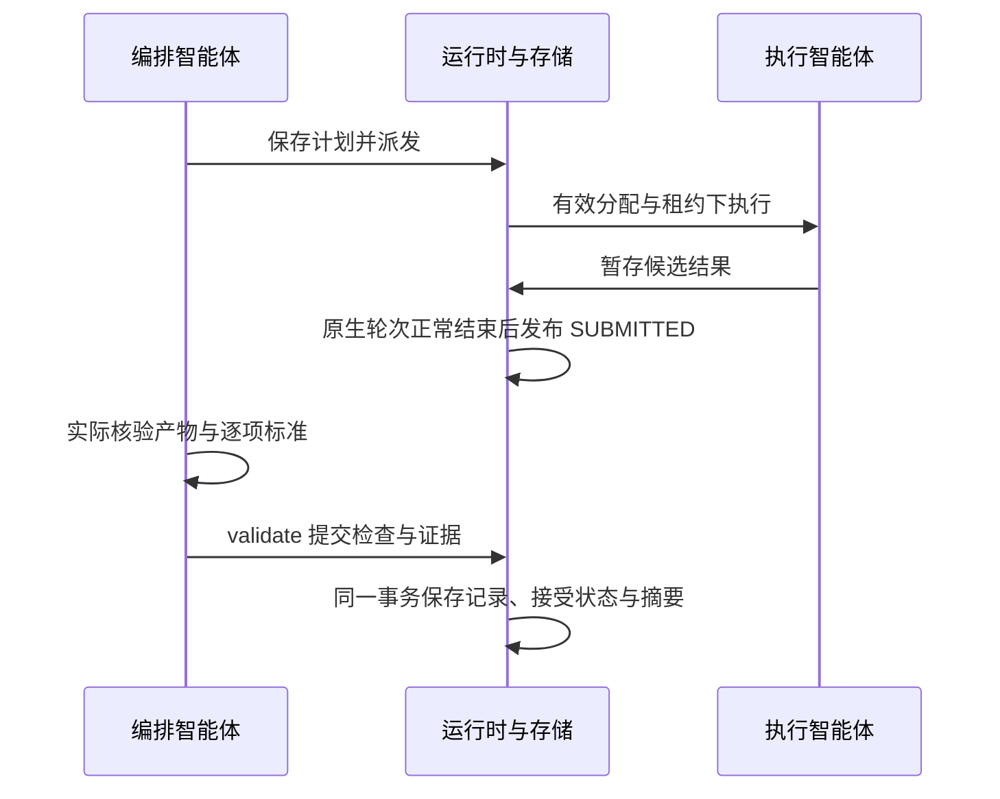

# 任务单元与业务验收

任务单元是可规划、执行和验收的一项工作。编排智能体理解目标、保存执行决定及下游简报，并实际校验交付；执行智能体向其提交产物与执行证据。编排智能体使用已授权原生工具核对产物，并对实际验收结论负责。数据库事务保证这些控制状态原子提交。

## 主要入口与对象

| 入口 | 关注内容 |
|---|---|
| `core/protocol.ts` | `TRANSACTION_STATUSES`、`TRANSITIONS` 和角色动作权限 |
| `core/actions.ts` | `dispatch`、`adjust_transaction`、`validate`、`submit_result` |
| `core/cluster.ts` | 执行智能体的轮次结算、候选结果发布、重启后的版本恢复 |
| `core/store.ts` | 保存任务单元、依赖、验收、纠正问题与摘要 |

任务单元持有 `current_plan_ref`、`current_result_ref` 和 `current_validation_ref`。计划引用为 `(transaction_id, prepared_revision)`，包含服务端记录的真实作者、正式契约、理解、执行方式、理由、交接和逐项责任。`criterion_responsibilities` 引用不可变契约中的标准，不用关键词自动分派职责。验收引用为 `(transaction_id, result_revision)`，其中 `result_revision` 是提交验收时的任务修订号。正式接受绑定当前计划、结果和验收引用。

## 当前主路径

新建 `DRAFT` 产生准备方案事项。`dispatch` 仅接受已有有效计划，或同次原子提交计划；裸批量派发不能绕过此门槛。`worker` 允许分配执行者，`management` 允许资源协调按已保存简报建立子管理域，`decompose` 父任务只聚合：父计划、子计划、子任务与依赖原子保存，父任务转 `READY`，子任务保持 `DRAFT` 等待逐项派发。

实际检查前由 `bind_validation` 绑定当前计划和结果，每个原生工具调用保存所属验收对象。正向 `validate` 必须覆盖正式标准并绑定当前结果，且等待本轮相关原生副作用及后台任务结算；接受守卫同时检查子任务完成以及聚合引用的当前子结果和验收记录。保存 validation、转换 `ACCEPTED`、写入摘要、事件和命令回执处于同一 SQLite 事务，守卫失败全部回滚。实际检查期间结果保持 `SUBMITTED`。

## 修改与返工

调用 `adjust_transaction` 前，需要等待轮次及分配达到安全点。业务修改增加 `revision` 并使旧计划、交接及分配失效；分配保存实际使用的 `plan_ref`。`expected_transaction_revision` 比较任务版本，工具顶层 `expected_revision` 仍比较集群版本。计划写入按真实作者、任务、基准版本与动作形成语义键，相同内容重试返回原回执，异文冲突必须重新读取后明确修订。

负向 `validate` 与 `reject_result` 共用业务纠正闭环。`reject_result` 必须带当前 `expected_transaction_revision`，可附 `plan_ref`、`result_ref` 防止旧事项误拒新交付：首次失败开问题，新结果或修订再次失败消耗纠正轮次，同一结果重试不重复计数。通过验收只关闭本次新证据已解决的业务问题；运行问题与误报由有权角色基于明确证据处理。超过 `max_corrections` 升级。验收后发现缺陷须显式重开，撤销接受并使祖先汇总及依赖方失效。验收事件保留 `validated_by` 与状态提交来源。

总协调可以修改产物，但已发布结果不能继续冒充修改后的版本。管理者执行 `write`、`edit`、`bash` 或 `job_kill` 时，运行时对本域全部 `SUBMITTED` / `ACCEPTED` 结果中显式声明的 `path`、`file`、`file_path`、`filepath`、`paths`、`files`、`artifacts` 观察前后内容；变化会使旧发布及相关汇总失效，必须重新交付后验收。这项保护独立于 `bind_validation`，后者只决定验收调用归属。

显式目录使用递归稳定摘要，并保留逻辑路径和软链元信息；辅助检查文件应放在声明产物目录之外。观察最多覆盖 10,000 项、64 层、256 MiB：调用前超过上限会拒绝修改，调用后无法完整观察则记录 `observation_error` 并使旧发布失效。没有显式路径的自由文本结果不具有文件哈希覆盖保证。

委派给下级的任务单元继承上级的交付约定。下级编排智能体可以细化目标、修正执行范围或增加验收检查，但不能通过更换输出文件或删除原验收标准来规避交付失败。正式接受父任务单元的结果前，还要确认委派工作是否全部完成。

## 不变量

- 执行智能体的 `submit_result` 只暂存候选结果，不能自行将任务单元标为 `ACCEPTED`。
- 发布结果需要原生执行轮次正常完成、租约有效且记账可确认；工具返回成功本身不代表工作完成。
- 正向 `validate` 必须完整覆盖正式标准，每项含稳定标准引用、实际方法、观察、判断及证据；编排智能体负责检查方法与依据是否充分。
- `aggregate` 只在父任务 `READY` 且子任务均已接受时发布汇总，不能替换正在验收的结果。
- 因结果不完整而提出的纠正要求，不能仅凭计划被编辑就视为已落实。

调用示例见 [API 手册](/development/api#角色工具)。状态与执行路径见[任务派发](/dispatch)。

源码：[actions.ts](https://github.com/Luohaothu/dsh-flow/blob/main/packages/dsh-flow/src/core/actions.ts)、[protocol.ts](https://github.com/Luohaothu/dsh-flow/blob/main/packages/dsh-flow/src/core/protocol.ts)。
