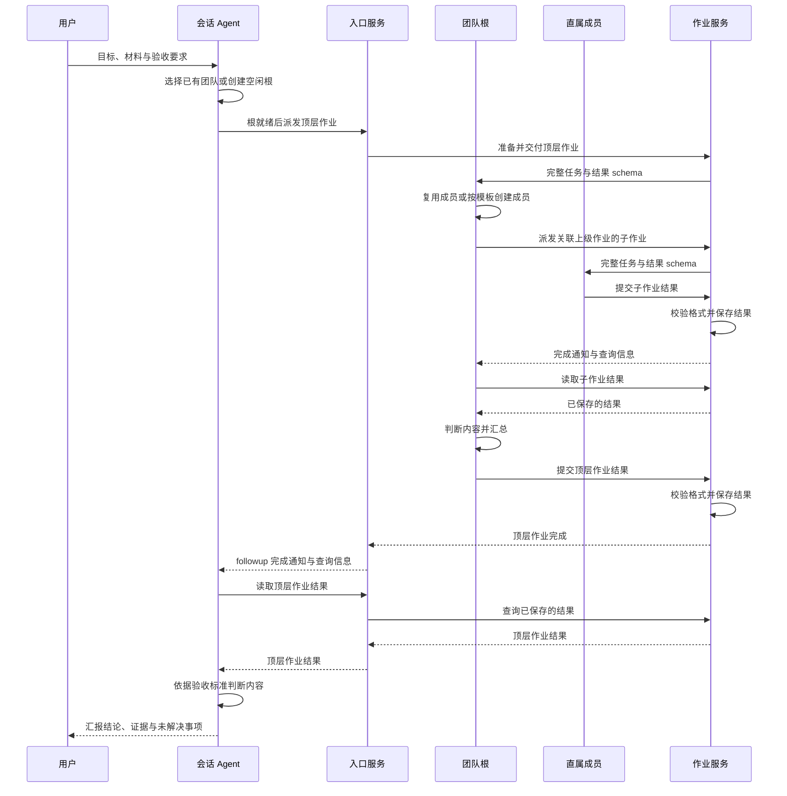

# 团队使用流程

一次团队任务从用户的目标开始。会话 Agent 明确需求，选择一棵已有团队树或创建新根，再向根派发作业。团队中的各级父 Agent 逐层管理工作，结果最终由会话 Agent 向用户交付。

> [!NOTE]
> 本页描述设计约定的使用流程。文中的工具名称与完成含义对应 [入口接口](design.md#接口定义-1)，使用具体版本前应核对该版本提供的工具。

## 明确任务和交付

在 DSH 主会话选择 `/agent-team` 后，说明任务背景、要完成的工作、验收标准和可用材料。例如：

> 请组织团队核查当前项目的发布说明。核对各项声明是否有代码或测试依据，输出问题清单与证据位置；无法确认的内容单独标明。后续我会继续交给这个团队处理修订和复查。

会话 Agent 据此确定顶层作业的结果 schema。schema 规定最终结果的结构，验收标准说明如何判断内容质量，两者都随任务交给团队根。

## 选择或创建团队

会话 Agent 先通过 `flow_teams` 查询已有团队。职责和成员能力适合本次任务时，可以复用已有根；需要新的独立组织时，通过 `flow_team_create` 创建团队。

创建工具立即返回运行句柄，其中的 `runId` 标识这棵团队树。入口服务异步建立空闲的根 Agent，会话 Agent 通过 `flow_team_get` 读取创建状态。团队就绪后，再通过 `flow_team_assign` 派发顶层作业。

创建团队和派发任务分别完成。创建返回的句柄用于定位团队；派发返回的作业记录用于追踪这次任务。会话 Agent 不等待团队执行完毕即可继续处理用户对话。

## 由团队根组织成员

根 Agent 根据本次任务选择模板与规模，调用 `flow_pattern_apply` 在自己下面创建成员。模板提供层级、职责、初始群聊和管理指引。根根据实际工作制定子作业，向直属成员派发；成员也可继续创建下级并分派自己的子作业。

发布核查任务可以采用多个研究组：每名组长负责一个方向，组内分别收集材料、核验声明和审查结论。不同组通过普通消息或协调群交流，共享需要交叉检查的线索。具体拆分和推进次序由各级 Agent 决定。

入口服务（RunService）连接会话与团队，作业服务（AssignmentService）负责派发、结果校验与保存。下图展示成功交付时的通知与读取顺序。

## 查看进展与接收结果

全局“智能体”面板展示各棵团队树，会话内“智能体”页签聚焦当前会话发起的团队。可以查看成员状态、作业关系、消息、群黑板和模型用量，也可以打开成员观察侧栏阅读原生会话。

Agent 空闲表示当前没有进一步执行请求。作业是否完成，以作业记录为准：结果格式通过检查并成功保存后，状态进入 `submitted`。

顶层作业完成后，入口服务主动通知并唤起会话 Agent。会话 Agent 读取保存的结果，判断是否满足需求，再向用户汇报。需要补充时，可以继续沟通或派发新的作业。

## 继续使用或结束团队

同一个根可以接收后续作业，也可以同时持有多份未结束的作业，由 Agent 自己安排处理顺序。已有成员、群和管理关系继续用于后续协作。

只停止某项任务时，取消对应作业；运行时沿作业关系取消未结束的后代，成员继续存在。结束整棵团队时，由会话 Agent 或用户明确解散团队，取消未结束作业并释放成员与群。操作含义见 [看板的停止操作](dashboard.md#停止操作)。
