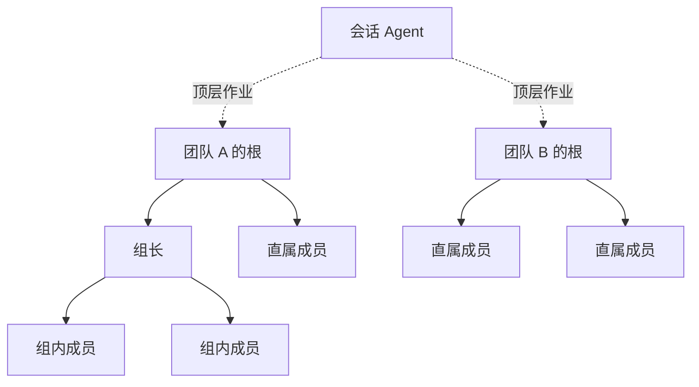

# 团队与运行

团队由一棵 Agent 树组成。根负责组织工作，各级父 Agent 管理自己的直属成员。模板帮助创建这种组织，作业把某次任务交给组织中的具体接收者。

`run` 表示一棵团队树及其运行环境，包含一个 Context、一个团队根、成员、群和作业记录。`runId` 标识团队的存续期，`assignmentId` 标识一次任务。

## 会话与团队的关系

会话 Agent 与用户交互，团队根专注于管理和分工。一个主会话可以创建多棵独立团队树，也可以选择已有团队承接后续作业。

图中的实线表示团队内部的父子关系。会话 Agent 通过入口服务与各个根交接任务；树内 Agent 逐层派发子作业。跨分支的信息交流使用普通消息或群聊。

## 创建组织

`RunService.create` 立即返回处于 `starting` 的运行句柄，异步建立空闲根。根就绪后，入口服务可以向它派发顶层作业。

根应用模板时，自己就是模板中的 `root`。运行时先解析参数和子树引用，再按父级先于子级的顺序创建成员，提供角色职责和管理指引，最后建立模板声明的初始群。

每个 Flow Agent 默认具备 `team-strategy` 技能，用来判断是否需要新成员、选择模板和规模、复用现有成员及安排任务。模板中的 `skills` 只声明附加技能。模板提供的管理经验供 Agent 自主使用，实际任务的拆分和推进由 Agent 决定。

不同模板创建的成员进入同一棵 Agent 树，统一由各自的父节点管理。创建完成后，协作使用实际的 Agent、Group 和作业对象。

## 持续承接作业

团队可以同时存在多份未结束作业。接收 Agent 根据任务情况安排顺序或交替推进，运行时逐份记录状态并保存提交结果。

顶层作业完成时，团队仍可保持 `active`。根和各级成员可以继续处理已说明存续理由的子作业，也可以等待新任务。会话 Agent 收到完成通知后读取结果，再决定复用团队继续工作或明确解散。

## 运行状态与释放

| 状态 | 含义 |
| --- | --- |
| `starting` | 正在建立运行环境和根。 |
| `active` | 团队可用，能够承接作业。 |
| `stopping` | 正在取消未结束作业并释放团队。 |
| `stopped` | 团队已解散。 |
| `failed` | 团队创建等运行级操作失败，记录原因。 |

由所属会话 Agent 或用户调用解散操作。入口服务取消未结束作业，解散群并释放 Context。暂时空闲和作业完成都不触发自动释放。

进程重启后，旧运行句柄失效，已保存的会话和作业记录作为历史保留。继续旧工作时显式恢复所需会话和组织关系，再派发新的作业。恢复关系见 [作业历史](assignments.md#历史与继续工作)。
