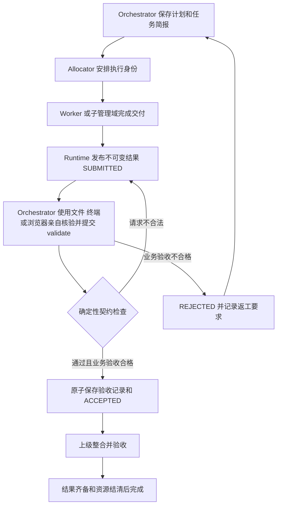

# Auditor 系统移除与 Orchestrator 完整权限方案

> 历史归档（2026-10-12，标准 Agent 精简方案）：本文保留当时的实现、验证和运行事实，不作为当前实施指令。旧权限/写入守卫、回合租约、执行账本及加强恢复的建议由[当前精简方案](../../native-agent-simplification-plan.md)替代；历史完成和失败判断不改写。见[归档索引](../README.md)。

状态：已实现；验证结果及模型未达标项见 [实施验证记录](auditor-removal-validation.md)。日期：2026 年 10 月 12 日。实施时源码基线为 `0c49836e6fe0c60a9ccff73c132934305608f65c`，另含当时尚未提交的消融实验代码与报告。以下保留执行方案及设计依据，实际结果以验证记录为准。

后续交付：实现已通过提交 `d69fff2` 推送，新实例使用独立 schema 5 数据目录。此后按用户要求清理原消融实验程序、报告、原生运行材料和冻结备份，撤下相关执行入口；当前工作区不再提供原实验复现。此项清理不重写 Git 历史，不改变下述决策摘要或实施阶段的验证结论。历史方案归档及此次实现验收证据继续保留。

既有七份方案、接口审计与配套验证记录已移至 [archive/2026-10-12](../README.md)，并标注历史适用范围。本文件是后续 Auditor 移除工作的执行依据；归档内冲突要求不再约束该项实现。

目标是从当前产品中完整移除固定 Auditor 角色、独立审核协议及其调度和完成门禁，同时修复 Orchestrator 缺少实际执行权限的问题，使其具有完整业务执行能力，能够亲自检查和运行 Worker 的交付。团队由 Orchestrator 负责业务验收、Allocator 负责资源安排、Worker 负责交付。验收所需的正式标准、不可变记录、证据绑定和运行安全守卫继续保留。生产代码不保留隐藏 Auditor、关闭开关或自动批准审核的兼容分支。

## 决策依据与历史约束

2026 年 10 月 9 日的历史对话已明确：Worker 向 Orchestrator 交付，Orchestrator 实际校验业务结果；Auditor 只独立审核调度的验收行为。此次移除的是最后一层固定角色，并不把业务验收责任转给 Worker，也不取消 Orchestrator 的计划、交接和实质校验义务。

此前“启动本地实例”对话定位过 Orchestrator 无法亲自运行脚本的问题：团队和 Agent 记录声明了 `shell`，但 `allowedToolsFor()` 清空所有非 Worker 的有效能力。制定方案时复查源码确认该分支仍存在；此外，当时工具执行准入从 Worker allocation 获取写范围，Orchestrator 没有该分配时会因空范围被拒绝写文件或运行 `bash`。因此完整权限修复是本次移除工作的必要组成部分。上述问题已在此次实现中修复，不能继续按原有缺陷理解当前代码。

2026 年 10 月 12 日完成的原实验报告包含 24 个配对、23 个完整配对。业务内容缺陷的 13 个完整配对中，初验、追加自审、独立审核分别错误放行 1、0、0 个；独立审核相对自审唯一少放行的样本涉及旧回执契约。报告没有进行统计显著性检验，也没有测量完整生产任务。因此决策表述为：当时的实验未显示固定 Auditor 优于追加自审的业务质量收益，结合角色和调度成本，选择取消该固定机制。该历史摘要不改写为“已经证明审核无效”；原报告及其物理材料已纳入后续清理范围，不再作为当前可读取或可复核的附件。

实施前曾核对原始 `report.json` 与 `frozen-manifest.json` 的 SHA256，均与报告一致。历史记录中的“等待容量”已被当时的完成记录取代。当时未提交的实验改动在实施期间先行保护，后续物理清理由用户另行明确授权，没有通过重置工作区丢弃无关改动。

## 完成后的责任与状态

| 对象 | 最终职责 |
| --- | --- |
| Orchestrator | 理解目标、保存计划、派发；使用完整业务工具亲自读取、运行和核验交付，记录验收、安排返工、整合结果 |
| Allocator | 安排 Worker 或子管理域、能力和资源，按安全边界回收 |
| Worker | 完成任务并提交结果、证据和限制；没有自我验收权限 |
| Runtime | 校验权限、当前版本、证据归属、状态和子任务条件，原子提交验收与事件 |

每个管理域由三个管理身份减少为两个。主会话继续独立于团队 Orchestrator。DSH 继续负责 Agent、模型、上下文和原生执行，Flow 负责任务、工具与协作；本次不改模型策略或其他角色边界。

Orchestrator 的完整业务能力覆盖文件读取与检索、文件写入与编辑、终端和后台任务、网络抓取、浏览器操作，即当前 Flow 支持的 `fs_read`、`fs_write`、`shell`、`web_fetch`、`browser`。根域和子域均采用完整角色授权，不再套用单个 Worker 的能力裁剪或写范围。团队创建时用于选择执行者能力的默认值不能隐式取消 Orchestrator 的验收工具；用户或部署明确规定的禁用能力、只读或纯文本约束仍须显式表达并执行。宿主未配置某工具时应报告实际缺口，不能把权限声明当作工具可用的证明。Flow 业务控制面仍按角色分工，宿主 sandbox、已有团队审批策略和原生执行规则继续有效。



采用一次 `validate` 完成验收提交：`accepted=true` 在现有 SQLite 命令事务内保存不可变 validation、执行统一接受守卫并转为 `ACCEPTED`；`accepted=false` 保存负向检查并进入 `REJECTED`。守卫失败则整次命令回滚，不留下半份验收记录、成功回执或接受状态。删除仅用于等待审核的 `VALIDATING` 状态和多余的公开 `accept_result` 动作。实际核验发生在提交之前，期间结果保持 `SUBMITTED`。

不增加固定“自审第二轮”模型调用。Orchestrator 根据任务和检查发现决定是否补充核验；业务明确要求交叉验证时，可按普通任务安排专业 Worker，仍由 Orchestrator 验收。确定性检查不声称能理解自然语言观察是否真实或逻辑充分。

## 保留与删除的边界

| 内容 | 处理 |
| --- | --- |
| `auditor` 角色、`flow_audit`、审核提示词、审核待办和通知 | 从生产角色、工具、执行与投影中删除 |
| 计划审核、验收审核、审核批准者和审核版本字段 | 删除生产表、类型、查询、事件字段和守卫分支 |
| `inspect_plan`、`inspect_validation`、独立纠正复核及模型健康评分 | 删除相关动作、规则和调度路径 |
| 计划、任务简报、`plan_ref`、`result_ref`、`validation_ref` | 保留；修订失效、当前版本和来源绑定继续强制执行 |
| 逐项业务检查、不可变 validation、结果摘要 | 保留并成为正式接受的业务依据 |
| issues、返工、重规划、人工问题、升级 | 按实际用途保留；取消专属审核流程，改为业务纠正或运行问题处理 |
| 原生工具回执、effects、事件日志、幂等回执、权限和租约 | 保留；这些是运行证据和安全机制 |
| Orchestrator 的业务能力与执行授权 | 补齐完整能力、挂载、白名单、管理域写范围和原生证据链；删除非 Worker 一律禁用业务工具的策略 |
| 运行统计和客观健康信号 | 保留可由 ledger 计算的部分；删除依赖审核决定的指标和八维模型打分 |
| 原消融实验协议、程序、结果及冻结备份 | 实施期间保护并核验；交付后按用户要求清理物理材料，保留决策摘要及 Git 历史 |
| 历史方案及此次实现验收记录 | 保留，清楚标注适用版本和已有验证边界 |

不能用全仓删除 `audit` 或“审核”文字代替语义清理。普通操作留痕、业务任务本身要求的评审、历史实验均不属于固定 Auditor 的生产实现。

## 分阶段实施

### 第一阶段 冻结实验与建立基线（已完成的历史步骤）

实施时记录了 HEAD、已有变更和文件哈希，冻结旧生产源码、包、依赖锁文件、原提示词、实验驱动及必要宿主辅助代码，并单独备份 Git 忽略的原生材料。旧包 SHA256 为 `c03628d0fa8fd8980951cb9d8dc09e63b34a4a3c8b63e66ceebcc769090d619e`；提交 `0c49836` 本身不含当时未提交的实验文件。

当时将旧运行驱动与新生产类型检查隔离，保留了独立评分、报告和核验入口。删除生产角色前后完成离线核查，并在临时目录使用路径映射核对原生记录，未修改原报告或启动新的消融实验。实施前构建与测试结果作为回归基线保存，没有靠生产兼容角色或类型断言维持编译。

以上记录说明当时采取的保护措施。交付后用户要求清理原实验物理材料及入口，该要求取代了持续保存和复现承诺；当前工作区不能重新执行上述实验或离线重算。

### 第二阶段 补齐 Orchestrator 完整执行权限

这一步先建立 Orchestrator 能亲自验收的能力，再修改接受门禁。重点修改 [cluster.ts](../../../../packages/dsh-flow/src/core/cluster.ts)、[runtime.ts](../../../../packages/dsh-flow/src/core/runtime.ts)、[protocol.ts](../../../../packages/dsh-flow/src/core/protocol.ts)、[scope.ts](../../../../packages/dsh-flow/src/core/scope.ts)、[native-evidence.ts](../../../../packages/dsh-flow/src/core/native-evidence.ts)，同步配置、身份记录和提示词。

| 当前断点 | 必须落实的修复 |
| --- | --- |
| `ensureRoles` 保存能力，`allowedToolsFor` 却对非 Worker 返回空集合 | 建立统一的 Orchestrator 完整角色授权策略，根域、子域、新建、续跑和恢复使用同一解析结果；持久化声明与实际工具政策一致 |
| `runTurn` 接到空能力后不挂载业务工具 | 贯通角色能力 → `mountCapabilityTools` → 本域工具挂载/根域 browser 继承 → `installToolPolicy` → 原生请求工具集合；不向 DSH create/resume 虚构 `capabilities` 参数 |
| `admitToolCall` 只读取 Worker allocation，管理者写范围为空 | 增加独立的管理域执行授权解析：Orchestrator 在团队工作区拥有完整读写和终端权限，不需要先取得 Worker 分配；每次实际派发仍核对角色、管理域、有效租约、当前授权及宿主工作区 |
| `captureSource` 从 `agent.meta.transaction_id` 取任务，管理者没有固定单任务绑定 | 将 Orchestrator 的网络来源及其他验收证据绑定到实际核验对象和正式引用，保证可用于当前 validation；同一管理者处理多个任务时不能串用来源 |

具体契约如下：

1. **完整授权与工具可用性分开检查。** 默认 Orchestrator 具有上述全部业务能力，不继承 Worker 的精简工具配置。更新 `config.ts`、`team-tools.ts`、类型及团队技能，明确执行者能力选择与团队级显式限制的不同语义；显式空权限或禁止终端等限制不得被非空回退绕过。管理者本轮声明需要的能力必须在原生 Agent 发布后、首个模型请求前完成可用性检查，缺失则明确报告能力/提供方，不静默降级或声称已完成实跑。完整权限的发布验收必须使用五类工具均已配置的环境。
2. **管理者有独立的工作区授权。** 在业务工作区内允许读取产物、写入/编辑验收脚本和临时文件、执行命令、读取/终止自身后台作业。根域默认取得该工作区完整执行授权，子域只能继承或收窄上级的显式授权范围，完整工具能力不意味着可越出管理域的执行边界。当前 `checkWriteAccess` 对 `bash/job_kill` 要求全工作区授权，应由管理者授权契约明确满足；目录受限的子域必须通过实际宿主目录隔离执行，或由有权上级安排较大范围的临时执行占用，不能删掉检查后声称 shell 已被目录隔离。不通过伪造 Worker allocation 或跳过执行 hook 实现。Worker 的分配约束继续独立生效。
3. **能力与并发执行分开处理。** 不为管理者创建长期占满工作区的 Worker 独占分配，避免阻塞下游。核验当前交付前等待对应生产轮次结束；会修改共享路径的检查必须与其他活跃写入协调，必要时使用明确绑定当前交付的隔离副本。管理者不得持有独占写授权同时等待被该授权阻塞的 Worker。校验过程修改正式产物时，必须形成新交付/修订后再验收，不能继续引用修改前的结果。
4. **保留真实执行的安全与记账链。** 文件、终端、Jobs、网络及 browser 调用都通过现有准入、租约 fencing、预算、工具回执和副作用处理。管理域授权范围和版本随 schema 5 持久化；恢复从正式授权重建策略，执行前及 `recheckToolCall` 的重新派发检查均核对当前有效授权，不能让旧实例继续使用已撤回范围。团队成员继续使用现有 session 级审批策略，普通主会话的策略不被修改；用户/宿主显式限制继续适用。仅允许查询或终止本身份拥有且可追溯的后台作业，不能从完整业务工具推导出其他角色的控制权限。
5. **验收证据属于实际执行者和当前对象。** 核验前绑定目标 transaction/plan/result；一轮检查多个任务时明确记录每条证据的对象，不能只把首次唤醒任务写死到 Agent meta。原生 `tool/call`、`tool/result`、来源和 effects 保留 Orchestrator 的 `agent_id/session_id/turn/epoch`，经 transaction/validation 查询支持 `current-manager` 和 `validation-author` 证据。Worker 的回执仍标为结果生产者，不可冒充总协调亲自执行。
6. **更新行为说明和失败路径。** Orchestrator 提示词明确要求依据正式标准亲自执行必要检查，写明实际方法、观察、失败与限制。必须亲自执行的标准不能通过读取 Worker 的完成声明替代；缺失工具时报告具体缺口，不能自动放宽标准或继续给出通过结论。

完成条件：根域和子域 Orchestrator 在新建及冷恢复后都能实际调用完整业务工具；至少一轮验收由其自己读取 Worker 产物、编写独立检查、运行终端、获得真实结果并记录验收。数据库 capabilities、tools/list 或工具名称出现在提示词中，均不能单独视为通过。

### 第三阶段 修改验收和业务纠正契约

集中修改 [actions.ts](../../../../packages/dsh-flow/src/core/actions.ts)、[protocol.ts](../../../../packages/dsh-flow/src/core/protocol.ts)、[contracts.ts](../../../../packages/dsh-flow/src/core/contracts.ts)、[model.ts](../../../../packages/dsh-flow/src/core/model.ts) 和 [types.ts](../../../../packages/dsh-flow/src/types.ts)。

1. 将 `validate` 改为上述原子验收；精简 `acceptTransaction`，删除审核批准条件，保留正式标准覆盖、正向 checks、当前计划和结果绑定、子任务完成及聚合来源版本检查。验收事件和摘要保留验收者与提交来源，删除 `audited_by`。
2. 删除 `VALIDATING`、`accept_result`，同步修订状态迁移表、暂停/恢复状态、聚合条件、语义幂等和所有调用者。相同命令重试不得重复接受、重复摘要或重复计数。
3. `dispatch`、`decompose` 保存计划并派发，不再创建计划审核；返回值和事件不再含审核 ID、审核状态或 `audits` 包装。正式计划的完整性、继承标准和依赖检查仍由代码执行。
4. `validate(false)` 与 `reject_result` 复用业务纠正逻辑：首次拒绝开问题；在对应问题存在后的新结果或修订再次失败才消耗纠正轮次，同一结果重试不重复计数。成功验收只关闭被本轮新证据解决的业务问题；超出 `max_corrections` 仍升级，不能因删掉 `verify_correction` 变成无限返工。
5. 保留验收后发现缺陷的业务重开能力。建议增加 Orchestrator 的 `reopen_transaction`，要求当前事务版本、明确原因与证据，在安全边界撤销当前接受，作废受影响祖先摘要并暂停依赖方，再进入业务修订。复用现有重开/祖先失效机制，删除其中的审核操作。原位重开仅限管理域仍活跃且身份、预算可用的任务；子域已完成、成员已回收时，由仍活跃的上级创建引用旧交付的新纠正任务，按正常分配流程安排新执行者或子域，并更新聚合来源。禁止直接复活已终止成员或继续花费已返还预算。已终止团队不在本次增加跨运行复活能力。
6. 系统生成的权限拒绝、未知副作用、资源不足等问题按有权处理的角色分流；不能全部当成业务问题自动关闭，也不能因没有 Auditor 而无人处理。明确无 `transaction_id` 的节点/团队问题和误报撤销的关闭路径：提供受管理域与问题类别限制的 `resolve_issue`，Orchestrator 处理业务/协调问题，Allocator 处理资源/分配问题；保留原因、处置证据和关闭者。可机械判断的关闭必须验证对应事实，例如副作用已经通过原有 `resolve_effect` 处置、分配已修复或相关执行已终止。撤销误报必须记录证据，不能借此跳过实际权限或副作用守卫；人工问题仍通过原有用户回答路径解决。删除无人消费的审核专属 issue 状态，所有保留状态必须有可达的推进和关闭路径。

完成条件：Worker 无法自验收；合格交付可直接通过 Orchestrator 验收；不合格、过期、越权或未完成子任务的交付仍被拒绝，返工和祖先失效形成闭环。

### 第四阶段 移除调度和生命周期依赖

重点修改 [cluster.ts](../../../../packages/dsh-flow/src/core/cluster.ts)、[budget.ts](../../../../packages/dsh-flow/src/core/budget.ts)、[runtime.ts](../../../../packages/dsh-flow/src/core/runtime.ts)、[team.ts](../../../../packages/dsh-flow/src/core/team.ts)。

1. 根节点、子管理域、恢复和补建路径只创建 Orchestrator、Allocator 两类管理身份；清除 Auditor 会话、待办、唤醒、优先级和角色循环。
2. 审查管理身份数量、最小启动额度、预留槽位、子树委派费用、预算返还和并发调度。凡表达“管理角色数”的固定 `3` 改由统一角色集合推导，避免误改普通数值。
3. 删除管理域结束时等待 Auditor 八维健康评分的逻辑。关闭依据为：当前交付接受、必要摘要持久化、子域结清、活动轮次与租约结束、未知副作用有明确处置、资源按规则返还；根域保留 `finish_cluster` 意图与全部交付条件。
4. 保留客观运行信号，移除 `evaluate_health` 模型判断、最终评分请求及强制评分表。`health` 如继续存在，返回明确的运行统计，不再伪装为独立质量评审。
5. 处理原本交给 Auditor 的违规/拒绝通知：业务问题给 Orchestrator，分配或资源问题给 Allocator，无法授权解决的问题走现有人工/升级路径。保留拒绝事实、证据和重试限制。

完成条件：单 Worker、多 Worker、递归子管理域、失败返工、暂停恢复和资源回收均能终止；没有等待已删除角色的悬空条件。

### 第五阶段 清理持久化和公开接口

重点修改 [store.ts](../../../../packages/dsh-flow/src/core/store.ts)、[types.ts](../../../../packages/dsh-flow/src/types.ts)、[role-tools.ts](../../../../packages/dsh-flow/src/core/role-tools.ts)、[briefing.ts](../../../../packages/dsh-flow/src/core/briefing.ts)、[messages.ts](../../../../packages/dsh-flow/src/messages.ts)、[identity.ts](../../../../packages/dsh-flow/src/identity.ts) 及查询/服务投影。

1. 删除审核专属表、SQL、解码/投影、索引、字段、动作枚举、查询 `audit/audits` 和嵌套审核字段；清理提示词、成员归属、通信分类和工具参数说明。普通 issues、events、receipts、effects 等按用途保留。
2. schema 从 4 升为 5，延续现有“旧库拒绝打开、使用新 dataDir、原数据不动”的策略。拒绝旧 schema 必须发生在任何建表或修改之前；不将旧待审核事务自动接受，也不将历史 Auditor 映射为另一种角色。
3. 本次不建立透明数据库迁移层。部署时先记录并处理活动团队，再用新 Flow 数据目录启动；原方案要求先保留旧数据及构建用于隔离核验。新实例启动核对完成后，用户另行授权删除旧实例数据及原实验材料，后续清理不继续承诺可从本机旧目录查看历史团队。此次实现的隔离切换报告和构建证据保留，历史团队不迁入新实例。
4. 重新从源码生成 Typert Host/Remote 契约与客户端产物；不手改生成文件。检查发布包及原生成员实际工具列表，确认无 `flow_audit`、审核动作或 Auditor 角色。
5. 更新旧角色输入的拒绝行为和错误信息；不把非法角色默认为 Orchestrator。仅为历史数据展示而需要的字面值应隔离且不得接入调度。

完成条件：新数据库无审核专属运行结构；旧库被明确拒绝且保持不变；新的 API、工具、生成代码和运行包具有一致契约。

### 第六阶段 测试 界面与文档同步

先修改共享测试夹具和 mock，再逐项迁移业务断言。重点覆盖 `tests/unit/task-fixtures.ts`、`task-contracts.test.ts`、`member-briefing.test.ts`、`native-evidence.test.ts`、`cluster-*.test.ts`，以及 `src/host/mock-scenarios.ts`、`tests/acceptance/`。只断言 Auditor 审批、审核回合或八维评分的测试可以删除；保护版本、证据、权限、幂等、纠正、恢复和资源不变量的测试必须改写保留，不能按文件名整批删除。

| 测试组 | 必须证明的行为 |
| --- | --- |
| 原子验收 | 正向 validate 直接 ACCEPTED；负向进入 REJECTED；守卫失败时 validation、状态、摘要、事件及命令回执一起回滚 |
| 版本与证据 | 过期 plan/result/validation、外任务证据、未发布暂存结果、缺漏标准仍不可接受 |
| 权限与工具 | Worker 无法验收；Allocator 无法修改业务结论；实际 role tools 无审核入口；团队权限策略与普通会话保持既有隔离 |
| Orchestrator 直接执行 | 根/子总协调真实调用文件读写、shell/jobs、web 和 browser；原生请求提供工具，工具实际执行成功后以本人的证据完成验收 |
| 管理域授权 | 没有 Worker allocation 的 Orchestrator 可在工作区实际写文件和运行终端；显式限制、路径边界、作业归属、旧租约和并发写入规则仍有效 |
| 能力恢复与证据 | 冷恢复后重新挂载完整工具；多任务验收的来源与回执不串用，Worker 回执不能冒充总协调实跑，缺失能力明确失败 |
| 返工与重开 | 首拒/再次失败计数正确、重试幂等、成功关闭匹配问题、超限升级；重开子任务使祖先接受和摘要失效；已关闭子域通过新纠正任务处理 |
| 运行问题 | 无任务引用的节点/团队问题有关闭路径；错误角色/跨域不能关闭；误报撤销留证据，未知副作用不能被普通问题关闭绕过 |
| 聚合与递归 | 父级只接受当前子结果及验收引用；子域只有两个管理身份；已有子树恢复不重复创建 |
| 结束与恢复 | 无健康评分也可完整收尾；活跃轮次、租约、未决副作用仍阻止过早结束；新库重启及暂停恢复正常 |
| 数据与构建 | schema 4 被拒绝且数据未改；schema 5 可重开；公开与生成契约不存在已删能力 |
| UI 与原生轨迹 | 无 Auditor 卡片/头像/颜色/待审核文案；成员会话可导航，资源回收后记录仍可读，实际轨迹符合新流程 |
| 实施期间的历史实验保护 | 当时独立评分与原生记录核验保持原结论；后续授权清理不改写该历史判断 |

完整能力验证至少包含三个原生集成场景：

1. **文件、终端、Jobs 和网络直接验收。** Worker 提交产物后，Orchestrator 自己读取并编写独立测试，调用 `bash`、获取 `job_output`，并在独立作业中验证 `job_kill`；`web_fetch` 成功取得可控材料并绑定当前验收对象。包含 Worker 声称成功但真实测试失败的交付，必须由总协调的运行结果触发拒绝，修正后再接受。检查请求工具、文件字节、退出状态、原生调用与结果及最终验收作者。
2. **浏览器直接验收。** 总协调亲自导航、读取 snapshot、基于真实引用操作页面并读取结果，核对回执确属 Orchestrator；不能以 Worker 浏览器场景或仅有工具清单代替。
3. **递归与冷恢复。** 子 Orchestrator 在核验前冷重启，恢复同一身份/会话后直接读文件和运行检查，根 Orchestrator 再核验聚合交付。覆盖管理授权恢复、工具重新挂载、已完成调用不重复执行和旧租约拒绝。

落点包括 `tests/acceptance/native/mock-runtime.test.ts` 的真实工具执行夹具、`tests/unit/native-evidence.test.ts`、`team-permissions.test.ts`，以及 `tests/acceptance/handoffs-live.ts` 和 browser/recovery 场景及检查器。原生 scope 测试目前仅检查 `flow_` 工具的部分必须扩展到业务工具；原有“总协调无文件工具、通过 Worker 回执间接检查”的 live 指令应改为直接检查。原生证据查询迁移到 transaction/validation 后，保留分页、错误会话/域、验收后无关调用排除等断言。

界面重点检查 `identity.ts`、`client/styles.ts`、`core/team.ts`、消息分类、拓扑和等待协作者投影。通用成员视图按实际数据验证，不做无关重构。

文档同步分三类：

- 当前使用与设计：更新根 `README.md`、`CONTEXT.md`、`packages/dsh-flow/README.md`、包内 `skills/agent-team/SKILL.md`，以及 `docs/design` 的角色、调度、层次结构、配置、接口、动作目录、任务验收、持久化、运行时、观测与验证页。明确总协调完整业务能力、管理域授权来源及亲自执行验收的责任，删除“管理者只有 flow 工具”的旧说明。更新插件工具清单、角色数量、预算示例、YAML/下载示例、目录导航和 Mermaid 图。
- 截图和示例：重新运行当前构建的代表性任务并截图，检查快速开始、团队拓扑与 DeepSeek walkthrough 中的 Auditor 和待审核状态；废弃图片移除当前页面引用，不用修改旧截图冒充新运行。
- 历史计划和证据：既有方案及验证记录已物理移入 `docs/plans/archive/2026-10-12/`，加上归档说明并修正链接；后续新增的过期或冲突方案同样归档，当前目录只保留有效工作入口。保留旧验证事实。原消融材料按后续授权清理，决策摘要和统计限制保留，不将历史结果重新解释为当前验证。

### 第七阶段 验证与交付

按依赖顺序完成验证；无依赖且无共享输出的检查可并行。实施中先跑对应语义测试，再执行完整检查，不用测试数量减少证明正确性。

```bash
pnpm install --frozen-lockfile
pnpm typecheck
pnpm build
pnpm test
pnpm test:mock
pnpm docs:build
git diff --check
```

补充检查如下：

1. 对生产源码、包内 skill、当前文档、mock、公开类型、生成产物和发布包做语义残留检查。搜索词包括 `auditor`、`flow_audit`、`AUDITOR_ACTIONS`、`inspect_plan`、`inspect_validation`、`verify_correction`、`accept_result`、`VALIDATING`、`plan_approved_revision`、`audited_by`、`validation-audit`、最终健康评分以及中文审核角色名称。允许命中限于本移除方案及验证记录、标注版本的历史材料和验证删除行为的负向测试，逐项说明。
2. 用新构建、新 Flow 数据目录和隔离 workspace 运行本地原生模型冒烟：单执行者任务、含子管理域的整合任务，以及带错误交付和返工的场景。必须观察 Orchestrator 本人的实际文件/终端调用和验收链；能力集成测试还需覆盖成功 web/browser 操作及冷恢复。确定性验收套件负责可重复的故障注入；真实模型运行负责确认工具、提示词、交接和端到端终态。无需重做本轮 72 阶段消融。
3. 检查实际安装包的构建身份、监听和认证访问；核对成员名单、原生工具调用/结果、逐项验收、产物和最终状态。HTTP 200 或模型“完成”文字不单独构成通过。
4. 浏览器检查成员导航、通信/轨迹、运行和回收状态、资源用量及新截图；构建文档站并检查页面、图示、链接和导航。新旧数据目录切换及回退各验证一次，旧构建只配旧数据库。
5. 写入 `docs/plans/auditor-removal-validation.md`，记录文件范围、检查结果、构建身份、运行证据和限制。实施提交与后续授权的材料清理分开记录，不混淆实验结果与产品变化，也不重写 Git 历史。

## 实施顺序与最终验收

第二至第五阶段是同一契约变更，必须完整合并后才形成可部署版本。先证明 Orchestrator 能实际执行核验，再切换验收门禁，不发布“审核已删但总协调仍无工具”或“验收已改但收尾仍等审核”的中间状态。一个负责人负责 `actions.ts`、`cluster.ts`、`runtime.ts`、`scope.ts`、`store.ts` 的串行集成；契约确定后，测试、UI/文档和历史实验隔离可按不同文件并行。每阶段同步更新相关测试，不把回归修复全部推迟到最后。

最终验收要求同时满足：

- 生产运行从创建、执行、恢复到收尾均没有 Auditor 身份、工具、等待条件或隐藏模型调用。
- 根域与子域 Orchestrator 的完整业务权限真正贯通身份、工具挂载、原生请求、实际派发和结果回执；能够亲自运行验收，并在恢复后保持能力。
- Orchestrator 以真实检查和当前版本证据完成业务验收；没有通过伪造审核批准来绕过原门禁。
- 返工、子树聚合、预算回收、权限、租约和副作用处理保持闭环；实施阶段完成旧数据拒绝与回退验证，后续数据清理状态另行记录。
- 代码、测试、API、工具说明、当前文档、图示及截图一致，历史材料明确适用版本。
- 确定性测试、构建、文档检查和新构建的原生运行/UI 验证均有证据；未完成项明确列出，不以静态检查替代运行验证。
