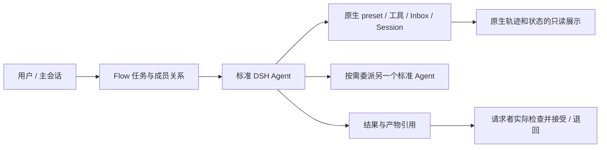

# 以标准 Agent 为最小调度单位的 Flow 实施合同

状态：**实施完成**。实施日期：2026-10-13。方案日期：2026-10-12。审查源码基线：`5682ff69e804913c4587d77e50d25ffa495a743c`；宿主基线：DSH `0.2.0-rc.2`。

本文是当前实现与验收合同，替代此前通过补齐 Flow 权限、写入守卫和故障恢复机制改善执行的方向。历史事实与旧方案见[归档索引](archive/README.md)。当前 `docs/design` 已同步新实现；部署及真实任务结果见[实施验证记录](native-agent-simplification-validation.md)，本文中的源码行号仍指审查基线。

## 1. 判断：大部分故障源于不必要的执行接管

审查基线中的 Flow 调用了 `ctx.agents.create/resume`，但是每轮还自行装工具包、裁剪能力、重写审批、重新装配压缩、拦截所有工具调用、取得租约、预留额度、登记副作用、绑定验收对象、结算并销毁 Agent。这只复用了原生模型循环，没有保留完整标准 Agent 的执行行为。

A 股会话中，子目录写入、shell 运行与总协调接管被这层附加协议阻断；固定两名管理者又通过通知、查询和恢复动作尝试修复。冻结窗口团队 159 次工具调用中有 51 次报错，管理者占 114 次调用，首次 Worker 在第 325 秒才开始执行。团队到期受阻后，主会话在自身原生上下文中接管生成报告。这是附加控制层损害通用执行能力的实际样本，尚不是新设计的性能验证。

上一轮诊断正确找到了故障位置，但方案仍把写入守卫、租约和效果账本当作不可删除的前提，提出更多预检、blocker 和恢复状态。此次撤销这条补丁方向：**Flow 调度完整 Agent，不再重造业务工具执行器；框架只保存协作所必需的事实。**

“过度设计”以删除后是否损失必要业务能力来判断，不以代码长、状态多或有校验本身来判断。

## 2. 明确职责分工

### DSH 负责 Agent 的完整执行

标准 preset 及其工具/插件、技能、模型、上下文和压缩、sandbox、审批、模型步骤和回合、原生 Inbox、取消、后台作业与原生日志都由宿主负责。Flow 使用公开接口组合和驱动 Agent，不通过额外工具 hook 改变这些行为。

默认团队成员采用宿主选定的**普通标准 Agent**。研究、执行、协调是任务分工，不决定其业务工具权限；已配置的新插件工具无需修改 Flow 的五类能力映射即可使用。用户选择的原生权限和提供方配置继续有效，“完整 Agent”不等于关闭 sandbox 或取消审批。

当前 rc2 需要明确组装原生 preset：`meta.agentPreset` 只是元信息，`create/resume` 本身不自动挂载。使用公开 `agentPresets.resolve/mount`，需要继承活主会话组合时使用 `composeFrom`。不要删除 Flow 自定义挂载后留下空工具 Agent，也不要再复制官方 preset 的一部分实现。

审批必须遵循实际宿主路径：普通 Agent 使用原生 preset、默认设置或该 Session 的持久选择；DSH 的原生 subagent provider 自带 delegated approval=never 策略。Flow 不复制或每轮重写这两条策略，也不能承诺所有子 Agent 都继承 ask。`never` 对需要审批的操作表示拒绝，不能称作自动批准。

### Flow 负责协作事实

只保留团队归属、成员与原生 Session 的映射、任务说明和依赖、当前负责人、结果与接受记录、消息路由及团队生命周期。任务状态命令仅能由有权的真实调用者执行；这些规则不进入 read/bash/web/MCP 等原生业务工具的执行管线。

任务分工可以说明负责哪个文件或目录，但它是协作说明。Flow 不把这种说明伪装成文件系统锁、权限系统或任意 shell 的隔离保证。需要独立工作区时，通过宿主的正常工作区配置实现；共享目录仍按普通 Agent 协作和真实业务检查处理。

## 3. 过度设计清单与删除决定

下列路径均位于 `packages/dsh-flow/src/`，行号对应审查基线。

| 机制 | 为什么是过度设计 / 现场影响 | 决定与主要位置 |
| --- | --- | --- |
| 五类能力→工具名→包名映射、角色工具禁止名单 | 必须预知所有工具；新插件、浏览器及原生委派受二次裁剪。挂载与可见列表还可能不一致 | 删除 `core/protocol.ts:94–146`、`runtime.ts:244–398`、`cluster.ts:4995–5013`；移除 `FlowCapability` 和相关配置、启动字段 |
| 独立管理权限与 Worker 分配授权 | 为同一个标准 Agent 再建两套能力/目录授权，再为完整权限增加例外 | 删除 `management-authorization.ts`、`managementCapabilities/managementWriteScope` 和 allocation 能力授权层；使用宿主原生策略 |
| write_scope 硬授权、重叠锁、bash 根范围 claim | 局部受管工具检查不能保证系统单写；却直接阻断普通 curl、脚本和总协调验收。修 glob 仍需维护多处自创语义 | 删除 `scope.ts`、`actions.ts` 分配写范围检查、`cluster.ts:5355–5487`；不再改成更复杂的 glob/锁服务 |
| 全工具准入、每调用租约和效果账本 | 普通原生工具必须通过 Flow 预算、flush、epoch、效果状态和再次派发检查；MCP/Jobs 越复杂越难泛用 | 整体删除 `cluster.ts:5018–5027` 的 hook、`runtime.ts:745–872` 及 admission/recheck/settle/effect 依赖；不保留另名网关 |
| 强制审批、step 消息重排、手动压缩组装 | 复制并改变宿主标准 preset；Flow 的“never”覆盖阻断原生审批；消息顺序需要额外纠偏 | 删除 `runtime.ts:492–536` 中这些干预；标准 preset 负责执行 |
| 固定 Allocator 和双角色管理节点 | 创建、排队和回收被要求交给另一模型；每个递归层自动新增两个管理身份 | 删除固定 Allocator、`ensureRoles` 及 management/worker node 必配结构；成员直接委派标准 Agent |
| worker / decompose / management 三种执行类型 | 相同委派需求先选择组织模型，再准备不同契约、派发和分配 | 合并为子任务委派；删除 `spawn_management_node` 与独立分配阶段。任一有权成员可继续委派，不预设层级治理角色 |
| FormalPlan、逐 criterion 责任矩阵、约束原文结构复制 | 业务开始前必须填完父子计划及引用；现场 decompose 7 次才成功。文字相等不能证明业务正确 | 删除强制 `preparePlan/criterion_responsibilities` 门槛。保留简明任务说明和约束引用；检查表按任务需要写在业务材料中 |
| bind_validation 与每个检查工具的计划/结果/轮次绑定 | 做普通读取和重算也要先操作验收绑定；一轮切换任务必须再次绑定；为守卫产物还扫描所有写操作 | 删除绑定前置动作、每工具证据门禁和结果路径猜测。接受具体结果版本，实际检查直接使用原生工具 |
| 每个成功管理动作/消息后 concludeTurn、每轮 dispose/resume | 一次“委派、沟通、继续工作”被切成多次模型回合；衍生 lease、heartbeat、epoch、修复 wake 和 owner driver 特判 | 删除 `role-tools.ts:112–118,145–150` 的强制切分；成员持有长期 AgentHandle，空闲时不销毁 |
| 层级预算与多套缺省限额 | 工具调用像财务账户转账；15 分钟、12 轮、24 工具、两次纠正等变成通用任务断路器 | 删除多级预算/预留/补账/再平衡及缺省业务硬限。只保留一个透明的 Agent 调度容量设置及用户明确期限 |
| 拒写通知、agenda/issue/修复循环、全局事件进展判定 | 框架先制造阻断再唤醒两模型解决；通信又被算作进展。17 条拒写正文没有有效原因 | 删除随旧守卫产生的事件调度与恢复平台，不新建 incident 引擎。业务结果、明确请求和真实状态投影足以驱动协作 |
| 八分类通信、group/blackboard/subscription 通用平台 | 普通成员交流先学习另一套协议；跨回合收件队列重复宿主 Inbox，停止消息运行中未投递 | 收束直接成员消息与任务关联；使用原生 identified input。删除必填分类、黑板、订阅和重复 step 队列 |
| 模型参与 finish/finalize 收尾、全文目标终态通知 | 资源回收要求追加模型动作，自己的取消又唤醒自己 | 终态资源清理由生命周期自动完成；状态变化是只读投影，确需决定时才发新输入 |
| Node/Allocation/Lease/Budget/Effect/Plan/Issue 等重复事实 | 原生 Agent、任务与多层运行表需不断对账，正常执行依赖它们全一致 | 删除执行镜像，保留任务事实及必要索引；用原生事件重建运行/用量展示，不另建执行真相 |

这些删除必须成组完成。例如移除 native tool hook 时，也要移除 validate 对 effects、manager-tool-bound 和执行结算的门槛，否则只是让所有结果无法接受。

### 不属于过度设计、仍须保留的边界

| 保留性质 | 最小实现 |
| --- | --- |
| 宿主实际权限和工具配置有效 | 原生 preset、sandbox、审批和提供方处理；Flow 不自动扩大用户明确策略 |
| 任务和结果有真实作者，不能越权改他人任务 | Flow 自身命令从真实 `exec.agent`/Session 解析成员；参数不能伪造身份 |
| 旧结果不能替代修改后的任务交付 | 任务版本、结果作者及对应任务版本；接受绑定当前具体 result_id |
| 子任务由委派者确认，根任务由已有主 Agent 完成交付确认 | 真实 owner/授权及具体结果版本；主 Agent 正常检查后提交根 result 并记录 review，不新增评审 persona、后台根成员或人工点击门禁 |
| 重试同一 Flow 命令不重复创建任务/消息 | 原生操作身份、参数 hash、actor/team 和 SQLite 原子更新；不扩展到任意业务工具 exactly-once |
| 迟到回调和已取消成员不改变新任务状态 | 单一 live owner、当前分派的 Session 身份、任务版本和关闭标记；不依赖每轮 TTL |
| 消息入队与实际进入模型可区分 | 稳定 MessageId、原生 Inbox/journal 收据和小型交付索引 |
| 不把 idle、取消或文件存在当成成功验收 | 执行状态、业务结果和资源状态分别表达；业务接受明确发生 |
| Flow 恢复不主动补做或重发原生工具调用 | 恢复原生 Session/已入队输入，保留任务事实；未完成或未知如实显示，不重演 Flow 效果账本，不另承诺宿主没有提供的任意工具 exactly-once |

搜索缺 API Key、外部接口失败、数据覆盖不全及模型写错普通参数，不会因精简而自动消失。普通参数 schema、来源核查和真正业务验收仍有必要，但不再把它们发展为统一治理执行器。

## 4. 目标设计：任务直达标准 Agent

`createTeam` 只建立团队与根任务，根任务的 owner 和 assignee 都是已有主会话，自动创建成员数为零。只有显式 `flow_task` 委派才创建普通成员；有独立协调需要时也必须作为明确的委派处理。简单任务由主 Agent 直接完成，不自动创建 Worker、根执行副本或 Allocator。递归协作通过 `task.parent_id` 和原生成员关系表达，任何有权成员使用同一种委派操作，不创建 management node 三件套。

Agent 与任务分开：一个成员可连续处理多个任务，任务有自己的交付版本；Agent idle 仅是运行事实。暂停、等待审批、后台 job 和业务完成按宿主/任务各自事实显示，不复制三套相同状态。

主 Agent 沿用普通原生工具完成检查，随后对根任务调用 `flow_result` 和 `flow_review` 记录完整交付。二者是业务记录，不启动新评审 persona，不要求人工点击，也不重新执行一轮模型审核。子任务仍由其真实委派者检查并接受。团队完成只清理 Flow 创建的子成员，保留已有主 Agent。

### 4.1 六类小接口

工具名已收敛为 `flow_task`、`flow_result`、`flow_review`、`flow_message`、`flow_read`、`flow_control`，含义和删除范围固定。每类使用具体 schema，不把旧 36 个业务/资源动作与 6 个通信动作换名塞回开放 `params`。

| 操作 | 输入与行为 |
| --- | --- |
| task | 自包含工作说明、必要交付/约束、可选成员与依赖；一次创建并委派，返回 task_id/session_id。修改只需要 task_id、当前版本和实际变化 |
| result | task_id、真实结果摘要/产物引用；绑定执行时任务版本并记录作者，返回 result_id。阶段成果或受阻说明不能自动变成成功 |
| review | result_id、接受/退回、理由和必要证据引用；请求者直接用原生工具检查，无 bind_validation 或逐字标准矩阵 |
| message | 接收成员、正文、可选任务关联；明确需要继续/回复还是仅通知。运行中的信息使用原生 next-step/steer，不能把普通正文“停止”解析成取消 |
| read | team/task/member/result 及分页；摘要足够使用，大内容可打开或分页。删除对象专有字段白名单和查询前置链 |
| control | 明确目标及暂停调度/继续/取消；当前活动使用原生 cancel 并排空，返回实际状态。资源收尾自动进行，不要求模型再调用 finalize |

删除 `flow_allocation`、预算/issue/effect 修复动作、强制 finish/finalize、生产中的 `flow_sum`。测试需要的 helper 留在测试夹具。主会话和成员复用一份协作实现，避免外层 agent_team 和内层角色协议继续各自发展。

### 4.2 生命周期与消息

每个活跃成员有一个 owned AgentHandle。通过公开 create/resume 与原生 preset 组合创建；新任务使用 `handle.agent.followup`，当前回合交流使用 send/steer/inject，普通消息保留其 id/source。Native Agent 已有持久 Inbox，不再重排 pre-step 或复刻队列。

委派立即返回成员/任务身份，不能在父 Agent 的工具调用内持有执行容量同步等待孩子完成。父 Agent 可继续其他工作；需要等待时自然结束当前回合，结果到达后仅投递一次有意义的输入。不得另起 shell 循环或长 `job_output` 等待协作文件来模拟 Inbox。

正常回合结束不 dispose。成员或团队取消先调用 `Agent.cancel` 并等待原生排空，再 dispose 所拥有的子成员 Handle；任务级取消保留可复用 Handle，不把其他排队任务一起取消。已有主 Agent 不属于 Flow 创建和回收的资源。`whenIdle` 不证明某项任务、某条消息或后台 job 已完成，不能把它用作万能完成条件。job 管理继续使用原生能力。

rc2 Agent 没有 pause/resume 方法，也没有持久 paused 状态：Flow 的 pause 停止新增任务投递/唤醒，并对所拥有成员的当前活动执行原生 cancel、等待排空；继续工作使用普通输入唤醒，冷恢复使用 registry.resume。`keepInbox=true` 不是原生暂停，不得用 step/tool gate 补造这种能力。

同一成员连续处理多个独立任务时，Flow 不把它们混成一次业务活动。Result/review 始终以 task_id、对应任务版本和结果身份归属。任务级取消先移除该任务尚未投递的输入；正在执行的目标使用 Agent.cancel 时，必须明确它的实际作用范围，不能把其他排队任务一起标成取消。成员级取消才覆盖整个 Agent 的工作。若宿主不支持某项精确取消语义，明确报告范围，不伪造成功或重新拦截工具实现。

冷恢复仅重建需要恢复的标准 Agent、任务关系和尚未完成的消息。Flow 不主动重发工具调用或补做未知效果；Agent 后续继续行为遵循宿主公开恢复语义，不能为了额外 exactly-once 保证重新加执行门禁。当前支持单宿主、单 Flow owner；依靠 owned handle、原生 Session 单一所有权和业务原子更新，不保留按工具执行的分布式租约模型。不在本次引入多控制进程调度。

### 4.3 最小持久事实与状态

保留 team 归属、成员/session 映射、task 版本与 owner/assignee/依赖、result/review 历史、消息交付索引、Flow 命令幂等和必要观察事件。Task 业务状态收束为 `OPEN / SUBMITTED / ACCEPTED / FAILED / CANCELLED`；排队、执行、暂停、等待输入是宿主活动与明确控制意图的投影，不再复制到 Node/Agent/Transaction 三份状态。

退回结果让同一任务重新 OPEN 并保留历史；业务变更形成新任务版本。结果记录不可变，普通文件路径并不因此永远不变。需要可复现文件证据时，在业务发布/接受时明确保存快照或摘要，不再每次 bash/write 扫描全域产物。

删除强制 Plan、Allocation、Lease、层级 Budget、Effect、通用 Issue、角色 agenda、blackboard/group 等存储/查询依赖。原生日志是工具和执行事实的权威；Flow 可以保存可重建展示索引，但不能要求原生事实符合第二份执行账本才能继续。

### 4.4 资源和通知

删除未由用户指定的 15 分钟团队截止、12 管理轮、每轮 24 工具、两次尝试/纠正、固定树深度/孩子数及层级额度转账。宿主所选 preset 的原生 limiter/执行限制完整保留；删除的是 Flow 自创限制。只保留一个透明的部署级 Agent 并发容量，用于启动/唤醒活动成员，idle handle 不占执行位；不声称它是精确 provider 请求并发，不恢复 Flow 模型请求 hook。

用户明确设定的期限仍有效，到期按原生取消处理并显示原因，不通过每个工具的预算报错反复阻断。宿主自身限制继续有效。

界面观察事件不自动成为模型输入。需要推进工作的委派、成果、修正或请求才投递到相关 Agent；工具错误由原生 Agent 正常处理。接受、关闭和回收等常规状态变化只读展示；自己发起的收尾回执不再次唤醒自己。删除旧反复拒写/修复消息后，不另建 incident、治理规则或停滞阈值平台。

## 5. 代码、接口、补丁与数据的删除范围

### 核心代码

- `core/runtime.ts` 改为标准 Agent 生命周期的薄接入与原生事件观察，删除业务工具 package mounting/allowlist/hook/lease/额度/效果处理。
- `core/cluster.ts` 退出回合执行器、角色循环、强制 wake、权限判定和工具账本，收敛为成员/任务生命周期与协作路由；不把原大类拆成多文件原样保留。
- 删除 `core/scope.ts`、`core/management-authorization.ts`、层级 `core/budget.ts`；`protocol.ts` 删除能力表、固定角色和运行限额，`actions.ts/contracts.ts/briefing.ts` 删除 FormalPlan/责任矩阵/验收前置链。
- `core/model.ts/store.ts` 删除上述机制的状态与表依赖；Flow 状态命令身份、原子幂等和业务版本保留。
- `team-tools.ts`、`service.ts/types.ts`、Host/Remote 契约、原生 UI 与技能统一使用精简接口；删除旧参数和隐藏兼容动作。
- 动态挂载移除后，清理 Flow 对 tool-bash/fs/search/jobs/web、BasicCompaction 和审批执行服务的直接依赖；宿主 preset 仍依赖这些包，不能从宿主安装一起卸掉。

### 会话输入与补丁

审查基线中的 `dsh-flow/member`、text-only SessionDriver 和 controller 特判是为逐轮临时 owner 服务的。常驻标准 Agent 后，优先让原生输入、附件、取消、模型选择和历史读取作用于实际 Agent，删除正文中转和特殊 preset 阻断。

固定 rc2 若仍需外部 owned Agent 的导航/冷恢复桥，只保留单一 owner 的薄路由；不借此重建每轮调度或过滤业务工具。实现前先验证 controller 与 parent-owned Agent 的实际契约，不能让两个 factory 争抢同一 Session。

14 个 provider 补丁不能一概当作过度设计删除。按 hunk 审查：与逐轮 driver/member 特判耦合的收缩；原生完整会话导航、历史观察、命令意图和展示补丁按独立功能保留或用公开接口替换。补丁使用 pnpm patch 流程并更新 lock/基线，不直接修改 node_modules。

### 旧数据与兼容范围

运行数据使用新的 Flow schema/dataDir；明确拒绝旧控制库运行，不为已删除角色、预算、未决效果和正式计划建立迁移执行层。旧库/证据和原生 Session 保留可追溯读取，旧任务不自动重放或标成完成。需要继续的工作通过新接口明确安排。

Provider 配置、认证凭据、原生用户会话、工作区及业务产物不因框架精简被删除。实际切换时确认实例归属和新包身份；活跃用户会话与团队不因本轮隔离验收被自动停止、恢复或删除。发布步骤及授权范围单独记录。

## 6. 实施顺序

### 阶段一：建立标准 Agent 的纵向闭环

在固定 rc2 上验证标准 preset 组装、长期 handle、Flow 自身小接口、真实文件/shell/web 工具、result→请求者检查→review、原生停止和资源关闭。该闭环不依赖 Allocator、FormalPlan、native tool hook 或预算账户。

先验证 create/resume/输入/取消和 UI 的 owner 接入，避免删除旧挂载却产生空 Agent、丢输入或双 owner。开发中可用隔离测试，但不发布旧/新两套长期模式或回退开关。

### 阶段二：同一接口覆盖协作，然后整体删除旧实现

增加实际需要的并行子任务、同一种递归委派、运行中消息、任务更新/退回与冷恢复。同步删除执行网关及其验收、配额、issue、通知、状态和生成契约依赖；移除 Allocator 与强制回合切分。不要先删一个 guard 后再保留大量失败修复代码。

### 阶段三：测试、文档和发布接入一起收敛

删除仅证明旧约束存在的测试；用新公共接口重写其中真正保护业务或原生行为的部分。清理自动补计划、临时 alias、控制 fixture 和生产 helper，不为维持旧用例数增加兼容逻辑。

审查盘点：67 个测试文件、457 个静态 test/it 声明中，首批至少 65 个旧声明应删、20 个抽取价值重写；这是静态声明数量，不是展开后的运行数，也不是把其余测试全部判为正确。Native 17 项及 2 项管理者集成按原生工具、恢复、压缩、取消的实际价值重写/保留。具体位置见本地审查索引。

同步 CONTEXT、适用 ADR、README、技能、examples、provider 接口/基线、docs/design、UI 和脚本。文档描述真实交付版本，不再出现旧能力裁剪/写入独占/必须 bind_validation 等指令。

### 阶段四：真实任务与部署验证

完成冻结安装、类型检查、构建、适当单元与原生集成、文档构建；通过新数据目录安装实例，核对包身份、认证、Provider 可编辑和原生会话。生产实施提交、构建身份与部署结果在实施验证记录中分别记录；运行证据只适用于其实际指纹，不能将 V2 质量基线与诊断结果冒称为随后关闭/任务顺序修复构建的完整实测。

固定同一模型/preset/宿主权限、数据输入和验收条件，对照普通标准 Agent 与 Flow 成员；再比较真正需要并行的任务。记录所有失败和缓存语义，不选择性重跑。不预设删框架必然提升市场分析质量。

## 7. 必须通过的验证矩阵

| 验证 | 通过条件 |
| --- | --- |
| 标准 Agent 一致性 | 同 preset/用户策略下，普通 Agent 与 Flow 成员能完成相同原生工具任务；新增未知名称插件工具无需 Flow 代码改动 |
| 原生权限和审批 | 宿主只读/写入/审批选择实际生效；Flow 不额外拒绝，也不偷偷切 never 或扩大用户策略；原生 delegation 策略单独验证 |
| 通用业务执行 | 真正使用文件、shell/curl、后台 job、web/MCP；不靠 flow_sum 或工具目录显示替代执行证据 |
| 自然回合 | 一名成员连续委派、发送消息、使用业务工具；不因成功 Flow 操作结束回合；正常多轮保持同一个 live handle |
| 并行与递归 | 两名成员并行交付并汇总、三层实际委派；没有自动 Allocator 或双角色节点；工作区限制来自原生策略 |
| 结果与接受 | 非 owner 不能替请求者接受；拒绝伪造作者或把其他任务结果冒充本任务交付；允许有权读取并明确引用依赖/子任务结果；旧版本不能完成新任务，部分/受阻结果不自动接受 |
| 任务修订 | 退回后通过同一任务完成修正；不需要 resolve_issue/reopen/replan 三重动作或逐字约束矩阵 |
| 消息与停止 | 运行中消息实际进入下一步或得到明确队列状态；cancel/排空/回收使用 native receipt；后台 job 不因 idle 被假定完成 |
| 幂等与冷恢复 | 同一 Flow 操作不重复委派；两个有意相同内容任务不误去重；Flow 不因恢复主动重发原生工具或误认任务完成，历史 Session 可读，Agent 继续行为与宿主基线一致 |
| 长任务 | 未设业务期限的任务不因旧 15 分钟/12 轮/24 工具阈值中断；明确用户期限有效 |
| 无事件空转 | 无新任务/成果/请求时，不产生周期查询或修复模型回合；自己的收尾不再次触发主会话 |
| 发布与界面 | 活成员原生输入/附件及取消可用；回收后历史可读；Provider 保存与系统浏览器认证不回退 |

确定性精简验收：一次委派不再先 dispatch 再 allocate；创建团队自动成员数为零；Agent 不需要填写 prepared_revision/责任矩阵才能开始；原生业务工具不经过 Flow admission/effect/write_scope 路径；生产接口没有旧动作 alias 或兼容角色。

性能记录首次有效业务产出前控制调用数、参数错误、无业务新输入的模型回合、排队时间、端到端正确交付率及原生 input/cache/output。代码行数和测试总数不作为效果指标。

## 8. 文档优先级与证据

四份材料归档：Auditor 移除方案、实施验证、部署清理记录，以及上一轮 A 股诊断与加强守卫方案。其运行事实和历史结论不改写；旧守卫、租约、完整计划和效果门禁不再约束此次实现。原诊断路径仅保留导航，防止既有会话链接失效。其他历史材料继续归档，另一任务的 `team-organization-patterns-discussion.md` 不属于本次文件范围。

本轮本地审查材料位于 `.artifacts/ashare-session-diagnosis-20261012/`：

- `native-agent-boundary-audit.md`：native 公开接口、preset/审批路径、业务工具网关及依赖删除链。
- `control-plane-simplification-audit.md`：固定组织、任务契约、回合、状态与通信精简。
- `simplification-docs-tests-audit.md`、`simplification-test-dispositions.json`：测试删改位置、文档归档及入链。
- 既有冻结会话证据：保留调用/通知/时序事实；其 conservative guard 修补建议已被本方案替代。

该方案延续 [ADR 0003](../adr/0003-use-host-model-capacity-and-compaction.md) 中 DSH 负责模型和上下文的原则，并将职责分工扩展到原生工具、权限和生命周期。实施验证记录保存各阶段原生证据、剩余宿主限制、关闭路径补验和部署身份；未完成项不得提前标为通过。
